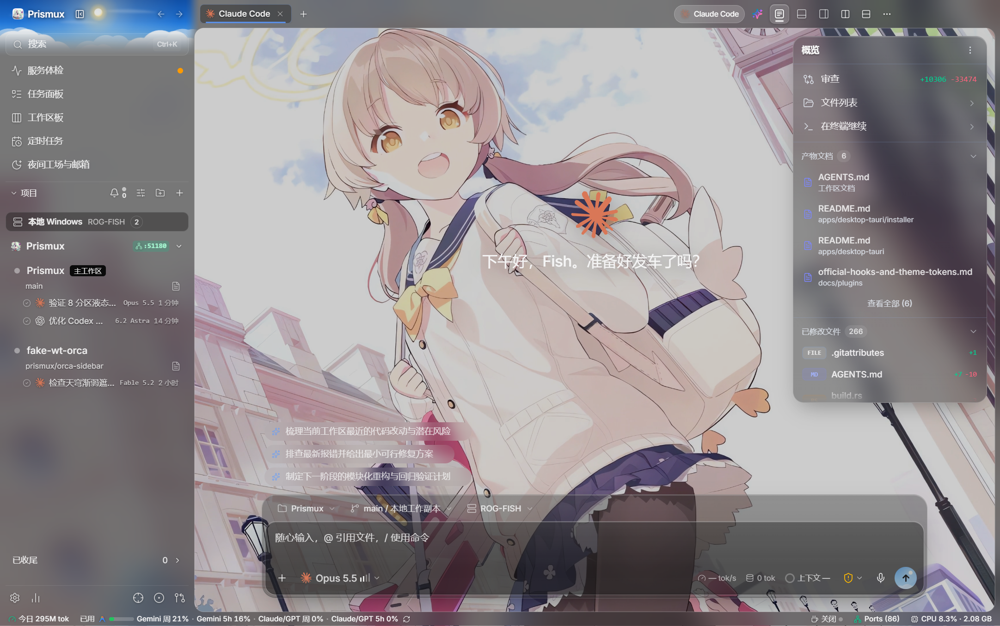
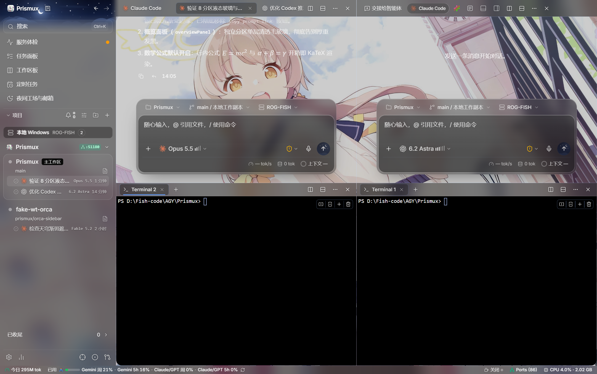
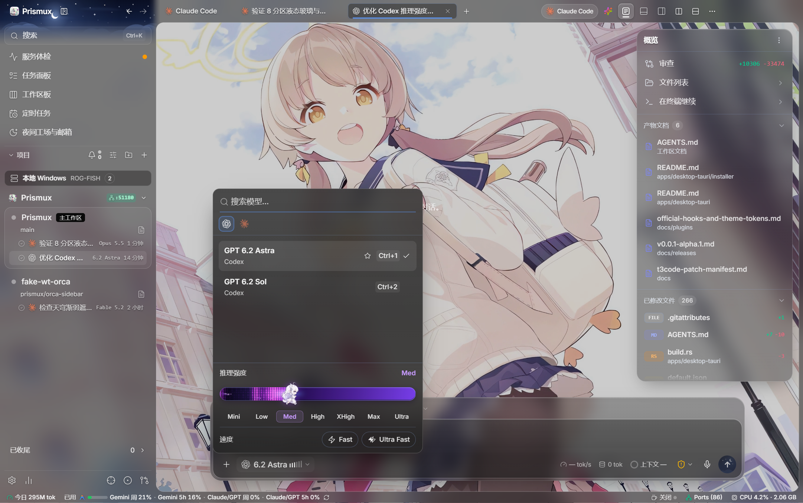
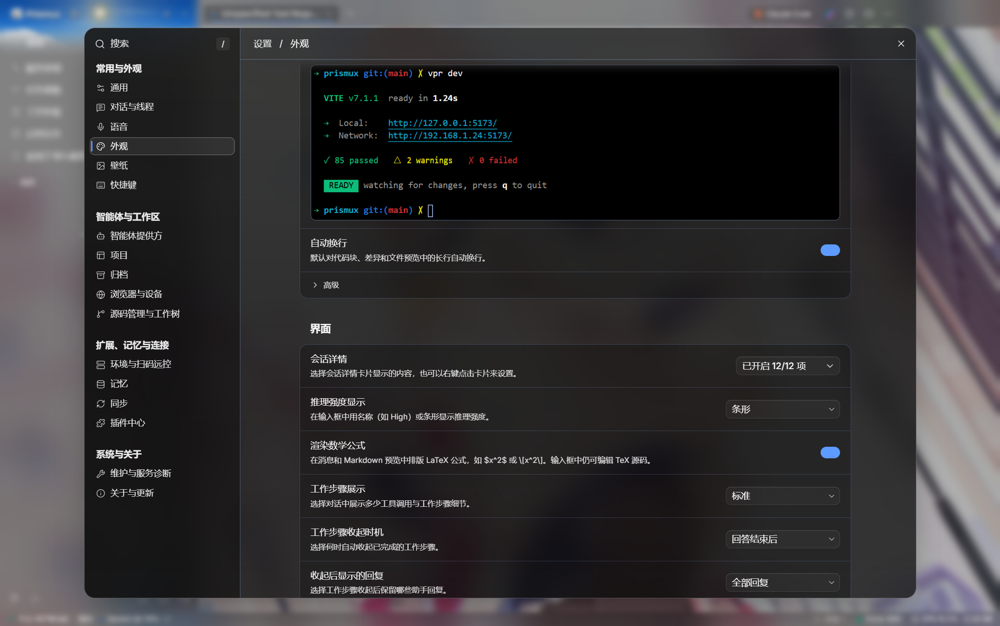

<div align="center">

<p>
  <a href="README.md"><picture><source media="(prefers-color-scheme: dark)" srcset="assets/readme/key-zh-en-dark.png"></picture></a>
  <a href="README.en.md"><picture><source media="(prefers-color-scheme: dark)" srcset="assets/readme/key-en-en-dark.png"></picture></a>
  <a href="#install"><picture><source media="(prefers-color-scheme: dark)" srcset="assets/readme/key-start-en-dark.png"></picture></a>
</p>

<picture>
  <source media="(prefers-color-scheme: dark)" srcset="assets/readme/hero-en-dark.png">
  
</picture>

<p>
  <a href="https://github.com/Fish-under-sea/Prismux/releases/tag/v0.2.0-rc.2"><picture><source media="(prefers-color-scheme: dark)" srcset="assets/readme/stat-version-en-dark.png"></picture></a>
  <a href="#preview"><picture><source media="(prefers-color-scheme: dark)" srcset="assets/readme/stat-visual-en-dark.png"></picture></a>
  <a href="#features"><picture><source media="(prefers-color-scheme: dark)" srcset="assets/readme/stat-memory-en-dark.png"></picture></a>
  <a href="#plugins"><picture><source media="(prefers-color-scheme: dark)" srcset="assets/readme/stat-plugins-en-dark.png"></picture></a>
</p>

<p>
  
  
  
  = 24.12">
  
  
</p>

<p><strong>Prismux · Local-First, Zero-Telemetry 8-Zone Liquid-Glass AI Super Workbench &amp; 24/7 Secretary</strong><br>
Built on a unified first-party <strong><code>@prismux/*</code> Monorepo (Electron 44 + Effect + TypeScript + React 19)</strong>, Prismux commands Claude Code, Codex, Antigravity, live native <code>dsh</code>, and OpenCode from one calm window—uniting an Orca compact sidebar, 2×2 Split Anything grids, DSH / CC / Codex benchmarked work steps &amp; reasoning summaries, unified auth-mode probing &amp; subscription risk guardrails, 0-Token 8-zone Liquid Glass, single-file SQLite hybrid memory, and an Overnight Factory.<br>
Zero silent telemetry out of the box, pure QR remote pairing (zero cloud accounts), and strictly zero-preinstall plugins—your workspace, your privacy, your rules.</p>

<p>
  <a href="#install"><picture><source media="(prefers-color-scheme: dark)" srcset="assets/readme/key-download-en-dark.png"></picture></a>
  <a href="https://github.com/Fish-under-sea/Prismux/releases/tag/v0.2.0-rc.2"><picture><source media="(prefers-color-scheme: dark)" srcset="assets/readme/key-release-en-dark.png"></picture></a>
  <a href="https://github.com/Fish-under-sea/Prismux/issues"><picture><source media="(prefers-color-scheme: dark)" srcset="assets/readme/key-issues-en-dark.png"></picture></a>
</p>

<br>

<p>
  
  <br>
  <sub><strong>8-Second Live Electron 44 GPU Capture</strong> (<a href="assets/readme/hero-demo-v02.webp">View crisp 1200×750 16 FPS Animated WebP</a>): (1) Open the right wallpaper drawer to adjust <strong>8-Zone Liquid Glass</strong> refraction live over an animated wallpaper; (2) Sweep the Codex <strong><code>dsh-fish</code> running-chibi 7-level effort slider</strong> (<code>Mini → Ultra</code>) and toggle <code>Fast / Ultra Fast</code>; (3) Launch a <strong>2×2 Orca Split Anything</strong> grid (zero interior corner radius, crisp <code>1px</code> dividers) with the <strong>24-hour living sky</strong> shifting smoothly from noon to starry night.</sub>
</p>

</div>

<h2 id="intro"><picture><source media="(prefers-color-scheme: dark)" srcset="assets/readme/section-intro-en-dark.png"></picture></h2>

**Prismux** is a local-first AI Super Workbench and 24/7 headless secretary built on a unified first-party **Electron 44 + Effect + TypeScript + React 19** desktop runtime, paired with an isolated **0-Token visual shell** and an **on-demand dual-realm plugin kernel**. Whether you orchestrate multiple coding agents interactively or leave overnight runs unattended, Prismux converges sessions, collaboration, durable memory, diagnostics, and desktop craft into one focused space:

- **Local-First, Zero Telemetry & Pure QR Remote Connect**: Permanently severs all silent telemetry, fingerprinting, and cold-start phone-home calls, completes full De-T3 branding cleanup with zero cloud account binding, and keeps remote mobile access strictly **LAN / Tailscale QR pairing**. Every byte stays 100% local by default.
- **Unified Multi-Agent Control, Live Windows `dsh` & Subscription Guardrails**: Run Claude Code, Codex, Antigravity (strictly official `agy acp` with event-driven lazy quota refresh), live native **`DeepSeek Harness (dsh)`**, and OpenCode side by side (with obsolete `omp` cleanly removed). Powered by `PrismuxProviderProbeService` (CCS / Magpie-safe auth detection) and the unified Subscription Risk Waiver Center.
- **0-Token 8-Zone Liquid Glass & Multi-Source Wallpaper Stage**: Flip between Light, Dark, and Liquid Glass via the full-width 1:1 optical Celestial capsule, fine-tune **8 independent frosted-glass zones** (including directional Fresnel-rimmed `userBubble` and independent translucent `overviewPanel`) at ≥ 4.5:1 WCAG contrast, follow `--pmx-accent` on inline file links, and drive a Z-0 stage supporting Image, Video, Web, WebWallGL, and Steam Wallpaper Engine (`431960`)—at strictly **0 LLM tokens**.
- **Orca Compact Sidebar, Split Anything & Benchmarked Work Steps**: Features an Orca-grade compact tree sidebar, recursive **Split Anything** arbitrary pane grids (splits consolidated cleanly into the sleek topbar `⋯` menu, zero interior radius + `1px` resizable dividers), DSH / Claude Code / Codex benchmarked expanded work steps & GPT reasoning summaries (single directional chevrons, stripped `pwsh.exe` wrapper noise, frosted glass detail cards & tree rails, syntax-highlighted diffs), and a redesigned 17-page low-density Settings Center.
- **Single-File Hybrid Memory, Sidebar Overnight Factory & Zero-Preinstall Plugins**: Store all durable memories in `~/.prismux/data/memory.db` (SQLite WAL + FTS5 + `sqlite-vec`) with transport-level group-chat isolation; access `Overnight Factory & Mail` right from the main sidebar with one-click toggle; install `qq` and `fishdock-hook` strictly on demand (zero preinstall, leak-free teardown) alongside Argon2id + AEAD E2EE sync and concurrent GitHub / Gitee updates.

> [!TIP]
> **What's New in `Prismux v0.2.0-RC.2`**
> - **Unified First-Party `@prismux/*` Monorepo & Complete De-T3 / `omp` Removal**: Consolidates `apps/{desktop,server,web,daemon}` and all core packages into one native first-party monorepo under `@prismux/*`, `PRISMUX_*`, and `prismux/` Oxlint rules—completely eliminating legacy `omp` integration and residual upstream brand traces.
> - **`PrismuxProviderProbeService` + Merged Subscription Risk Waiver Center**: Classifies provider auth modes non-invasively (`api_or_custom` / `local` / `subscription_oauth` / `unknown`) with zero false positives for CCS / Magpie proxies or custom endpoints; merges personal-subscription cross-agent orchestration & automation toggles into `/settings/providers#subscription-risk-waiver` (hard-blocking unattended personal AGY while letting `api_or_custom` and `local` pass through friction-free).
> - **DSH / CC / Codex Benchmarked Expanded Work Steps, GPT Reasoning Summaries & Accent-Following File Links**: Enforces strictly 1 directional chevron per collapsible row, strips `pwsh.exe` shell-wrapper noise, renders frosted-glass detail cards with tree rails and syntax-colored unified diffs plus GPT reasoning summaries, and binds inline file links pixel-for-pixel to `--pmx-accent`.
> - **Event-Driven Lazy Antigravity Quota**: Replaces 3-minute background `setInterval` polling with on-demand event-driven quota checks and hides unauthenticated provider badges in the status bar.
> - **Live Windows `dsh` Connection + Electron IPC Real-UI Dispatch & Double Backdoors**: Connects natively to Windows `DeepSeek Harness (dsh acp)` sessions and delivers Electron IPC main-thread real-UI dispatch with v3 dual-backdoor foundations.
> - **17-Page Low-Density Settings Redesign & Sleek Topbar**: Reorganizes all 17 Settings pages with segmented tabs (3-tab Appearance / Chat / Maintenance, single reasoning slider in Chief & Memory, unified About hero, zero false yellow degraded warnings for uninstalled optional CLIs), consolidates pane splitting into the topbar `⋯` menu, and fixes modal color-picker focus isolation & localization polish.

The current release is **`Prismux v0.2.0-RC.2`** (tag `v0.2.0-rc.2`), shipping `Prismux-Setup-0.2.0-rc.2-win-x64.exe` on GitHub Releases and Gitee Releases, with macOS and Linux channels reserved.

<h2 id="preview"><picture><source media="(prefers-color-scheme: dark)" srcset="assets/readme/section-preview-en-dark.png"></picture></h2>

> Every screenshot below is captured directly from the live **Prismux v0.2.0-RC Electron 44 Windows GPU-composited desktop window**—zero mockups, zero retouching:

<table>
  <tr>
    <td width="50%" align="center" valign="top">
      
      <br>
      <sub><strong>Orca Compact Sidebar, Real OS Greeting &amp; Feathered 24h Sky</strong>: High-density host capsules, workspace cards, and normalized short model names (<code>Opus 5.5</code> / <code>6.2 Astra</code> / <code>Fable 5.2</code>), paired with the right-feathered 24h sky, daytime black send arrow, real OS username hero, and <code>20px</code> quota status bar.</sub>
    </td>
    <td width="50%" align="center" valign="top">
      
      <br>
      <sub><strong>8-Zone Liquid Glass: Fresnel User Bubble &amp; Translucent Overview</strong>: Dedicated <code>userBubble</code> and <code>overviewPanel</code> zones deliver a directional silver-white Fresnel highlight rim (with <code>Copy prompt link</code> removed), default-ON KaTeX math rendering, and nighttime white send arrow contrast.</sub>
    </td>
  </tr>
  <tr>
    <td width="50%" align="center" valign="top">
      
      <br>
      <sub><strong>Flagship 2×2 Orca Split Anything</strong>: Combine Claude Code, Codex, and live Terminals in arbitrary recursive grids over GPU wallpapers—zero interior corner radius (<code>rounded-none</code>) at cross junctions with crisp <code>1px</code> draggable dividers and zero flicker.</sub>
    </td>
    <td width="50%" align="center" valign="top">
      
      <br>
      <sub><strong>Codex 7-Level Running-Chibi Slider &amp; <code>Fast / Ultra Fast</code></strong>: One-click Logo-only Agent switcher, all 7 effort labels cleanly abbreviated (<code>Mini / Low / Med / High / XHigh / Max / Ultra</code>, zero truncation), and mutually exclusive English Title-Case speed toggles.</sub>
    </td>
  </tr>
  <tr>
    <td width="50%" align="center" valign="top">
      
      <br>
      <sub><strong>Live Right-Drawer 8-Zone Liquid Glass Studio</strong>: Open <em>Appearance &amp; Glass</em> directly inside the workspace to tune opacity and blur live across all 8 independent zones—including the new <strong>User Message Bubble</strong> and <strong>Overview Panel</strong>—right over your wallpaper.</sub>
    </td>
    <td width="50%" align="center" valign="top">
      
      <br>
      <sub><strong>Reorganized 4-Group Settings &amp; DSH Work-Step Controls</strong>: Streamlined settings navigation (zero T3 Connect or duplicate rows), branded <code>prismux git:(main)</code> terminal preview, and the 3 DSH thinking &amp; tool-call workflow controls alongside default-ON <code>bars</code> effort display and KaTeX math.</sub>
    </td>
  </tr>
</table>

<h2 id="features"><picture><source media="(prefers-color-scheme: dark)" srcset="assets/readme/section-features-en-dark.png"></picture></h2>

<table>
  <tr>
    <td width="50%" valign="top">
      <strong>1. Multi-Agent Control, Live Native <code>dsh</code> &amp; Subscription Guardrails</strong>
      <p>The Electron 44 desktop app supervises the 24/7 <code>@prismux/daemon</code>, running Claude Code, Codex, Antigravity (official <code>agy acp</code> + event-driven lazy quota refresh, zero credential scraping), live native Windows <strong><code>DeepSeek Harness (dsh)</code></strong>, and OpenCode side by side with instant hot-swap into the <code>Chief Thread Slot</code> (legacy <code>omp</code> removed).</p>
      <p>Powered by <code>PrismuxProviderProbeService</code> (CCS / Magpie-safe detection) and the merged Subscription Risk Waiver Center; includes global provider/model drag-sort, pixel-queen-bee AGY Swarm, read-only Claude / Codex collaboration sidebars, native <code>/btw</code> side questions, full telemetry cutoff, and pure LAN / Tailscale QR remote pairing.</p>
    </td>
    <td width="50%" valign="top">
      <strong>2. Orca Sidebar, Split Anything, DSH Workflow &amp; Five Core Primitives</strong>
      <p>Delivers an Orca-grade compact tree sidebar (host capsules, workspace cards, normalized model short names, and per-turn auto-summary titles with rename lock), recursive <strong>Split Anything 2×2+ grids</strong> (<code>rounded-none</code> inner edges + <code>1px</code> resizable dividers), and complete <strong>DSH thinking &amp; tool-call work steps</strong>.</p>
      <p>Intentionally excludes session-detached Task Boards, AgentTeam DAGs, Skill Lens, and Visual Companion—focusing on five crisp primitives:</p>
      <ul>
        <li><code>PersistentPtyPool</code>: <code>2 MB</code> per-terminal ring buffer &amp; lossless reconnect replay</li>
        <li><code>HandoffEngine</code>: <code>/handoff</code> distillation &amp; <code>agent / oracle / review</code> three-mode dial</li>
        <li><code>CollectorAndGuard</code>: Multi-format slicing, transport-layer identity injection &amp; <code>60 s</code> circuit breaker</li>
        <li><code>LifecycleHookBus</code>: 6 lifecycle hook events, exit-code <code>2</code> blocks &amp; default <code>onFailure: "block"</code></li>
        <li><code>WorktreeSandbox</code>: OS-level write isolation, default <code>prismux</code> branch prefix &amp; allowlisted proxy gateway</li>
      </ul>
    </td>
  </tr>
  <tr>
    <td width="50%" valign="top">
      <strong>3. Single-File Hybrid Memory, Custom Chief &amp; Sidebar Overnight Factory</strong>
      <p>All durable memories live in a single local <code>~/.prismux/data/memory.db</code> (SQLite WAL + FTS5 + <code>sqlite-vec</code>, bundled non-ASAR <code>vec0.dll</code> ready out of the box), featuring Mnemopi prompt-cache-friendly recall, custom Chief naming + persistent <code>~/.prismux/chief/AGENTS.md</code> rules, and curated Obsidian Vault import. Transport-level <code>forwardIdentity</code> physically locks group-chat queries away from <code>private/chief</code> and <code>workspace/*</code>.</p>
      <p><code>Overnight Factory &amp; Mail</code> now lives directly in the main sidebar as a first-class toggleable work panel (aligned with Tasks, Workspace Board, Automations, Issues, and PRs under unified <code>&lt;PrismuxStageFrame&gt;</code> with zero double topbar), automating mail intake → worktree coding → read-only Oracle review → HTML morning briefings.</p>
    </td>
    <td width="50%" valign="top">
      <strong>4. 0-Token 8-Zone Liquid Glass, Feathered 24h Sky &amp; Wallpaper Stage</strong>
      <p><code>@prismux/appearance</code> unites the full-width 1:1 optical Celestial tri-state capsule, <strong>8 independent frosted-glass zones</strong> (window chrome, right sidebar, main canvas, work panels, composer &amp; cards, overlays &amp; settings, directional Fresnel-rimmed <strong>user message bubbles</strong>, and airy independent <strong>Overview panel</strong>) with ≥ 4.5:1 contrast clamping, plus the 7-level running-chibi <code>dsh-fish</code> effort slider.</p>
      <p>The 288-frame declarative SVG 24-hour sky feathers smoothly toward the first tab edge while switching the send arrow crisp black/white by luminance; <code>@prismux/wallpaper</code> powers a Z-0 stage (Image, Video, Web, WebWallGL, Steam <code>431960</code>) with SHA-256 deduplication and <code>0 FPS</code> occlusion pause—at strictly <strong>0 LLM tokens</strong>.</p>
    </td>
  </tr>
  <tr>
    <td width="50%" valign="top">
      <strong>5. Desktop Craft, 20px Status Bar &amp; Real OS Username Greeting</strong>
      <p>Greets directly by host <code>osUsername</code> (zero path-guessing or cloud dependency), collapses into a crisp <code>54px</code> icon rail with shared <code>100ms</code> right-side tooltips, streamlines the 7-item right panel with bi-directional drag sync, and fully localizes built-in browser profiles.</p>
      <p>The <code>20px</code> status bar unifies daily usage, synced Orca multi-window quota pills, real-time Electron + Daemon + PTY process attribution, active port monitor, native Electron <code>powerSaveBlocker</code> Keep Awake (<code>On / Agent / Off</code>), Windows System Tray, zero-dependency Phone Simulator, and 4-tier Liquid Glass Service Diagnostics.</p>
    </td>
    <td width="50%" valign="top">
      <strong>6. Cordis On-Demand Plugins, E2EE Sync &amp; Clean Upgrade Sweeper</strong>
      <p><code>@prismux/cordis-kernel</code> enforces top-level <code>engines.prismux</code> SemVer, zero-leak <code>ctx.effect()</code> teardown, <code>512 KiB</code>-budget declarative liquid-glass UIs, <code>distribution: "managed"</code> locks, <code>0600</code> per-plugin secrets, and script-free npm tarball streaming without calling <code>git</code>.</p>
      <p><code>@prismux/sync-vault</code> seals <code>.prismux-backup</code> payloads with cross-runtime <code>PRXC02</code> <code>aes-256-gcm</code> / Argon2id+AEAD across WebDAV, S3, and GitHub (<code>If-Match</code> locking, <code>60 s</code> stall watchdog, portable <code>data/</code> mode). Dual-route updates race <strong>GitHub ↔ Gitee</strong> and <strong>npm ↔ npmmirror</strong>, while NSIS &amp; startup migration hooks safely sweep obsolete upgrade remnants without ever touching memories, credentials, wallpapers, or active plugins.</p>
    </td>
  </tr>
</table>

<h2 id="plugins"><picture><source media="(prefers-color-scheme: dark)" srcset="assets/readme/section-plugins-en-dark.png"></picture></h2>

> [!NOTE]
> **Two Active Official Plugins Are Strictly Never Preinstalled**: Neither `Prismux-Setup-0.2.0-rc.2-win-x64.exe` nor the unpacked desktop bundle contains any directory from `plugins-official/` (verified at 0 hits across the packaged tree). Both active official plugins (`qq` and `fishdock-hook`) ship independently as verified `.wb-plugin` archives (indexed by `prismux-plugins-official.json` and `prismux-plugins-0.2.0-rc.2-SHA256SUMS.txt`) and script-free npm single packages, installing strictly on demand with `ctx.effect()` zero-leak teardown.
>
> **Retired Plugins Notice**: `pet` (`@prismux/plugin-pet`) and `ssh` (`@prismux/plugin-ssh`) have been retired and removed from the official catalog and release pipeline — **Deprecated: Replaced by Prismux built-in capabilities**.

| Plugin ID | Archive (`.wb-plugin`) | npm Package (Unscoped / GitHub Packages) | Realms | Capabilities &amp; Isolation |
| :--- | :--- | :--- | :--- | :--- |
| `qq` | `prismux-plugin-qq-0.2.0-rc.2.wb-plugin` | `prismux-plugin-qq`<br><code>@fish-under-sea/prismux-plugin-qq</code> | `daemon`, `ui` | OneBot v11 forward/reverse WebSocket probe (NapCatQQ / Lagrange.Core); owner DMs route to the Chief slot while authorized QQ groups use anti-spam pacing hard-isolated to <code>social/qq-group-&lt;gid&gt;</code> |
| `fishdock-hook` | `prismux-plugin-fishdock-hook-0.2.0-rc.2.wb-plugin` | `prismux-plugin-fishdock-hook`<br><code>@fish-under-sea/prismux-plugin-fishdock-hook</code> | `daemon` | Bridges `PreToolUse` risk approvals, priority mail alerts, and Overnight Factory completions to FISH-Dock Dynamic Island cards with instant approve/reject actions |

### Plugin Authoring &amp; Official Documentation

Building a custom Prismux plugin or delegating it to a Coding Agent? Follow the two source-verified official guides below (or open **Settings → Plugins** and click **Creator Guide** to copy a pre-built Agent prompt in one click):

- **Prismux Plugin Development Guide**: [`docs/plugins/plugin-development-guide.md`](docs/plugins/plugin-development-guide.md) — Cordis dual-realm (`daemon` + `ui`) architecture, top-level `engines.prismux` SemVer contract, zero-leak `ctx.effect()` teardown, declarative liquid-glass UI (`ui: "components"`), `0600` encrypted credentials, `pnpm plugin:pack` roundtrip packaging, and a ready-to-copy minimal scaffold.
- **Official Lifecycle Hooks &amp; Light / Dark / Liquid Glass Theme Tokens**: [`docs/plugins/official-hooks-and-theme-tokens.md`](docs/plugins/official-hooks-and-theme-tokens.md) — Full `LifecycleHookBus` 6-event reference (`SessionStart`, `PreToolUse`, `PostToolUse`, `Notification`, `SubagentStop`, `Stop`), exit-code `2` blocking, 4-tier permission gating, and the complete reference for host DOM attributes, **8 liquid-glass zones**, and WCAG AA semantic color tokens.

<h2 id="install"><picture><source media="(prefers-color-scheme: dark)" srcset="assets/readme/section-install-en-dark.png"></picture></h2>

### Dual-Route Release Channels (GitHub Releases ↔ Gitee Releases)

| Channel | Best For | Release &amp; Download Details |
| :--- | :--- | :--- |
| **GitHub Releases** (Global) | Direct global network / GitHub CLI environments | [Prismux v0.2.0-RC.2 Release](https://github.com/Fish-under-sea/Prismux/releases/tag/v0.2.0-rc.2) · [Direct `Prismux-Setup-0.2.0-rc.2-win-x64.exe`](https://github.com/Fish-under-sea/Prismux/releases/download/v0.2.0-rc.2/Prismux-Setup-0.2.0-rc.2-win-x64.exe) |
| **Gitee Releases** (Mainland China Mirror) | High-speed direct downloads inside mainland China | [Prismux v0.2.0-RC.2 Release](https://gitee.com/Fish-under-sea/Prismux/releases/tag/v0.2.0-rc.2) (includes `80 MB` split `.7z` volumes, consolidated checksums, and active official plugin archives) |
| **In-App Update Center** (Recommended) | Concurrent latency probing, weighted split progress &amp; mandatory SHA-256 verification | Open **Settings → About &amp; Updates** (`/settings/about#prismux-updates`) to switch between `Auto / Domestic First / Global First`, browse rich release notes, and install with one click |

### Platform Downloads &amp; Integrity Verification

| Platform / Release Asset | Filename / Availability | Details &amp; Isolation |
| :--- | :--- | :--- |
| **Windows x64 Installer (Electron 44 NSIS)** | `Prismux-Setup-0.2.0-rc.2-win-x64.exe` (Gitee also provides `.7z` split volumes) | Full Electron 44 desktop app with bundled `resources/prismux-daemon/`, non-ASAR `resources/native/sqlite-vec/vec0.dll`, `resources/tools/7za.exe`, and `t3-resource-monitor.exe`; upgrades cleanly sweep obsolete remnants while strictly protecting `~/.prismux/` user data; defaults to per-user `%LOCALAPPDATA%\Programs\Prismux` (supports custom paths &amp; `/D=<dir>`); **zero preinstalled official plugins** |
| **macOS (Apple Silicon / Intel)** | `Coming soon (Channel reserved)` | Planned `.dmg` builds will follow the exact same `0-Token` visual separation and `~/.prismux/` isolation guarantees |
| **Linux (x86_64 / arm64)** | `Coming soon (Channel reserved)` | Planned `.AppImage` / `.deb` packages will support dual-route updates and verified on-demand plugin import |
| **2 Active Official Plugin Archives** | `prismux-plugin-{qq,fishdock-hook}-0.2.0-rc.2.wb-plugin` &amp; `prismux-plugins-official.json` | Deterministic ustar + gzip bundles for on-demand verified import via `/settings/plugins` (`pet` &amp; `ssh` retired: replaced by built-in capabilities) |
| **Consolidated Checksums** | `Prismux-0.2.0-rc.2-SHA256SUMS.txt` &amp; `prismux-plugins-0.2.0-rc.2-SHA256SUMS.txt` | Verify manual downloads with `Get-FileHash Prismux-Setup-0.2.0-rc.2-win-x64.exe -Algorithm SHA256` or `7z t` |

<h2 id="packages"><picture><source media="(prefers-color-scheme: dark)" srcset="assets/readme/section-packages-en-dark.png"></picture></h2>

Each active official plugin is also published as a **script-free (`preinstall / install / postinstall` disabled)** standalone npm package bundling its SHA-256-verified `prismux-plugin-<id>-0.2.0-rc.2.wb-plugin` archive and an overwrite-safe export CLI (`prismux-plugin-<id>`). Inside the Plugin Center, community and official tarballs stream directly over HTTPS with automatic failover between **`registry.npmjs.org` ↔ `registry.npmmirror.com`** and zero local `git` invocation.

```powershell
# 1. Install and extract a verified .wb-plugin archive from npmjs
npm install prismux-plugin-qq@0.2.0-rc.2
npx prismux-plugin-qq --out ./plugins-stage

# 2. Use the npmmirror domestic registry in mainland China
npm install prismux-plugin-qq@0.2.0-rc.2 --registry=https://registry.npmmirror.com
npx prismux-plugin-qq --out ./plugins-stage
```

- **Other Official Plugin**: Swap `qq` for `fishdock-hook`, then import the extracted `.wb-plugin` file via **Settings → Plugins** (`/settings/plugins`) (`pet` and `ssh` are retired: replaced by Prismux built-in capabilities).
- **GitHub Packages Mirror**: Published releases sync `@fish-under-sea/prismux-plugin-{qq,fishdock-hook}` to `https://npm.pkg.github.com`.

<h2 id="develop"><picture><source media="(prefers-color-scheme: dark)" srcset="assets/readme/section-develop-en-dark.png"></picture></h2>

> **Prerequisites**: `Node.js >= 24.12.0`, `pnpm >= 10.0.0` (repo pins `pnpm@12.3.4`), `Electron 44`, `React 19`, `vite-plus` (`vp`), and `Rust >= 1.85` (only for building `native/resource-monitor`; pass `-j 1` and `NO_PROXY=*` on Windows). Read [`AGENTS.md`](AGENTS.md), [`THIRD_PARTY_NOTICES.md`](THIRD_PARTY_NOTICES.md), and your contributor profile `docs/agents/local/<normalized-username>.md` first.

```powershell
# 1. Install unified monorepo dependencies (keep VP_GIT_HOOKS=0 so .git/config stays clean)
$env:VP_GIT_HOOKS = "0"
pnpm install

# 2. Build first-party packages, run unified workspace typecheck, and run script tests
pnpm --filter @prismux/protocol --filter @prismux/memory-core --filter @prismux/cordis-kernel --filter @prismux/sync-vault --filter @prismux/appearance --filter @prismux/wallpaper --filter @prismux/daemon --filter @prismux/plugin-qq --filter @prismux/plugin-fishdock-hook build
vp run --filter '!prismux-monorepo' typecheck
pnpm test:scripts

# 3. Build the Electron 44 desktop runtime (web + server + desktop)
vp run build:desktop

# 4. Orchestrate full desktop build & Windows NSIS installer (with 7z check & SHA256SUMS)
pnpm desktop:build
pnpm desktop:installer

# 5. Deterministically pack an official plugin (.wb-plugin + gunzip loopback check)
pnpm plugin:pack -- --plugin plugins-official/plugin-qq
```

<details>
<summary><strong>Expand: Unified First-Party Monorepo Structure</strong></summary>

```text
prismux/
├── AGENTS.md                            # Cross-machine engineering rules, guardrails & DoD gates
├── LICENSE                              # Standard MIT License
├── THIRD_PARTY_NOTICES.md               # Third-party open-source licenses & historical attributions
├── README.md / README.en.md             # Bilingual project homepages (with 8s live GPU demo)
├── pnpm-workspace.yaml                  # Unified workspace allowlist (apps/*, packages/*, plugins-official/plugin-*, oxlint-plugin-prismux, scripts)
├── package.json                         # Root orchestration scripts (0.2.0-rc.2)
├── tsconfig.base.json                   # Strict TS 5.8+ baseline for daemon & core packages (ES2024 + NodeNext)
├── tsconfig.core.json / vite.config.ts  # Unified Vite+ (vp) build, lint, format & test config
├── assets/
│   ├── prismux/                         # Brand icons and desktop application artwork
│   └── readme/                          # Pixel headers, 8s live GPU demo, screenshots & templates
├── apps/
│   ├── daemon/                          # @prismux/daemon: 24h supervisor, Chief slot, 5 primitives, unified probe, waiver guard & Overnight Factory
│   ├── desktop/                         # @prismux/desktop: Electron 44 desktop host (window, tray, IPC, keep-awake, preview, migrations)
│   ├── server/                          # @prismux/server: Effect orchestration server, provider drivers, Git/worktree, terminal & CLI
│   └── web/                             # @prismux/web: React 19 workbench UI, 8-zone Liquid Glass, Orca sidebar/splits & Settings
├── packages/                            # Unified @prismux/* workspace packages
│   ├── protocol/                        # @prismux/protocol: brand, RPC, hooks, probe, memory, plugin & updater types
│   ├── cordis-kernel/                   # @prismux/cordis-kernel: dual-realm host, declarative UI, dual-route installer & 0600 secrets
│   ├── memory-core/                     # @prismux/memory-core: SQLite WAL + FTS5 + sqlite-vec, Mnemopi recall & query isolation
│   ├── sync-vault/                      # @prismux/sync-vault: Argon2id + AEAD sync, optimistic locks & 60 s watchdog
│   ├── prismux-appearance/              # @prismux/appearance: Celestial capsule, 8-zone glass, Fresnel bubbles & effort slider
│   ├── prismux-wallpaper/               # @prismux/wallpaper: decluttered wallpaper studio, Z-0 stage, SHA-256 dedup & Steam 431960
│   ├── contracts/ / shared/ / client-runtime/ # @prismux/core-contracts, @prismux/core-shared, @prismux/client-runtime
│   ├── provider-*/ / effect-*/          # Provider protocols, ACP / dsh detection, OpenCode / FX & replay testkit
│   └── source-control-*/ / ssh/ / tailscale/  # Source-control providers, native SSH & Tailscale remote access
├── plugins-official/                    # 2 active optional official plugins (workspace packages) + catalog (pet/ssh retired)
│   ├── catalog/official.json            # Authoritative plugin index (active qq / fishdock-hook + retiredPlugins notices)
│   ├── plugin-qq/                       # @prismux/plugin-qq
│   └── plugin-fishdock-hook/            # @prismux/plugin-fishdock-hook
├── native/                              # Rust native resource monitor & Linux window-capture helpers
├── packaging/ / patches/                # Platform packaging manifests & pnpm dependency patches
├── oxlint-plugin-prismux/               # Prismux workspace Oxlint plugin (`prismux/*` rules)
├── scripts/                             # Operational, desktop build, release & regression test scripts (Node 24 TS / ESM)
└── docs/
    ├── agents/                          # Per-developer local environment profiles & templates
    ├── archive/                         # Historical evolution archives (transitional lock & patch manifest)
    ├── plans/                           # Release roadmaps & iteration plans
    ├── plugins/                         # Source-verified plugin guide, Hooks & 8-zone theme token reference
    └── specs/
        ├── master-prompt-v1.3.md        # Full-stack architectural constitution
        └── ui-ux-design-mandate.md      # Mandatory UI/UX, theme & installer specification
```

</details>

<details>
<summary><strong>Expand: Non-Negotiable Engineering Guardrails</strong></summary>

1. **Unified First-Party Runtime & Zero-Telemetry Independence**: All runtime code lives inside the single first-party `@prismux/*` monorepo with zero silent telemetry, zero cloud account lock-in, and pure LAN / Tailscale QR remote pairing; domain and visual engines stay modular in dedicated workspace packages.
2. **Never reintroduce the 4 eliminated bloat modules (native lightweight archiving & Orca lightweight Workspace Board / Tasks preserved)**: Heavy session-detached Task Boards, AgentTeam DAG, Skill Lens, Visual Companion, and custom heavy Session Archive backends remain excluded in favor of the five core primitives; the native lightweight `/settings/archived` view and Orca's lightweight `/workspace-board` & `/tasks` views are preserved per project decision.
3. **Single-file hybrid memory & physical isolation**: All memories reside in `~/.prismux/data/memory.db` (SQLite WAL + FTS5 + `sqlite-vec`) with zero PostgreSQL / Qdrant / MinIO / Obsidian client dependencies, enforced at transport level via `_callerScope`.
4. **Official Antigravity compliance & unified subscription risk waiver**: Antigravity runs strictly through the official local `agy` CLI / `agy acp` with zero credential scraping or private endpoints; `PrismuxProviderProbeService` + `SubscriptionOrchestrationGuard` classify provider auth modes without false positives and gate cross-agent orchestration over `subscription_oauth`.
5. **Official plugins are never preinstalled**: Active official plugins `qq` and `fishdock-hook` remain isolated in `plugins-official/` and are excluded from desktop installers, installed strictly on demand (`pet` and `ssh` are retired and replaced by Prismux built-in capabilities).
6. **Zero model token cost for the visual layer**: Wallpapers, 8-zone 360° Fresnel liquid glass, 24-hour dynamic sky, animated model effort sliders, typography tinting, audio FFT sync, and installer screens inject zero tool schemas or prompts into any LLM.

</details>

<details>
<summary><strong>Expand: M1–M5 &amp; v0.1.0–v0.2.0-RC.2 Evolution Milestones</strong></summary>

| Milestone | Scope Delivered | Status |
| :--- | :--- | :--- |
| **M1** | Monorepo scaffold, core server bridge, `apps/daemon` supervision, env sanitization, Chief Thread Slot &amp; `2 MB` ring-buffered `PersistentPtyPool` | Complete &amp; Verified |
| **M2** | Single-file SQLite WAL + FTS5 + `sqlite-vec` memory (out-of-the-box non-ASAR `vec0.dll`), Mnemopi prompt-cache recall, `forwardIdentity` isolation, `LifecycleHookBus`, `HandoffEngine` &amp; `WorktreeSandbox` | Complete &amp; Verified |
| **M3** | `cordis-kernel` (prerelease-compatible `engines.prismux`, zero-leak `ctx.effect()`, multi-source verified download, declarative glass UI, script-free npm tarball installer, `managed` lock) &amp; `sync-vault` (Argon2id + AEAD, `If-Match`, `60 s` stall watchdog, portable `data/`) | Complete &amp; Verified |
| **M4 / v0.1.0–v0.1.2** | `@prismux/appearance` &amp; `@prismux/wallpaper` extraction, real Electron 44 runtime integration, full-width Celestial capsule, `dsh-fish` effort slider, direct Windows Codex launch, official `agy acp` quota integration, per-user NSIS installer &amp; redesigned Plugin Center | Complete &amp; Live-Verified |
| **M5** | `OvernightFactory` end-to-end closed loop, deterministic `.wb-plugin` packaging/verification for active official plugins (`qq`, `fishdock-hook`), and dual-route split auto-updates (`pet` &amp; `ssh` retired) | Complete &amp; Verified |
| **v0.1.3-Preview.1–3** | Full-stack zero-telemetry cutoff, AGY Swarm &amp; Claude/Codex read-only collaboration sidebars, streamlined 7-item right panel with bi-directional drag sync, native `/btw` side questions, 24h 288-frame SVG dynamic sky, Logo-only Agent switcher &amp; bilingual `/` palette, `54px` icon rail, `20px` Orca quota bar &amp; Electron 44 BoringSSL E2EE sync hardening | Complete &amp; Live-Verified |
| **v0.2.0-RC.1** | Orca compact tree sidebar &amp; normalized model short names, per-turn Simplified Chinese auto-summarized titles, **2×2+ Orca Split Anything (zero interior radius + 1px draggable dividers)**, **8-zone Liquid Glass (independent Fresnel user bubbles &amp; translucent Overview)**, right-feathered 24h sky &amp; day/night adaptive send arrow, DSH complete thinking &amp; tool-call 3-control workflow, first-class `dsh` promotion &amp; global drag-sort providers/models, clean English Title-Case speed toggles &amp; 7 untruncated effort labels, pure QR remote pairing &amp; streamlined settings, real OS username greeting, unified monorepo consolidation &amp; NSIS upgrade sweeper | Complete &amp; Live-Verified |
| **v0.2.0-RC.2** | **Unified first-party `@prismux/*` monorepo consolidation &amp; complete De-T3 / `omp` removal**, **`PrismuxProviderProbeService` (CCS / Magpie-safe auth detection) + Merged Subscription Risk Waiver Center**, **DSH / CC / Codex benchmarked expanded work steps (single chevron, `pwsh.exe` stripping, frosted detail cards &amp; diffs) &amp; GPT reasoning summaries**, `--pmx-accent`-following inline file links, event-driven lazy Antigravity quota, live Windows `dsh` connection &amp; Electron IPC real-UI dispatch with dual backdoors, **17-page low-density Settings redesign**, sleek topbar `⋯` split menu &amp; modal color-picker focus isolation fix | Complete &amp; Live-Verified |

</details>

<h2 id="thanks"><picture><source media="(prefers-color-scheme: dark)" srcset="assets/readme/section-thanks-en-dark.png"></picture></h2>

### Documentation Index

| Document | Purpose |
| :--- | :--- |
| [`AGENTS.md`](AGENTS.md) | Cross-machine engineering rules, unified monorepo layout, guardrails, script/plugin contracts &amp; commit conventions |
| [`THIRD_PARTY_NOTICES.md`](THIRD_PARTY_NOTICES.md) | Third-party open-source license attributions, core dependency table &amp; historical notices |
| [`docs/plugins/plugin-development-guide.md`](docs/plugins/plugin-development-guide.md) | Complete Prismux plugin authoring guide (Cordis dual-realm, declarative UI, `0600` secrets &amp; packaging) |
| [`docs/plugins/official-hooks-and-theme-tokens.md`](docs/plugins/official-hooks-and-theme-tokens.md) | Official 6-event `LifecycleHookBus` hook reference &amp; Light / Dark / 8-Zone Liquid Glass theme token guide |
| [`docs/specs/ui-ux-design-mandate.md`](docs/specs/ui-ux-design-mandate.md) | UI/UX craftsmanship, Celestial tri-state capsule, liquid-glass sync contract &amp; installer mandate |
| [`docs/specs/master-prompt-v1.3.md`](docs/specs/master-prompt-v1.3.md) | Full-stack autonomous build specification (architectural constitution) |
| [`docs/agents/README.md`](docs/agents/README.md) | Contributor local environment profile naming rules, template &amp; maintenance workflow |
| [`assets/readme/MAINTAINING.md`](assets/readme/MAINTAINING.md) | README pixel-art header/banner &amp; live demo asset maintenance guide |

### Open-Source Credits

- [stablyai/orca](https://github.com/stablyai/orca) (MIT): Reference for the compact tree project/workspace sidebar, Split Anything arbitrary pane layout, port scanning &amp; resource monitoring, ultra-compact status bar, multi-window quota bar, and declarative plugin UI.
- [can1357/oh-my-pi](https://github.com/can1357/oh-my-pi) (MIT): Reference for Mnemopi prompt-cache-friendly recall &amp; scoped caches and status-bar telemetry gauges.
- `dsh-better-reasoning-effort-fish` ([HanaAyane/dsh-reasoning-effort](https://github.com/HanaAyane/dsh-reasoning-effort) PR #9 + [HaoyueQin/dsh-better-reasoning-effort](https://github.com/HaoyueQin/dsh-better-reasoning-effort), MIT) &amp; `DeepSeek Harness (dsh)`: Source for the model-recognizing animated reasoning effort slider (`<PrismuxReasoningEffortSlider />`, 8 model family themes &amp; RGBA WebP runners) and thinking / tool-call work-step presentation.
- [yetone/magpie](https://github.com/yetone/magpie): Inspiration for passphrase-sealed AEAD sync, `If-Match` optimistic locking, 60-second stall watchdogs, and portable mode.
- [Amp](https://ampcode.com/): Inspiration for `/handoff` distillation and `agent / oracle / review` dial workflows.
- [FISH-Dock](https://github.com/Fish-under-sea/FISH-Dock): Reference for the Warm Paper / Dark Olive stereomorphic README design system, 1:1 Celestial capsule &amp; 360° Fresnel liquid-glass theme hooks, and Dynamic Island approval bridging.
- Full historical upstream foundation and core dependency attributions are documented in [`THIRD_PARTY_NOTICES.md`](THIRD_PARTY_NOTICES.md).

### License Boundary

Prismux core source code and README layout tooling are licensed under the **MIT License** (see [`LICENSE`](LICENSE)); the bundled pixel font `Jersey20-Regular.ttf` is licensed under [SIL Open Font License 1.1](assets/readme/OFL-Jersey20.txt); all third-party libraries and historical open-source attributions are preserved in [`THIRD_PARTY_NOTICES.md`](THIRD_PARTY_NOTICES.md).

<p align="center"><sub>Prismux v0.2.0-RC.2 · Electron 44 + TypeScript + React 19 · Local-First Zero Telemetry · 8-Zone Liquid Glass · Orca Split Anything · 2 Optional Official Plugins</sub></p>
