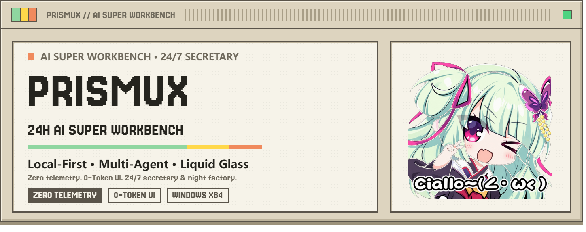
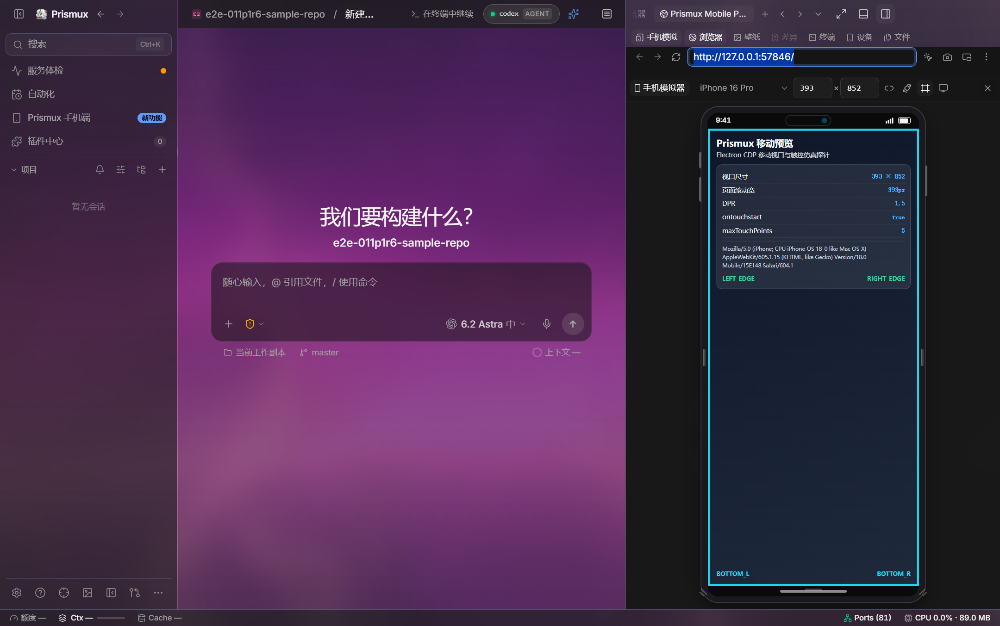
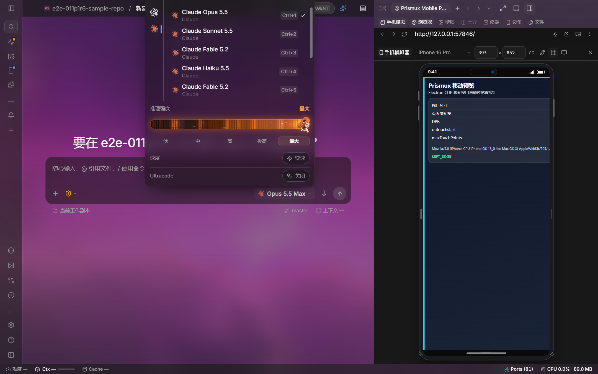
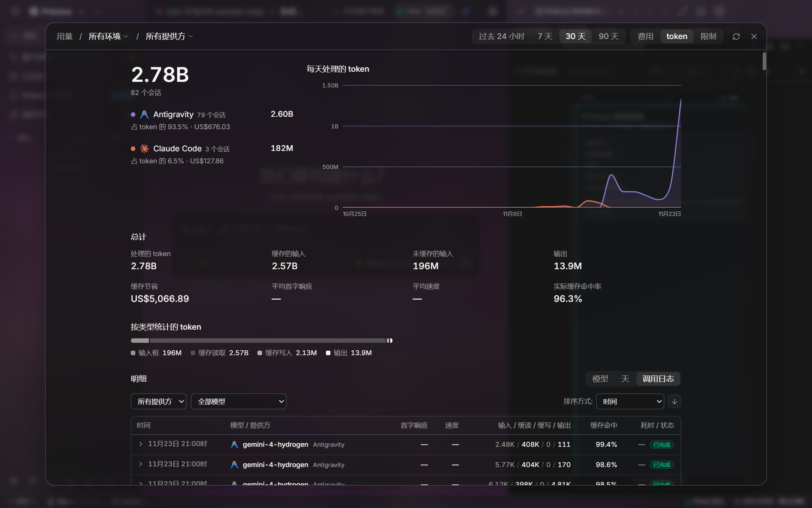
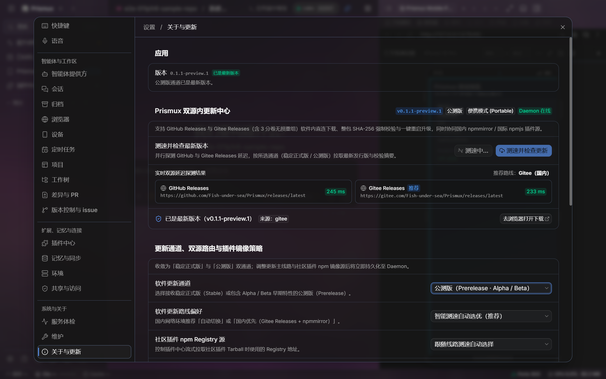
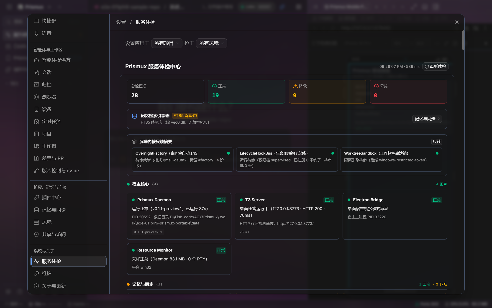
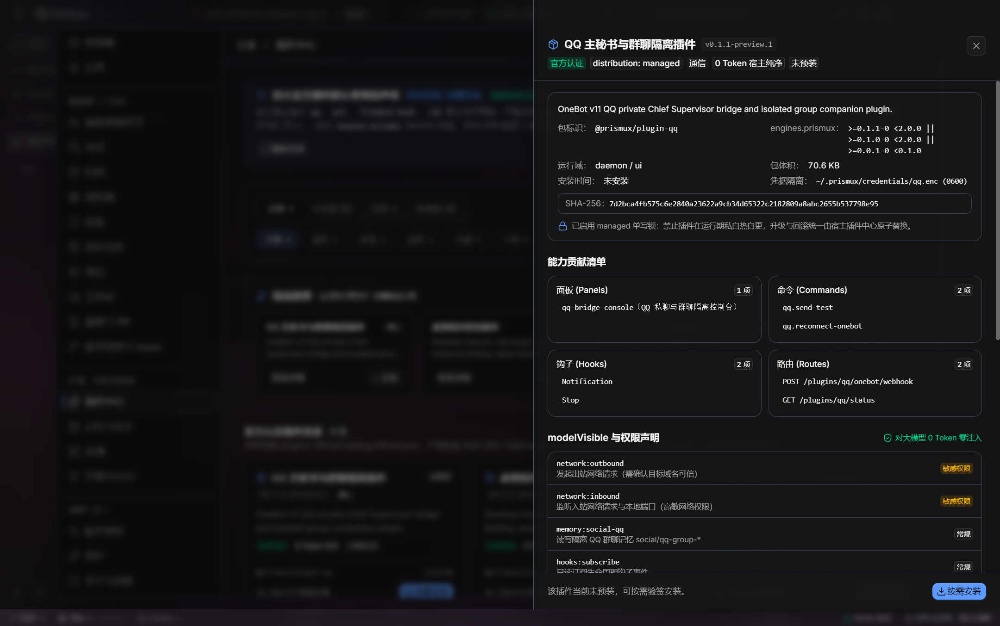

<div align="center">

<p>
  <a href="README.md"><picture><source media="(prefers-color-scheme: dark)" srcset="assets/readme/key-zh-en-dark.png"></picture></a>
  <a href="README.en.md"><picture><source media="(prefers-color-scheme: dark)" srcset="assets/readme/key-en-en-dark.png"></picture></a>
  <a href="#install"><picture><source media="(prefers-color-scheme: dark)" srcset="assets/readme/key-start-en-dark.png"></picture></a>
</p>

<picture>
  <source media="(prefers-color-scheme: dark)" srcset="assets/readme/hero-en-dark.png">
  
</picture>

<p>
  <a href="https://github.com/Fish-under-sea/Prismux/releases/tag/v0.1.1-preview.1"><picture><source media="(prefers-color-scheme: dark)" srcset="assets/readme/stat-version-en-dark.png"></picture></a>
  <a href="#preview"><picture><source media="(prefers-color-scheme: dark)" srcset="assets/readme/stat-visual-en-dark.png"></picture></a>
  <a href="#features"><picture><source media="(prefers-color-scheme: dark)" srcset="assets/readme/stat-memory-en-dark.png"></picture></a>
  <a href="#plugins"><picture><source media="(prefers-color-scheme: dark)" srcset="assets/readme/stat-plugins-en-dark.png"></picture></a>
</p>

<p>
  = 24.12">
  
  
  
  
  
</p>

<p><strong>Prismux · Minimalist Liquid-Glass AI Super Workbench &amp; 24/7 Secretary</strong><br>Built on a minimal-invasion T3 Code runtime (Electron 44 + <code>apps/server</code> + <code>apps/web</code>), uniting an Orca-aligned left sidebar &amp; 54px icon rail, monolithic Orca composer with animated model-aware reasoning slider (0-Token), zero-clipping phone simulator, 28-check service diagnostics, 24px status bar, TTFT/TPS call logs, 4-group animated settings, and dual-route split updates.</p>

<p>
  <a href="#install"><picture><source media="(prefers-color-scheme: dark)" srcset="assets/readme/key-download-en-dark.png"></picture></a>
  <a href="https://github.com/Fish-under-sea/Prismux/releases/tag/v0.1.1-preview.1"><picture><source media="(prefers-color-scheme: dark)" srcset="assets/readme/key-release-en-dark.png"></picture></a>
  <a href="https://github.com/Fish-under-sea/Prismux/issues"><picture><source media="(prefers-color-scheme: dark)" srcset="assets/readme/key-issues-en-dark.png"></picture></a>
</p>

</div>

<h2 id="intro"><picture><source media="(prefers-color-scheme: dark)" srcset="assets/readme/section-intro-en-dark.png"></picture></h2>

Prismux is an AI Super Workbench and 24/7 headless secretary built around **a real T3 Code core, an isolated 0-Token visual layer, and strictly on-demand plugins**. **Prismux v0.1.1 Preview 1** (`v0.1.1-preview.1`) runs on a managed **T3 Code fork** (Electron 44 + `apps/server` + `apps/web` tracked in [`docs/t3code-patch-manifest.md`](docs/t3code-patch-manifest.md) with zero edits to `vendor/t3code/pnpm-lock.yaml`) and introduces major craftsmanship and UX upgrades:

- **Orca Composer + `dsh-fish` Animated Reasoning Slider + Live Telemetry Strip**: Rebuilt as a translucent monolithic glass card with a 4-tier Permission Shield (`Ask for approval` / `Accept edits` / `Approve for me` / `Full access`), unified Model Combobox integrating **`dsh-better-reasoning-effort-fish`** (auto-detecting 8 model families with animated pixel runners at **0 LLM tokens** and `prefers-reduced-motion` support) + Codex/Claude **`⚡ Fast`** toggle, and a bottom real-time telemetry strip (`TPS`, token cache hit rate, and `14×14` SVG context ring).
- **Orca Left Sidebar with 54px Icon Rail & 300ms Aim-Cone Menus**: Top search + compliant shortcuts (`Diagnostics`, `Automations`, `Prismux Mobile [New]`, `Plugins`—zero `Bots`) + `Projects` header with notification inbox, collapsing smoothly into a persistent `54px` icon rail (90ms label fade → 150ms rail shrink); global hover submenus feature a 300ms **Safe Triangle** (`pointerType === "mouse"` only).
- **Zero-Dependency Mobile Phone Simulator & Android Toolchain Fallback**: 6 curated device presets + instant blank-stage launch + 60ms portrait/landscape rotation; Electron CDP (`deviceScaleFactor: 0` + reversible `ontouchstart`) paired with single-layer CSS scaling eliminates Windows 150% DPI clipping above the 24px status bar; Android SDK probing adds `npmmirror → npmjs` fallback.
- **24px Status Bar, 28-Check Diagnostics & TTFT/TPS Call Logs**: Single-row status bar surfaces Usage/Context gauge/Prompt Cache/deduped `Ports`/CPU & RAM (`>= 4.5:1` contrast across Light/Dark/Glass); `/settings/diagnostics` runs 28 health probes + read-only summaries of sleeping engines; `/usage#calls` adds Avg TTFT, Avg TPS, real cache hit rate, and up to 500 filterable `Call Logs`.
- **4-Group Animated Settings Architecture (Archived Preserved)**: Consolidated into 4 clean localized groups with dual-pill motion (GPU `translate3d` slide inside groups, in-place `crossfade` across groups), unified Appearance & Wallpaper + About & Updates pages, cleanup of `Boring Sidebar` / `Guest Links` / `Simlock` / `EAS` / `T3 Connect`, while **explicitly preserving T3 Code's native lightweight `/settings/archived` view**.
- **In-App Split-Volume Dual Updates, `omp acp`, Antigravity Compliance & Zero Preinstall Plugins**: Concurrent GitHub ↔ Gitee probing (with HTML fallback on OpenAPI 403), Gitee 80 MB `.7z.001..003` reassembly via bundled `resources/tools/7za.exe`, mandatory SHA-256 verification, first-class `omp acp` dialect, 100% pure official `agy acp` (zero OAuth/Keyring/`v1internal` scraping), Cordis declarative liquid-glass UI (`z-[70]`/`z-[80]` Portals), and zero preinstalled official plugins.

The current release is **`Prismux v0.1.1 Preview 1`** (`v0.1.1-preview.1`), shipping `Prismux-Setup-0.1.1-preview.1-win-x64.exe` on GitHub Releases and Gitee Releases (with reserved placeholders for macOS and Linux builds).

<h2 id="preview"><picture><source media="(prefers-color-scheme: dark)" srcset="assets/readme/section-preview-en-dark.png"></picture></h2>

> All screenshots below were captured directly from the verified **Prismux v0.1.1 Preview 1 (`v0.1.1-preview.1`) Electron 44 Windows binary** during R6 sign-off—no mockups:

<table>
  <tr>
    <td width="50%" align="center" valign="top">
      
      <br>
      <sub><strong>Liquid-Glass Workbench, Orca Shell &amp; Unclipped Phone Simulator</strong>: Orca left sidebar with Search, Diagnostics, and <code>Prismux Mobile [New]</code>; translucent composer with Permission Shield; iPhone 16 Pro bezel rendering full <code>393×852</code> edges and <code>ontouchstart=true</code> at 150% DPI cleanly above the 24px status bar.</sub>
    </td>
    <td width="50%" align="center" valign="top">
      
      <br>
      <sub><strong>54px Collapsed Icon Rail + <code>dsh-fish</code> Runner Slider + <code>⚡ Fast</code> Mode</strong>: Persistent 54px rail with vertically stacked footer icons; selecting <code>Claude Opus 5.5</code> switches the pixel-matrix runner to warm amber alongside the Codex/Claude <code>Speed · ⚡ Fast</code> pill (<strong>0 LLM tokens</strong>).</sub>
    </td>
  </tr>
  <tr>
    <td width="50%" align="center" valign="top">
      
      <br>
      <sub><strong>Usage Dashboard with TTFT/TPS Metrics &amp; Call Logs Tab</strong>: Displays <code>2.78B</code> tokens across <code>82</code> sessions, daily trend chart, summary KPIs (Avg TTFT, Avg Speed, <code>96.3%</code> real cache hit rate), and the sortable, filterable <code>Call Logs</code> tab (<code>/usage#calls</code>).</sub>
    </td>
    <td width="50%" align="center" valign="top">
      
      <br>
      <sub><strong>4-Group Settings Sidebar &amp; Dual-Route Update Center</strong>: 4 cleanly separated groups (preserving <code>Archived</code>); merged <code>About &amp; Updates</code> embeds the dual-route updater (<code>v0.1.1-preview.1</code>) showing live green latency probes for <code>GitHub Releases (245 ms)</code> and <code>Gitee Releases (233 ms)</code>.</sub>
    </td>
  </tr>
  <tr>
    <td width="50%" align="center" valign="top">
      
      <br>
      <sub><strong>28-Check Service Diagnostics Center (4/4 Host Core Green)</strong>: Live status for Daemon, T3 Server (<code>HTTP 200</code>), Electron Bridge, Resource Monitor, memory FTS5/<code>sqlite-vec</code> mode, and read-only status of <code>OvernightFactory</code>, <code>LifecycleHookBus</code>, and <code>WorktreeSandbox</code>.</sub>
    </td>
    <td width="50%" align="center" valign="top">
      
      <br>
      <sub><strong>4-Tab Plugin Center &amp; Portal Detail Drawer (Zero Preinstall)</strong>: Body-mounted <code>z-[70]</code> detail drawer above the backdrop displays <code>distribution: managed</code>, <code>engines.prismux</code>, SHA-256 digest, <code>0600</code> secret isolation, and <code>0 Token</code> purity alongside "Not Preinstalled / On-Demand Install".</sub>
    </td>
  </tr>
</table>

<h2 id="features"><picture><source media="(prefers-color-scheme: dark)" srcset="assets/readme/section-features-en-dark.png"></picture></h2>

<table>
  <tr>
    <td width="50%" valign="top">
      <strong>1. T3 Code Base, <code>omp acp</code> &amp; Pure Official <code>agy acp</code></strong>
      <p>The Electron 44 app (<code>PrismuxDaemonService</code>) supervises <code>@prismux/daemon</code> (scoping <code>ELECTRON_RUN_AS_NODE=1</code> strictly to the child process and injecting live T3 server URLs), launches <code>/welcome</code> on first run, and hot-swaps Claude, Codex, Antigravity, OpenCode, or OMP in the <code>Chief Thread Slot</code>.</p>
      <p>Built-in Antigravity uses strictly official <code>agy acp</code> (<code>local-cli</code>—zero token/keyring scraping or <code>v1internal</code> calls), while the first-class <code>omp acp</code> dialect supports <code>_session/steering</code>, pure ACP <code>_omp/usage</code>, shell sanitization, and <code>sessionLost</code> recovery.</p>
    </td>
    <td width="50%" valign="top">
      <strong>2. Five Core Primitives (No Redundant Bloat)</strong>
      <p>Permanently excludes Task Board, AgentTeam DAG, Skill Lens, Visual Companion, and custom heavy Session Archive backends (while <strong>preserving T3 Code's lightweight <code>/settings/archived</code></strong>), consolidating onto five primitives:</p>
      <ul>
        <li><code>PersistentPtyPool</code>: <code>2 MB</code> per-terminal ring buffer &amp; lossless reconnect replay</li>
        <li><code>HandoffEngine</code>: <code>/handoff</code> distillation, <code>agent / oracle / review</code> Dial &amp; Orca dynamic fences</li>
        <li><code>CollectorAndGuard</code>: Multi-format slicing, identity injection &amp; <code>60 s</code> breaker</li>
        <li><code>LifecycleHookBus</code>: 6 hook events, exit-code <code>2</code> blocks &amp; <code>onFailure: "block"</code></li>
        <li><code>WorktreeSandbox</code>: OS-level write isolation &amp; domain-allowlisted proxy gateway</li>
      </ul>
    </td>
  </tr>
  <tr>
    <td width="50%" valign="top">
      <strong>3. Mnemopi Memory Recall, Isolation &amp; Night Factory</strong>
      <p>Memories stay in single-file <code>~/.prismux/data/memory.db</code> (SQLite WAL + FTS5 + <code>sqlite-vec</code>) with <strong>Mnemopi prompt-cache-friendly recall</strong> (<code>&lt;memories&gt;</code>/<code>&lt;memory-delta&gt;</code> XML guarding, two-phase <code>prepare/commit</code>, 4-tier scoped cache) and Obsidian migration. Transport-level <code>forwardIdentity</code> locks <code>qq_group:&lt;gid&gt;</code> queries away from <code>private/chief</code> and <code>workspace/*</code>.</p>
      <p><code>OvernightFactory</code> automates Gmail OAuth2 / IMAP <code>#factory</code> ingestion → memory Handoff → sandboxed <code>git worktree</code> coding → read-only Oracle <code>review</code> → HTML morning report with diff &amp; <code>prismux://review/&lt;threadId&gt;</code> link.</p>
    </td>
    <td width="50%" valign="top">
      <strong>4. 0-Token Visual Matrix, Orca UX &amp; Effort Slider</strong>
      <p><code>@prismux/appearance</code> unites the 1:1 Celestial capsule and <code>&lt;PrismuxReasoningEffortSlider /&gt;</code> (ported from <code>dsh-better-reasoning-effort-fish</code> with 8 model families, embedded RGBA WebP runners, and Canvas pixel radiation) alongside <code>@prismux/wallpaper</code> (Steam <code>431960</code> / WebWallGL / <code>0 FPS</code> occlusion pause), 24px status bar, and 4-group animated settings—at <strong>0 LLM tokens</strong> and ≥ 4.5:1 contrast.</p>
      <p>Global 300ms hover aim-cones, 54px icon-rail choreography, Orca composer, and live TTFT/TPS telemetry run purely locally.</p>
    </td>
  </tr>
  <tr>
    <td width="50%" valign="top">
      <strong>5. Cordis Declarative Plugins &amp; Magpie E2EE Sync</strong>
      <p><code>@prismux/cordis-kernel</code> enforces top-level <code>engines.prismux</code> SemVer, zero-leak <code>ctx.effect()</code> rollback, <code>512 KiB</code>-budget declarative liquid-glass UI (<code>DeclarativeGlassRenderer</code>), 4-tab Plugin Center, <code>distribution: "managed"</code> locks, <code>0600</code> per-plugin secrets, and script-free npm tarball imports without invoking <code>git</code>.</p>
      <p><code>@prismux/sync-vault</code> seals <code>.prismux-backup</code> payloads with Argon2id + AEAD across WebDAV, S3, and GitHub with <code>If-Match</code> locking, <code>60 s</code> watchdog, and portable <code>data/</code> mode.</p>
    </td>
    <td width="50%" valign="top">
      <strong>6. Phone Simulator, 28-Check Diagnostics &amp; Split Updates</strong>
      <p>Zero-dependency phone simulator pairs Electron CDP (<code>deviceScaleFactor: 0</code> + touch emulation) with single-layer CSS scaling for crisp unclipped HiDPI previews; Windows Android SDK probing includes <code>npmmirror → npmjs</code> toolchain fallback.</p>
      <p><code>AppUpdater</code> races <strong>GitHub ↔ Gitee</strong> (auto-falling back to Web Releases on OpenAPI 403) and <strong>npm ↔ npmmirror</strong>, reassembling Gitee 3-part <code>.7z.001..003</code> volumes via bundled <code>7za.exe</code> with mandatory SHA-256 checks; 10-locale catalog keeps <code>en/zh</code> <code>10,296</code> keys 100% aligned.</p>
    </td>
  </tr>
</table>

<h2 id="plugins"><picture><source media="(prefers-color-scheme: dark)" srcset="assets/readme/section-plugins-en-dark.png"></picture></h2>

> [!NOTE]
> **Four Official Plugins Are Never Preinstalled**: Neither `Prismux-Setup-0.1.1-preview.1-win-x64.exe` nor the unpacked desktop bundle contains any directory from `plugins-official/` (verified at 0 hits across the packaged tree). Each official plugin ships separately as a verified `.wb-plugin` archive (indexed by `prismux-plugins-official.json` and `prismux-plugins-0.1.1-preview.1-SHA256SUMS.txt`) and script-free npm single package, installing strictly on demand with `ctx.effect()` zero-leak rollback.

| Plugin ID | Archive (`.wb-plugin`) | npm Package (Unscoped / GitHub Packages) | Realms | Capabilities &amp; Isolation |
| :--- | :--- | :--- | :--- | :--- |
| `qq` | `prismux-plugin-qq-0.1.1-preview.1.wb-plugin` | `prismux-plugin-qq`<br><code>@fish-under-sea/prismux-plugin-qq</code> | `daemon`, `ui` | OneBot v11 forward/reverse WebSocket probe (NapCatQQ / Lagrange.Core); owner DMs route to the Chief slot while authorized QQ groups use anti-spam pacing locked to <code>social/qq-group-&lt;gid&gt;</code> |
| `pet` | `prismux-plugin-pet-0.1.1-preview.1.wb-plugin` | `prismux-plugin-pet`<br><code>@fish-under-sea/prismux-plugin-pet</code> | `ui`, `daemon` | Desktop mascot bridge implementing targeted instance binding, expiring Lease Tokens, read-only playback subscriptions, and staged motion/bubble handover |
| `fishdock-hook` | `prismux-plugin-fishdock-hook-0.1.1-preview.1.wb-plugin` | `prismux-plugin-fishdock-hook`<br><code>@fish-under-sea/prismux-plugin-fishdock-hook</code> | `daemon` | Bridges `PreToolUse` risk approvals, priority mail alerts, and Overnight Factory completions to FISH-Dock Dynamic Island cards with instant approve/reject actions |
| `ssh` | `prismux-plugin-ssh-0.1.1-preview.1.wb-plugin` | `prismux-plugin-ssh`<br><code>@fish-under-sea/prismux-plugin-ssh</code> | `daemon`, `ui` | Optional remote ops plugin offering an isolated SSH host pool, Web PTY session bridging, path validation, and SFTP file browsing |

<h2 id="install"><picture><source media="(prefers-color-scheme: dark)" srcset="assets/readme/section-install-en-dark.png"></picture></h2>

### Dual-Route Release Channels (GitHub Releases ↔ Gitee Releases)

| Channel | Best For | Release &amp; Download Details |
| :--- | :--- | :--- |
| **GitHub Releases** (Global) | Direct global network / GitHub CLI environments | [Release (`v0.1.1-preview.1`)](https://github.com/Fish-under-sea/Prismux/releases/tag/v0.1.1-preview.1) · [Direct `Prismux-Setup-0.1.1-preview.1-win-x64.exe`](https://github.com/Fish-under-sea/Prismux/releases/download/v0.1.1-preview.1/Prismux-Setup-0.1.1-preview.1-win-x64.exe) |
| **Gitee Releases** (Mainland China Mirror) | High-speed direct downloads inside mainland China | [Release (`v0.1.1-preview.1`)](https://gitee.com/Fish-under-sea/Prismux/releases/tag/v0.1.1-preview.1) (includes 80 MB split `.7z.001..003` volumes, consolidated checksums, and official plugin archives) |
| **In-App Update Center** (Recommended) | Concurrent latency probing, split reassembly &amp; mandatory SHA-256 verification | Open **Settings → About &amp; Updates** (`/settings/about#prismux-updates`) to switch between `Auto / Domestic First / Global First` with one-click install &amp; restart |

### Platform Downloads &amp; Integrity Verification

| Platform / Release Asset | Filename / Availability | Details &amp; Isolation |
| :--- | :--- | :--- |
| **Windows x64 Installer (Electron 44 NSIS)** | `Prismux-Setup-0.1.1-preview.1-win-x64.exe` (Gitee also provides `.7z.001..003`) | Full Electron 44 desktop app with bundled `resources/prismux-daemon/`, `resources/tools/7za.exe`, and `t3-resource-monitor.exe`; supports `/D=<dir>` custom install paths; keeps state in `~/.prismux/` (plus portable `data/` mode); **zero preinstalled official plugins** |
| **macOS (Apple Silicon / Intel)** | `Coming soon (Placeholder reserved)` | Planned `.dmg` artifacts will follow the exact same `0-Token` visual separation and `~/.prismux/` isolation guarantees |
| **Linux (x86_64 / arm64)** | `Coming soon (Placeholder reserved)` | Planned `.AppImage` / `.deb` packages will support dual-route updates and on-demand plugin verification |
| **4 Official Plugin Archives** | `prismux-plugin-{qq,pet,fishdock-hook,ssh}-0.1.1-preview.1.wb-plugin` &amp; `prismux-plugins-official.json` | Deterministic ustar + gzip bundles for on-demand verified import via `/settings/plugins` |
| **Consolidated Checksums** | `Prismux-0.1.1-preview.1-SHA256SUMS.txt` &amp; `prismux-plugins-0.1.1-preview.1-SHA256SUMS.txt` | Verify manual downloads with `Get-FileHash Prismux-Setup-0.1.1-preview.1-win-x64.exe -Algorithm SHA256` or `7z t` |

<h2 id="packages"><picture><source media="(prefers-color-scheme: dark)" srcset="assets/readme/section-packages-en-dark.png"></picture></h2>

Each official plugin is also published as a **script-free (`preinstall / install / postinstall` disabled)** single npm package bundling its SHA-256-verified `prismux-plugin-<id>-0.1.1-preview.1.wb-plugin` archive and overwrite-safe copy CLI (`prismux-plugin-<id>`). Inside the Plugin Center, Track 2 streams tarballs directly over HTTPS with automatic failover between **`registry.npmjs.org` ↔ `registry.npmmirror.com`** and zero local `git` invocation.

```powershell
# 1. Install and extract a verified .wb-plugin archive from npmjs
npm install prismux-plugin-qq@0.1.1-preview.1
npx prismux-plugin-qq --out ./plugins-stage

# 2. Use the npmmirror domestic registry in mainland China
npm install prismux-plugin-qq@0.1.1-preview.1 --registry=https://registry.npmmirror.com
npx prismux-plugin-qq --out ./plugins-stage
```

- **Other Official Plugins**: Swap `qq` for `pet`, `fishdock-hook`, or `ssh`, then import the extracted `.wb-plugin` file via Settings → **Plugins** (`/settings/plugins`).
- **GitHub Packages Mirror**: Published releases sync `@fish-under-sea/prismux-plugin-{qq,pet,fishdock-hook,ssh}` to `https://npm.pkg.github.com`.

<h2 id="develop"><picture><source media="(prefers-color-scheme: dark)" srcset="assets/readme/section-develop-en-dark.png"></picture></h2>

> **Prerequisites**: `Node.js >= 24.12.0`, `pnpm >= 10.0.0` (repo pins `pnpm@12.3.4`), `Electron 44`, and `Rust >= 1.85` (for `vendor/t3code/native/resource-monitor`; pass `-j 1` and `NO_PROXY=*` on Windows). Read [`AGENTS.md`](AGENTS.md), [`docs/t3code-patch-manifest.md`](docs/t3code-patch-manifest.md), and your contributor profile `docs/agents/local/<normalized-username>.md` first.

```powershell
# 1. Install workspace dependencies (12 TypeScript workspace packages)
pnpm install

# 2. Build, typecheck, and test all root workspace packages and ops scripts
pnpm -r build
pnpm -r typecheck
pnpm -r --if-present test
pnpm test:scripts

# 3. Verify the vendor/t3code managed-fork lock contract and patch manifest
pnpm upstream:check

# 4. Typecheck and build the Electron 44 T3 Code runtime (web + server + desktop)
pnpm --dir vendor/t3code exec vp run --filter @t3tools/web typecheck
pnpm --dir vendor/t3code exec vp run --filter @t3tools/desktop typecheck
pnpm --dir vendor/t3code exec vp run build:desktop

# 5. Orchestrate full desktop build & Windows NSIS installer (with 7z check & SHA256SUMS)
pnpm desktop:build
pnpm desktop:installer

# 6. Deterministically pack an official plugin (.wb-plugin + gunzip loopback check)
pnpm plugin:pack -- --plugin plugins-official/plugin-qq
```

<details>
<summary><strong>Expand: Monorepo Structure &amp; T3 Code Minimal-Invasion Boundary</strong></summary>

```text
prismux/
├── AGENTS.md                            # Cross-machine engineering rules, guardrails & DoD gates
├── LICENSE                              # Standard MIT License
├── README.md / README.en.md             # Bilingual project homepages
├── UPSTREAM_LOCK.json                   # pingdotgg/t3code baseline SHA, managed-fork mode & manifest pointer
├── pnpm-workspace.yaml                  # 12 TS workspace packages (excludes vendor/t3code & desktop-tauri)
├── package.json                         # Root orchestration scripts (0.1.1-preview.1)
├── tsconfig.base.json                   # Shared strict TypeScript 5.8+ baseline (ES2024 + NodeNext)
├── assets/
│   ├── logo.png                         # Transparent 1024×1024 mascot master icon
│   └── readme/                          # Pixel-art headers, section banners, Preview 1 screenshots & templates
├── docs/
│   ├── t3code-patch-manifest.md         # Authoritative registry of MP-01 ~ MP-07 T3 Code mounts & extensions
│   ├── agents/                          # Per-developer local environment profiles & templates
│   ├── releases/v0.0.1-alpha.1.md       # Archived initial prototype release notes
│   └── specs/
│       ├── master-prompt-v1.3.md        # Full-stack architectural constitution
│       └── ui-ux-design-mandate.md      # Mandatory UI/UX, theme & installer specification
├── scripts/                             # Operational tooling & README renderer (Node 24 native TS / ESM)
│   ├── build-prismux-desktop.ts         # Unified desktop & NSIS installer orchestrator (--installer / --skip-rust)
│   ├── release-all.ts                   # Desktop + 4 official plugins + npm packages + SHA256SUMS bundler
│   ├── sync-t3-upstream.ts              # managed-fork / upstream lock verifier (--check / --sync)
│   ├── pack-plugin.ts                   # Deterministic ustar + gunzip loopback plugin packer
│   ├── build-npm-plugin-packages.ts     # Script-free npm & GitHub Packages generator
│   ├── rename-brand.ts                  # Safe repository-wide brand identifier renamer
│   ├── render-readme.mjs                # Edge CDP pixel-header & section-banner renderer
│   └── __tests__/scripts.test.ts        # node:test regression suite
├── vendor/
│   └── t3code/                          # T3 Code base (Electron 44 + server + web), tracked by MP-01 ~ MP-07
├── packages/                            # 6 core workspace packages
│   ├── protocol/                        # @prismux/protocol: brand, RPC, hooks, memory, plugin & updater types
│   ├── cordis-kernel/                   # @prismux/cordis-kernel: dual-realm host, declarative UI, dual-route installer & 0600 secrets
│   ├── memory-core/                     # @prismux/memory-core: SQLite WAL + FTS5 + sqlite-vec, Mnemopi recall & query isolation
│   ├── sync-vault/                      # @prismux/sync-vault: Argon2id + AEAD sync, optimistic locks & 60 s watchdog
│   ├── prismux-appearance/              # @prismux/appearance: Celestial capsule, declarative glass, model effort slider & T3 glass bridge
│   └── prismux-wallpaper/               # @prismux/wallpaper: 2-tab sidebar, 4-tab settings, Z-0 stage & Steam 431960
├── apps/                                # Headless daemon (+ retiring prototype & historical shell)
│   ├── daemon/                          # @prismux/daemon: 24h supervisor, Chief slot, 5 primitives, diagnostics, ports & factory
│   ├── workbench-ui/                    # @prismux/workbench-ui: [retiring prototype] v0.0.1 shell superseded by T3 Code base
│   └── desktop-tauri/                   # prismux-desktop: [historical shell] superseded by T3 Code Electron 44
└── plugins-official/                    # 4 optional official plugins (workspace packages) + catalog
    ├── catalog/official.json            # Authoritative plugin index (SHA-256 / bytes / engines / status)
    ├── plugin-qq/                       # @prismux/plugin-qq
    ├── plugin-pet/                      # @prismux/plugin-pet
    ├── plugin-fishdock-hook/            # @prismux/plugin-fishdock-hook
    └── plugin-ssh/                      # @prismux/plugin-ssh
```

</details>

<details>
<summary><strong>Expand: Five Non-Negotiable Engineering Guardrails</strong></summary>

1. **Minimal-Invasion Layering on T3 Code**: `vendor/t3code/` changes remain strictly registered under MP-01 ~ MP-07 in [`docs/t3code-patch-manifest.md`](docs/t3code-patch-manifest.md) with zero changes to `vendor/t3code/pnpm-lock.yaml`; heavy domain logic and visual engines reside in root `packages/*` and `apps/daemon`.
2. **Never reintroduce the 4 eliminated bloat modules (native lightweight archiving preserved)**: Task Board, AgentTeam DAG, Skill Lens, Visual Companion, and custom heavy Session Archive backends remain excluded in favor of the five core primitives; **T3 Code's native lightweight `/settings/archived` view is preserved per project decision**.
3. **Single-file hybrid memory & physical isolation**: All memories reside in `~/.prismux/data/memory.db` (SQLite WAL + FTS5 + `sqlite-vec`) with zero PostgreSQL / Qdrant / MinIO / Obsidian client dependencies, enforced at transport level via `_callerScope`.
4. **Four official plugins are never preinstalled**: `qq`, `pet`, `fishdock-hook`, and `ssh` remain isolated in `plugins-official/` and are excluded from desktop installers, installed strictly on demand.
5. **Zero model token cost for the visual layer**: Wallpapers, 360° Fresnel liquid glass, animated model effort sliders, typography tinting, audio FFT sync, desktop pet staging, and installer screens inject zero tool schemas or prompts into any LLM.

</details>

<details>
<summary><strong>Expand: M1–M5 &amp; Preview 1 Integration Milestones</strong></summary>

| Milestone | Scope Delivered | Status |
| :--- | :--- | :--- |
| **M1** | Monorepo scaffold, T3 Code baseline lock, `apps/daemon` supervision, env sanitization, Chief Thread Slot &amp; `2 MB` ring-buffered `PersistentPtyPool` | Complete &amp; Verified |
| **M2** | Single-file SQLite WAL + FTS5 + `sqlite-vec` memory, Mnemopi prompt-cache recall, `forwardIdentity` isolation, `LifecycleHookBus`, `HandoffEngine` &amp; `WorktreeSandbox` | Complete &amp; Verified |
| **M3** | `cordis-kernel` (`engines.prismux`, zero-leak `ctx.effect()`, declarative UI, script-free npm tarball installer, `managed` lock) &amp; `sync-vault` (Argon2id + AEAD, `If-Match`, `60 s` stall watchdog, portable `data/`) | Complete &amp; Verified |
| **M4 / v0.1.0–v0.1.1 Preview 1** | `@prismux/appearance` (with `dsh-fish` effort slider) + `@prismux/wallpaper` extraction, T3 Code MP-01 ~ MP-07 integration (Orca composer &amp; 54px rail, live telemetry strip, TTFT/TPS Call Logs, 300ms aim-cones, 4-group animated settings, unclipped HiDPI phone simulator, 28-check diagnostics &amp; pure official ACP) | Complete &amp; R6 Signed Off |
| **M5** | `OvernightFactory` end-to-end closed loop, deterministic `.wb-plugin` packaging/verification (`0.1.1-preview.1`) for `qq`, `pet`, `fishdock-hook`, and `ssh`, plus dual-route split auto-updates | Complete &amp; Verified |

</details>

<h2 id="thanks"><picture><source media="(prefers-color-scheme: dark)" srcset="assets/readme/section-thanks-en-dark.png"></picture></h2>

### Documentation Index

| Document | Purpose |
| :--- | :--- |
| [`AGENTS.md`](AGENTS.md) | Cross-machine engineering rules, five guardrails, script/plugin contracts &amp; commit conventions |
| [`docs/t3code-patch-manifest.md`](docs/t3code-patch-manifest.md) | Authoritative registry of MP-01 ~ MP-07 mounts, Provider extensions &amp; upstream merge guide |
| [`docs/specs/ui-ux-design-mandate.md`](docs/specs/ui-ux-design-mandate.md) | UI/UX craftsmanship, Celestial tri-state capsule, four-region glass sync &amp; installer mandate |
| [`docs/specs/master-prompt-v1.3.md`](docs/specs/master-prompt-v1.3.md) | Full-stack autonomous build specification (architectural constitution) |
| [`docs/agents/README.md`](docs/agents/README.md) | Contributor local environment profile naming rules, template &amp; maintenance workflow |
| [`docs/releases/v0.0.1-alpha.1.md`](docs/releases/v0.0.1-alpha.1.md) | Archived initial prototype release notes |
| [`assets/readme/MAINTAINING.md`](assets/readme/MAINTAINING.md) | README pixel-art header/banner rendering workflow, dimensions &amp; CDN cache guide |

### Upstream Credits &amp; MIT Open-Source Attributions

- [pingdotgg/t3code](https://github.com/pingdotgg/t3code) (MIT): Upstream Electron 44 + `apps/server` + `apps/web` runtime and provider bridge core.
- [stablyai/orca](https://github.com/stablyai/orca) (MIT): Reference for port scanning &amp; resource monitoring, 24px status bar, sortable Activity Bar, Orca sidebar &amp; monolithic composer, `omp` dialect, and declarative plugin UI.
- [can1357/oh-my-pi](https://github.com/can1357/oh-my-pi) (MIT): Reference for Mnemopi prompt-cache-friendly recall &amp; scoped caches, `omp acp` `_session/steering` / `_omp/usage`, and status-bar context/cache gauges.
- `dsh-better-reasoning-effort-fish` ([HanaAyane/dsh-reasoning-effort](https://github.com/HanaAyane/dsh-reasoning-effort) PR #9 + [HaoyueQin/dsh-better-reasoning-effort](https://github.com/HaoyueQin/dsh-better-reasoning-effort), MIT): Source for the model-recognizing animated reasoning effort slider (`<PrismuxReasoningEffortSlider />`, 8 model family themes &amp; RGBA WebP runners).
- [yetone/magpie](https://github.com/yetone/magpie): Inspiration for passphrase-sealed AEAD sync, `If-Match` optimistic locking, 60-second stall watchdogs, and portable mode.
- [Amp](https://ampcode.com/): Inspiration for `/handoff` distillation and `agent / oracle / review` dial workflows.
- [FISH-Dock](https://github.com/Fish-under-sea/FISH-Dock): Reference for the Warm Paper / Dark Olive stereomorphic README design system, 1:1 Celestial capsule &amp; 360° Fresnel liquid-glass theme hooks, and Dynamic Island approval bridging.

### License Boundary

Prismux core source code and README layout tooling are licensed under the **MIT License** (see [`LICENSE`](LICENSE)); the bundled pixel font `Jersey20-Regular.ttf` is licensed under [SIL Open Font License 1.1](assets/readme/OFL-Jersey20.txt); the managed `vendor/t3code` fork and ported MIT references above preserve their original MIT licenses and notices.

<p align="center"><sub>Prismux · 24/7 Agent-Agnostic Super Workbench · 0-Token Visual Layer · 4 Official Optional Plugins</sub></p>
