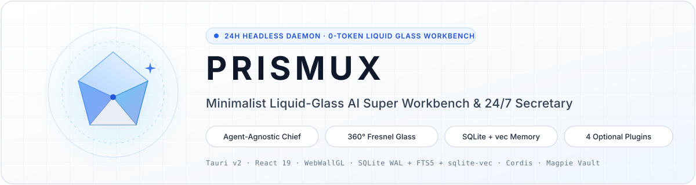
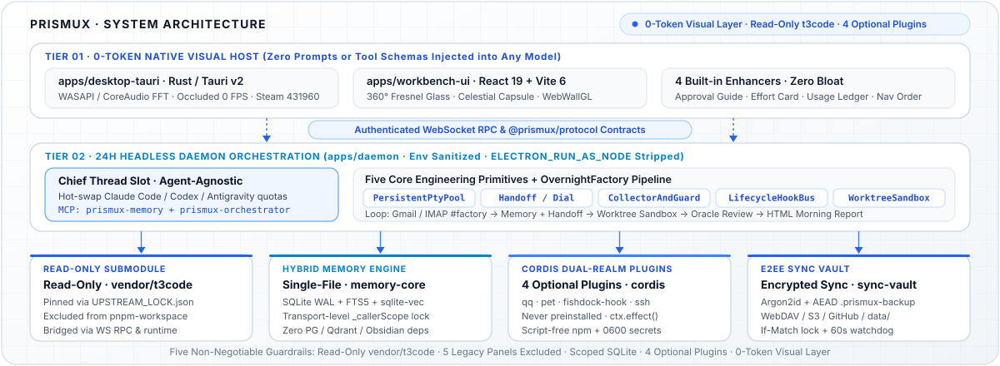

<div align="center">

<p>
  <a href="README.md">简体中文</a> ·
  <a href="README.en.md"><strong>English</strong></a> ·
  <a href="#preview">Visual Preview</a> ·
  <a href="#features">Capabilities</a> ·
  <a href="#architecture">Architecture</a> ·
  <a href="#plugins">Plugins</a> ·
  <a href="#quickstart">Quick Start</a> ·
  <a href="#docs">Documentation</a>
</p>

<picture>
  <source media="(prefers-color-scheme: dark)" srcset="assets/readme/hero-en-dark.svg">
  
</picture>

<p>
  = 24.12">
  
  
  
  
  
  
</p>

<p><strong>Minimalist Liquid-Glass AI Super Workbench &amp; 24/7 Secretary</strong><br>Bridges a read-only <code>t3code</code> core with an agent-agnostic Chief Supervisor, query-isolated single-file SQLite memory, 360° Fresnel liquid glass, and an overnight autonomous factory.</p>

<table>
  <tr>
    <td align="center" width="25%"><strong>0 Token</strong><br><sub>Host-only visual overhead</sub></td>
    <td align="center" width="25%"><strong>100% Read-Only</strong><br><sub><code>vendor/t3code</code> submodule</sub></td>
    <td align="center" width="25%"><strong>Single-File</strong><br><sub>SQLite + FTS5 + vec memory</sub></td>
    <td align="center" width="25%"><strong>4 Official Plugins</strong><br><sub>Zero preinstall by default</sub></td>
  </tr>
</table>

</div>

<h2 id="preview">Visual Preview</h2>

<p align="center">
  
  <br>
  <sub><strong>Secretary Standby Preset</strong>: Collapses heavy coding panels to leave 85%–90% unobstructed <code>WebWallGL</code> live wallpaper space alongside floating glass capsules and the bottom <code>UsageLedger</code> bar.</sub>
</p>

<table>
  <tr>
    <td width="50%" align="center" valign="top">
      
      <br>
      <sub><strong>Celestial Capsule &amp; Four-Region Liquid Glass</strong>: Full-width recessed tri-state capsule (Light / Dark / Glass), <code>WebWallGL + Steam 431960</code> wallpaper controls, and four-region optical glass tuning.</sub>
    </td>
    <td width="50%" align="center" valign="top">
      
      <br>
      <sub><strong>Multi-Agent Coding &amp; Approval Guide</strong>: Worktree tree, persistent 2 MB ring-buffered PTY terminal, inline Git diff, three-column risk approval card, and <code>Dial / Handoff</code> preview.</sub>
    </td>
  </tr>
</table>

<h2 id="features">Core Capabilities</h2>

<table>
  <tr>
    <td width="50%" valign="top">
      <strong>1. Agent-Agnostic Chief Slot &amp; Read-Only <code>t3code</code> Bridge</strong>
      <p><code>apps/daemon</code> supervises an unmodified, read-only <code>vendor/t3code/apps/server</code> 24/7 in headless mode while stripping host pollution variables such as <code>ELECTRON_RUN_AS_NODE</code> before spawning any provider or shell.</p>
      <p>A dedicated <code>Chief Thread Slot</code> lets you hot-swap Claude Code, Codex, Antigravity, or OpenCode from the top bar—reusing existing subscriptions and attaching loopback <code>prismux-memory</code> and <code>prismux-orchestrator</code> MCPs automatically.</p>
    </td>
    <td width="50%" valign="top">
      <strong>2. Five Core Primitives (Zero Legacy Bloat Panels)</strong>
      <p>Replaces heavy Task Boards, AgentTeam DAGs, Skill Lens, Visual Companions, and Session Archives with five focused engineering primitives:</p>
      <ul>
        <li><code>PersistentPtyPool</code>: <code>2 MB</code> per-terminal ring buffer with lossless reconnect replay</li>
        <li><code>HandoffEngine</code>: <code>/handoff</code> distillation plus <code>agent / oracle / review</code> dial modes</li>
        <li><code>CollectorAndGuard</code>: Lightweight slicing, transport identity injection &amp; <code>60 s</code> breaker</li>
        <li><code>LifecycleHookBus</code>: 6 deterministic hook events, exit-code <code>2</code> blocks &amp; <code>onFailure: "block"</code></li>
        <li><code>WorktreeSandbox</code>: OS-level write isolation &amp; domain-allowlisted proxy gateway</li>
      </ul>
    </td>
  </tr>
  <tr>
    <td width="50%" valign="top">
      <strong>3. Single-File Three-Domain Hybrid Memory &amp; Physical Isolation</strong>
      <p>Stores all memory inside a single <code>~/.prismux/data/memory.db</code> (SQLite WAL + FTS5 + <code>sqlite-vec</code> hybrid RRF search) with zero PostgreSQL, Qdrant, MinIO, or Obsidian client runtime dependencies, plus a <code>POST /v1/memory/import-obsidian</code> migration endpoint.</p>
      <p><code>forwardIdentity</code> overwrites <code>_callerScope</code> at the transport boundary—never trusting model arguments. Group scopes (<code>qq_group:&lt;gid&gt;</code>) hard-bind SQL queries to <code>social/qq-group-&lt;gid&gt;</code>, physically preventing leaks from <code>private/chief</code> or <code>workspace/*</code>.</p>
    </td>
    <td width="50%" valign="top">
      <strong>4. 360° Fresnel Liquid Glass, Celestial Capsule &amp; <code>WebWallGL</code></strong>
      <p>Built on Tauri v2 and React 19 with per-region <code>fill</code> and <code>blur</code> controls (<code>sidebar / content / overlay / control</code>), independent light/dark text palettes, <code>FishDock.theme</code> follow hooks, and sanitized <code>.wb-theme</code> export/import bundles.</p>
      <p>Includes Steam <code>431960</code> scanning, WASAPI / CoreAudio / PipeWire audio FFT sync, <code>visibility: occluded</code> 0 FPS suspension, and four built-in workbench tools: <code>ApprovalGuide</code>, <code>ReasoningEffortCard</code>, <code>UsageLedger</code>, and <code>NavAndCommandOrder</code>.</p>
    </td>
  </tr>
  <tr>
    <td width="50%" valign="top">
      <strong>5. Cordis Dual-Realm Plugins &amp; Magpie Encrypted Sync</strong>
      <p><code>@prismux/cordis-kernel</code> enforces top-level <code>engines.prismux</code> SemVer checks, cleans up every route, hook, style, and panel via <code>ctx.effect()</code>, and supports script-free streaming <code>npm</code> tarball installation with <code>distribution: "managed"</code> locks and <code>0600</code> per-plugin credentials.</p>
      <p><code>@prismux/sync-vault</code> seals <code>.prismux-backup</code> payloads using Argon2id + AEAD across independent WebDAV, S3 (<code>path-style</code>), and GitHub channels with <code>If-Match</code> optimistic locking, a <code>60 s</code> stall watchdog, and portable <code>data/</code> mode.</p>
    </td>
    <td width="50%" valign="top">
      <strong>6. Autonomous Overnight Factory (<code>OvernightFactory</code>)</strong>
      <p>Executes an unattended email-to-PR-ready-branch pipeline: Gmail OAuth2 / IMAP <code>#factory</code> ingestion → Stage A memory enrichment &amp; Handoff brief → Stage B sandboxed <code>git worktree</code> coding &amp; self-healing test commit (never force-pushing <code>main</code>) → Stage C read-only Oracle <code>review</code> → Stage D HTML morning report with diff highlights and <code>prismux://review/&lt;threadId&gt;</code> deep link.</p>
    </td>
  </tr>
</table>

<h2 id="architecture">System Architecture</h2>

<p align="center">
  <picture>
    <source media="(prefers-color-scheme: dark)" srcset="assets/readme/arch-en-dark.svg">
    
  </picture>
</p>

<h2 id="plugins">Four Official Optional Plugins (Zero Preinstalled)</h2>

> [!NOTE]
> **Minimal Core Guarantee**: Prismux ships only a lean core in both the main runtime and desktop installer—**none of the four official plugins are preinstalled by default**. Each plugin lives independently under `plugins-official/`, packs deterministically via `scripts/pack-plugin.ts` into `.wb-plugin` + `.sha256` artifacts, installs on demand from the Plugin Market, and rolls back cleanly with `ctx.effect()`.

| Plugin ID | npm Package | Realms | Capabilities &amp; Isolation |
| :--- | :--- | :--- | :--- |
| `qq` | `@prismux/plugin-qq` | `daemon`, `ui` | OneBot v11 forward/reverse WebSocket probe (NapCatQQ / Lagrange.Core); private owner DMs route to the Chief slot while authorized QQ groups use anti-spam pacing locked strictly to <code>social/qq-group-&lt;gid&gt;</code> |
| `pet` | `@prismux/plugin-pet` | `ui`, `daemon` | Desktop mascot bridge implementing targeted instance binding, expiring Lease Tokens, read-only playback progress subscriptions, and staged motion/bubble handover |
| `fishdock-hook` | `@prismux/plugin-fishdock-hook` | `daemon` | Bridges `PreToolUse` risk approvals, priority mail alerts, and Overnight Factory completion summaries to FISH-Dock Dynamic Island cards with shortcut approve/reject actions |
| `ssh` | `@prismux/plugin-ssh` | `daemon`, `ui` | Optional remote ops plugin offering an isolated SSH host pool, Web PTY session bridging, path validation, and SFTP file browsing |

<h2 id="quickstart">Quick Start</h2>

> **Prerequisites**: `Node.js >= 24.12.0`, `pnpm >= 10.0.0` (repo pins `pnpm@12.3.4`), and `Rust >= 1.85` (for the Tauri v2 desktop shell). On Windows, always pass `-j 1` to Cargo to avoid MSVC concurrent linker crashes (`0xC0000005`).

```powershell
# 1. Install workspace dependencies
pnpm install

# 2. Build and typecheck all TypeScript workspace packages (typecheck works cleanly even with zero dist/)
pnpm -r build
pnpm -r typecheck

# 3. Run all workspace unit tests and zero-dependency script tests
pnpm test
pnpm test:scripts

# 4. Verify the read-only vendor/t3code upstream lock contract
pnpm upstream:check

# 5. Start the 24/7 headless daemon CLI
node apps/daemon/dist/cli.js start --headless

# 6. Deterministically pack an official plugin (.wb-plugin + gunzip loopback check + .sha256)
pnpm plugin:pack -- --plugin plugins-official/plugin-qq

# 7. Check and test the Rust / Tauri v2 native desktop shell
# (If using a portable Rust toolchain, activate RUSTUP_HOME / CARGO_HOME / PATH per docs/agents/local/<username>.md first)
cargo check -j 1 --offline --manifest-path apps/desktop-tauri/Cargo.toml
cargo test -j 1 --offline --manifest-path apps/desktop-tauri/Cargo.toml
```

<h2 id="details">Engineering Structure &amp; Governance</h2>

<details>
<summary><strong>Expand: Monorepo 10-Package Tree</strong></summary>

```text
prismux/
├── AGENTS.md                            # Cross-machine engineering rules, guardrails & DoD gates
├── README.md / README.en.md             # Bilingual project homepages
├── UPSTREAM_LOCK.json                   # Pinned commit & required paths for read-only vendor/t3code
├── pnpm-workspace.yaml                  # 10 TS workspace packages (excludes vendor/t3code & desktop-tauri)
├── package.json                         # Root orchestration scripts
├── tsconfig.base.json                   # Shared strict TypeScript 5.8+ baseline (ES2024 + NodeNext)
├── assets/readme/                       # Dark/light README SVGs and real UI screenshots
├── docs/
│   ├── agents/                          # Per-developer local environment profiles & templates
│   └── specs/
│       ├── master-prompt-v1.3.md        # Full-stack architectural constitution
│       └── ui-ux-design-mandate.md      # Mandatory UI/UX, theme & quiet-luxury installer spec
├── scripts/                             # Zero-dependency Node 24 native TS scripts & tests
│   ├── rename-brand.ts                  # Safe repository-wide brand identifier renamer
│   ├── sync-t3-upstream.ts              # Read-only check (--check) & shallow sync (--sync)
│   ├── pack-plugin.ts                   # Deterministic ustar + gunzip loopback plugin packer
│   └── __tests__/scripts.test.ts        # node:test regression suite
├── vendor/
│   └── t3code/                          # 100% read-only pingdotgg/t3code submodule (excluded from workspace)
├── packages/                            # 4 core workspace packages
│   ├── protocol/                        # @prismux/protocol: brand constants, RPC, hooks, memory, handoff & plugin contracts
│   ├── cordis-kernel/                   # @prismux/cordis-kernel: dual-realm plugin host, SemVer, tarball installer & 0600 secrets
│   ├── memory-core/                     # @prismux/memory-core: SQLite WAL + FTS5 + sqlite-vec & query isolation
│   └── sync-vault/                      # @prismux/sync-vault: Argon2id + AEAD sync, optimistic locks & 60 s watchdog
├── apps/                                # 2 TS workspace apps + 1 standalone Rust crate
│   ├── daemon/                          # @prismux/daemon: 24h supervisor, Chief slot, 5 primitives & OvernightFactory
│   ├── workbench-ui/                    # @prismux/workbench-ui: React 19 + Vite + WebWallGL + 360° Fresnel glass
│   └── desktop-tauri/                   # prismux-desktop: Rust + Tauri v2 transparent shell & NSIS installer
└── plugins-official/                    # 4 optional official plugins (workspace packages) + catalog
    ├── catalog/official.json            # Authoritative plugin index (SHA-256 / bytes / engines / status)
    ├── plugin-qq/                       # @prismux/plugin-qq
    ├── plugin-pet/                      # @prismux/plugin-pet
    ├── plugin-fishdock-hook/            # @prismux/plugin-fishdock-hook
    └── plugin-ssh/                      # @prismux/plugin-ssh
```

</details>

<details>
<summary><strong>Expand: Five Non-Negotiable Engineering Guardrails</strong></summary>

1. **Never modify a single line inside `vendor/t3code/`**: `git status --porcelain` must stay completely empty and aligned with `UPSTREAM_LOCK.json`; all extensions live externally via authenticated WebSocket RPC, `client-runtime`, and loopback MCPs.
2. **Never reintroduce the 5 eliminated bloat modules**: Task Board, AgentTeam DAG, Skill Lens, Visual Companion, and Session Archive remain permanently excluded in favor of the five core primitives.
3. **Single-file hybrid memory & physical isolation**: All memories reside in `~/.prismux/data/memory.db` (SQLite WAL + FTS5 + `sqlite-vec`) with zero PostgreSQL / Qdrant / MinIO / Obsidian client dependencies, enforced at transport level via `_callerScope`.
4. **Four official plugins are never preinstalled**: `qq`, `pet`, `fishdock-hook`, and `ssh` remain isolated in `plugins-official/` and are installed strictly on demand via the Plugin Market.
5. **Zero model token cost for the visual layer**: Wallpapers, 360° Fresnel liquid glass, typography tinting, audio FFT sync, desktop pet staging, and installer screens inject zero tool schemas or prompts into any LLM.

</details>

<details>
<summary><strong>Expand: M1–M5 Delivered Milestones</strong></summary>

| Milestone | Scope Delivered | Status |
| :--- | :--- | :--- |
| **M1** | Monorepo scaffold, read-only `vendor/t3code` submodule lock, `apps/daemon` supervision, env sanitization, Chief Thread Slot & `2 MB` ring-buffered `PersistentPtyPool` | Complete & Verified |
| **M2** | Single-file SQLite WAL + FTS5 + `sqlite-vec` memory, Obsidian importer, `forwardIdentity` isolation, `LifecycleHookBus` (`onFailure: "block"`), `HandoffEngine` (`Dial`) & `WorktreeSandbox` | Complete & Verified |
| **M3** | `cordis-kernel` (top-level `engines.prismux`, zero-leak `ctx.effect()`, script-free npm tarball installer, `managed` lock) & `sync-vault` (Argon2id + AEAD, `If-Match`, `60 s` stall watchdog, portable `data/`) | Complete & Verified |
| **M4** | `apps/desktop-tauri` (audio FFT, `visibility: occluded` 0 FPS suspend, Steam `431960` scanner, 5-step quiet-luxury NSIS installer) & `apps/workbench-ui` (Celestial capsule, 4-region liquid glass, dual presets, `WebWallGL`, 4 built-in enhancers) | Complete & Verified |
| **M5** | `OvernightFactory` end-to-end closed loop & deterministic `.wb-plugin` packaging/verification for `qq`, `pet`, `fishdock-hook`, and `ssh` | Complete & Verified |

</details>

<h2 id="docs">Documentation &amp; Acknowledgments</h2>

### Documentation Index

| Document | Purpose |
| :--- | :--- |
| [`AGENTS.md`](AGENTS.md) | Cross-machine engineering rules, five guardrails, script/plugin contracts & commit conventions |
| [`docs/specs/ui-ux-design-mandate.md`](docs/specs/ui-ux-design-mandate.md) | UI/UX craftsmanship, Celestial tri-state capsule, four-region glass sync & 5-step installer mandate |
| [`docs/specs/master-prompt-v1.3.md`](docs/specs/master-prompt-v1.3.md) | Full-stack autonomous build specification (architectural constitution) |
| [`docs/agents/README.md`](docs/agents/README.md) | Contributor local environment profile naming rules, template & maintenance workflow |
| [`apps/desktop-tauri/README.md`](apps/desktop-tauri/README.md) | Rust / Tauri v2 desktop shell modules & `-j 1` build/test gates |
| [`apps/desktop-tauri/installer/README.md`](apps/desktop-tauri/installer/README.md) | Windows NSIS quiet-luxury installer hooks, portable `data/` mode & zero-preinstall contract |

### Upstream Credits & Inspirations

- [pingdotgg/t3code](https://github.com/pingdotgg/t3code): Read-only upstream runtime, provider service, and server core.
- [yetone/magpie](https://github.com/yetone/magpie): Inspiration for passphrase-sealed AEAD sync, `If-Match` optimistic locking, 60-second stall watchdogs, and portable mode.
- [stablyai/orca](https://github.com/stablyai/orca): Inspiration for server-side persistent PTY ring buffers and worktree state trees.
- [Amp](https://ampcode.com/): Inspiration for `/handoff` distillation and `agent / oracle / review` dial workflows.
- [FISH-Dock](https://github.com/Fish-under-sea/FISH-Dock): Reference for 360° Fresnel liquid-glass theme hooks and Dynamic Island approval bridging.

<p align="center"><sub>Prismux · 24/7 Agent-Agnostic Super Workbench · 0-Token Visual Layer · 4 Official Optional Plugins</sub></p>
