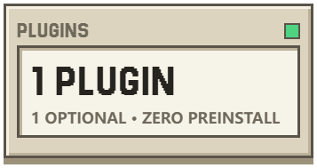
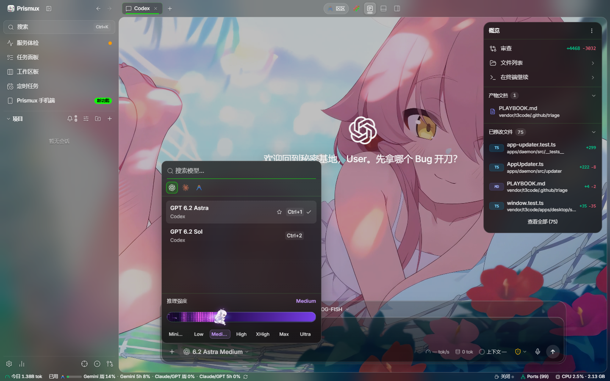
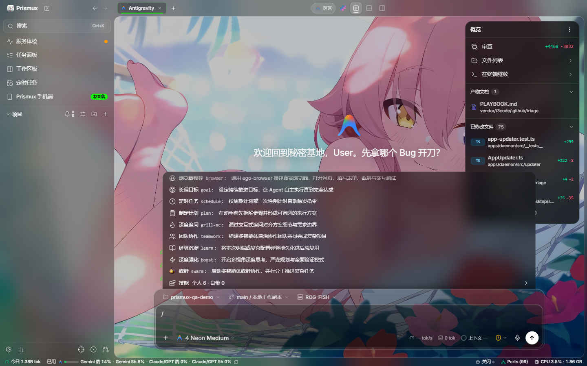

<div align="center">

<p>
  <a href="README.md"><picture><source media="(prefers-color-scheme: dark)" srcset="assets/readme/key-zh-en-dark.png"></picture></a>
  <a href="README.en.md"><picture><source media="(prefers-color-scheme: dark)" srcset="assets/readme/key-en-en-dark.png"></picture></a>
  <a href="#install"><picture><source media="(prefers-color-scheme: dark)" srcset="assets/readme/key-start-en-dark.png"></picture></a>
</p>

<picture>
  <source media="(prefers-color-scheme: dark)" srcset="assets/readme/hero-en-dark.png">
  
</picture>

<p>
  <a href="https://github.com/Fish-under-sea/Prismux/releases/tag/v0.1.3-preview.3"><picture><source media="(prefers-color-scheme: dark)" srcset="assets/readme/stat-version-en-dark.png"></picture></a>
  <a href="#preview"><picture><source media="(prefers-color-scheme: dark)" srcset="assets/readme/stat-visual-en-dark.png"></picture></a>
  <a href="#features"><picture><source media="(prefers-color-scheme: dark)" srcset="assets/readme/stat-memory-en-dark.png"></picture></a>
  <a href="#plugins"><picture><source media="(prefers-color-scheme: dark)" srcset="assets/readme/stat-plugins-en-dark.png"></picture></a>
</p>

<p>
  = 24.12">
  
  
  
  
  
</p>

<p><strong>Prismux · Local-First, Zero-Telemetry Liquid-Glass AI Workbench &amp; 24/7 Secretary</strong><br>
Command Claude Code, Codex, Antigravity, OpenCode, and OMP from one calm desktop canvas—combining native multi-agent collaboration, a 0-Token liquid-glass and live-wallpaper stage, single-file SQLite hybrid memory, and an Overnight Factory.<br>
Zero silent telemetry out of the box, 100% local data by default, and strictly zero-preinstall plugins—your workspace, your privacy, your rules.</p>

<p>
  <a href="#install"><picture><source media="(prefers-color-scheme: dark)" srcset="assets/readme/key-download-en-dark.png"></picture></a>
  <a href="https://github.com/Fish-under-sea/Prismux/releases/tag/v0.1.3-preview.3"><picture><source media="(prefers-color-scheme: dark)" srcset="assets/readme/key-release-en-dark.png"></picture></a>
  <a href="https://github.com/Fish-under-sea/Prismux/issues"><picture><source media="(prefers-color-scheme: dark)" srcset="assets/readme/key-issues-en-dark.png"></picture></a>
</p>

</div>

<h2 id="intro"><picture><source media="(prefers-color-scheme: dark)" srcset="assets/readme/section-intro-en-dark.png"></picture></h2>

**Prismux** is a local-first AI Super Workbench and 24/7 headless secretary built on the real **T3 Code** desktop runtime (Electron 44), paired with an isolated **0-Token visual shell** and an **on-demand dual-realm plugin kernel**. Whether you juggle multiple coding agents daily or leave overnight engineering runs in the background, Prismux brings sessions, live collaboration, durable memory, system diagnostics, and desktop craft into one cohesive workspace:

- **Local-First & Zero Telemetry**: Permanently severs all upstream silent telemetry, account fingerprinting, remote tracing, and cold-start phone-home calls, defaults feedback reports to zero attached logs, and redacts launch arguments, credentials, cookies, and intranet URLs end to end. Unless you explicitly enable remote sync or remote access, every byte stays 100% on your machine.
- **Unified Multi-Agent Control & Native Collaboration**: Run Claude Code, Codex, Antigravity, OpenCode, and OMP side by side and hot-swap any agent into the `Chief Thread Slot`. Switch agents with one click via the always-visible Logo-only Agent bar, dial reasoning effort with the animated `dsh-fish` slider, and follow live teamwork inside the 1:1 pixel-queen-bee AGY Swarm view or native read-only Claude Code / Codex collaboration sidebars (appearing automatically only when collaboration turns active, never intruding on idle or archived threads).
- **0-Token Liquid Glass & Live Wallpaper Stage**: Flip seamlessly between Light, Dark, and Liquid Glass via the full-width 1:1 optical Celestial capsule, fine-tune 6 independent frosted-glass zones with automatic ≥ 4.5:1 WCAG contrast clamping, and power your backdrop through a Z-0 stage supporting Image, Video, Web, WebWallGL, and Steam Wallpaper Engine (`431960`)—complete with SHA-256 permanent deduplication and `0 FPS` occlusion pause at strictly **0 LLM tokens**.
- **Single-File Hybrid Memory & 24/7 Overnight Factory**: Keep all durable memories in one local `~/.prismux/data/memory.db` file (SQLite WAL + FTS5 + `sqlite-vec`) protected by transport-level scope isolation. Let the headless daemon preserve lossless PTY history, execute scheduled jobs, and run an email-driven Overnight Factory that delivers morning HTML reports with diffs and read-only review notes.
- **Zero-Preinstall Plugins, E2EE Sync & Dual-Route Updates**: Only two official optional plugins (`qq` and `fishdock-hook`) exist—both strictly zero-preinstall with leak-free uninstall (`pet` and `ssh` are retired and built into core). Built-in Argon2id + AEAD encrypted sync and concurrent GitHub / Gitee updates keep everything effortless across networks.

> [!TIP]
> **What's New in `Prismux v0.1.3-Preview.3`**
> - **Streamlined 7-Item Right Panel & Bi-Directional Drag Sync**: Removed duplicate `PR` and `Wallpaper` actions, locking the clean default order `Associated → Diff → Files → Terminal → Browser → Phone Simulator → Side Question`; the top quick bar, bottom *Open Panel* vertical list, and `+` menu now stay synced with bi-directional drag-to-reorder and one-click reset (`v4` migration).
> - **1:1 Antigravity Native `/btw` Side Question Mode**: Unified `/btw`, right-bar, and Overview entry points with enforced `approval-required` read-only safety guardrails, hidden `btw-guardrail` context injection (keeping user bubbles 100% clean), parallel non-blocking execution, zero main-thread pollution, independent model switching, a dedicated `BTW · Read-only` header (`+ New` / `Quote to Main` / delete / close), and instant blank-draft start.
> - **Appearance Deduplication & Always-On 24-Hour Dynamic Sky Backdrop**: Removed duplicate Appearance settings rows and rebuilt the sidebar top bar (and send button) with a default declarative SVG 24-hour living sky (288 frames advancing every 5 minutes across dawn, sunlit clouds, golden dusk, and starry moonlight—paused in background, strictly 0 LLM tokens, ≥ 4.5:1 contrast all day).
> - **E2EE Sync 404 / BoringSSL Hardening & Channel Card Redesign**: Fixed `/v1/sync/config` `POST`/`PUT` 404 and Electron 44 BoringSSL `Unknown cipher` HTTP 500 crashes (`CredentialStore` upgraded to cross-runtime `PRXC02` `aes-256-gcm` with `PRXC01` fallback; `cryptoSeal` seamlessly falls back to `scrypt + aes-256-gcm`); placed inline *Save Channel* & *Test Channel* actions inside each expanded card with clear labels, inline passphrase save, auto-save before test/sync, and accurate GitHub repo permission probing.

The current release is **`Prismux v0.1.3-Preview.3`** (tag `v0.1.3-preview.3`), shipping `Prismux-Setup-0.1.3-preview.3-win-x64.exe` on GitHub Releases and Gitee Releases, with macOS and Linux channels reserved.

<h2 id="preview"><picture><source media="(prefers-color-scheme: dark)" srcset="assets/readme/section-preview-en-dark.png"></picture></h2>

> Every screenshot below is captured directly from the live **Prismux Electron 44 Windows GPU-composited desktop window**—zero mockups, zero retouching:

<table>
  <tr>
    <td width="50%" align="center" valign="top">
      
      <br>
      <sub><strong>Multi-Agent Split Workspace &amp; Z-0 Liquid Glass Stage</strong>: Translucent <code>280px</code> sidebar, <code>14px</code> rounded inner canvas over live wallpaper, multi-tab workspace with parallel right-hand agent chat, dual-layer frosted composer, and a breathing vendor-logo Chief pill.</sub>
    </td>
    <td width="50%" align="center" valign="top">
      
      <br>
      <sub><strong>Logo-Only Agent Switcher, <code>dsh-fish</code> Effort Slider &amp; Decoupled Overview</strong>: Switch agents in one click from the Model Picker with keyboard shortcuts and the 0-Token animated reasoning slider; the floating right-side <em>Overview</em> never squeezes the centered composer, while the <code>20px</code> status bar streams multi-window quota stats.</sub>
    </td>
  </tr>
  <tr>
    <td width="50%" align="center" valign="top">
      
      <br>
      <sub><strong>Bilingual Icon <code>/</code> Palette, Pixel Queen Bee <code>/swarm</code> &amp; Universal <code>/browser</code></strong>: Unified icon-prefixed bilingual layout featuring cross-agent <code>/browser</code> (auto-promoting <code>ego-browser</code>), <code>/btw</code>, and <code>/compact</code>, a 1:1 pixel queen bee SVG on <code>/swarm</code>, and cleanly folded personal/built-in skills.</sub>
    </td>
    <td width="50%" align="center" valign="top">
      
      <br>
      <sub><strong>Live Right-Drawer Wallpaper &amp; 6-Zone Frosted Glass Studio</strong>: Open <em>Appearance &amp; Glass</em> right inside the workspace sidebar to tune opacity and blur independently across all 6 glass zones (window chrome, right sidebar, main canvas, work panels, composer, and overlays) live over your wallpaper.</sub>
    </td>
  </tr>
  <tr>
    <td width="50%" align="center" valign="top">
      
      <br>
      <sub><strong>4-Group Settings Sidebar, Full-Width Celestial Capsule &amp; 6-Zone Controls</strong>: Clean 4-group navigation (preserving native <code>Archived</code>) with the full-width 1:1 Celestial tri-state capsule (<em>Light / Dark / Glass</em>) synced live with the 6-zone glass studio at ≥ 4.5:1 WCAG contrast.</sub>
    </td>
    <td width="50%" align="center" valign="top">
      
      <br>
      <sub><strong><code>20px</code> Status Bar Live System &amp; PTY Attribution + Keep Awake</strong>: Real-time CPU/RAM breakdown across Electron renderer, Server, Daemon, and active Agent/terminal processes (sortable by RAM, CPU, or name), alongside active ports and native Electron Keep Awake control.</sub>
    </td>
  </tr>
</table>

<h2 id="features"><picture><source media="(prefers-color-scheme: dark)" srcset="assets/readme/section-features-en-dark.png"></picture></h2>

<table>
  <tr>
    <td width="50%" valign="top">
      <strong>1. Unified Multi-Agent Control, Native Collaboration &amp; Zero Telemetry</strong>
      <p>The Electron 44 desktop app supervises the 24/7 <code>@prismux/daemon</code>, running Claude Code, Codex, Antigravity (strictly official <code>agy acp</code> with zero credential scraping), OpenCode, and <code>omp acp</code> side by side with instant hot-swap into the <code>Chief Thread Slot</code>.</p>
      <p>Includes the 1:1 pixel-queen-bee AGY Swarm sidebar, read-only Claude Code / Codex collaboration sidebars (auto-opening only on active transitions), always-visible Logo-only Agent switching, refined bilingual <code>/</code> commands (universal <code>/btw</code>, <code>/compact</code>, <code>/browser</code>), and full-stack zero-telemetry privacy hardening with end-to-end secret &amp; intranet-URL redaction.</p>
    </td>
    <td width="50%" valign="top">
      <strong>2. Five Core Primitives (Zero Redundant Bloat)</strong>
      <p>Intentionally excludes heavy session-detached Task Boards, AgentTeam DAGs, Skill Lens, and Visual Companion while preserving native lightweight <code>/settings/archived</code> and Orca's Workspace Board / Tasks views—focusing on five crisp primitives:</p>
      <ul>
        <li><code>PersistentPtyPool</code>: <code>2 MB</code> per-terminal ring buffer &amp; lossless reconnect replay</li>
        <li><code>HandoffEngine</code>: <code>/handoff</code> distillation &amp; <code>agent / oracle / review</code> three-mode dial</li>
        <li><code>CollectorAndGuard</code>: Multi-format slicing, transport-layer identity injection &amp; <code>60 s</code> circuit breaker</li>
        <li><code>LifecycleHookBus</code>: 6 lifecycle hook events, exit-code <code>2</code> blocks &amp; default <code>onFailure: "block"</code></li>
        <li><code>WorktreeSandbox</code>: OS-level write isolation &amp; domain-allowlisted local proxy gateway</li>
      </ul>
    </td>
  </tr>
  <tr>
    <td width="50%" valign="top">
      <strong>3. Single-File Hybrid Memory, Custom Chief &amp; Overnight Factory</strong>
      <p>All durable memories live in a single local <code>~/.prismux/data/memory.db</code> (SQLite WAL + FTS5 + <code>sqlite-vec</code>, bundled non-ASAR <code>vec0.dll</code> ready out of the box), featuring Mnemopi prompt-cache-friendly recall, custom Chief naming + persistent <code>~/.prismux/chief/AGENTS.md</code> rules, and curated Obsidian Vault import. Transport-level <code>forwardIdentity</code> locks group-chat queries away from <code>private/chief</code> and <code>workspace/*</code>.</p>
      <p><code>OvernightFactory</code> automates Gmail OAuth2 / IMAP <code>#factory</code> intake → memory-enriched Handoff → isolated <code>git worktree</code> coding → read-only Oracle <code>review</code> → HTML morning briefing with diffs and <code>prismux://review/&lt;threadId&gt;</code> deep links.</p>
    </td>
    <td width="50%" valign="top">
      <strong>4. 0-Token Liquid Glass, 6-Zone Controls &amp; Live Wallpaper Stage</strong>
      <p><code>@prismux/appearance</code> unites the full-width 1:1 optical Celestial tri-state capsule, <strong>6-zone</strong> live independent glass controls (window chrome, right sidebar, main canvas, work panels, composer &amp; cards, overlays &amp; settings) with ≥ 4.5:1 contrast clamping, the <code>dsh-fish</code> model-aware animated effort slider, AGY capsule user bubbles, and 4-sided Liquid Glass sidebar cards with active RGB marquee.</p>
      <p><code>@prismux/wallpaper</code> powers a Z-0 multi-source stage (Image, Video, Web, WebWallGL, and Steam Wallpaper Engine <code>431960</code>) with a decluttered right-side studio, SHA-256 permanent deduplication, and <code>0 FPS</code> occlusion pause—at strictly <strong>0 LLM tokens</strong>.</p>
    </td>
  </tr>
  <tr>
    <td width="50%" valign="top">
      <strong>5. Desktop Craft, 20px Status Bar &amp; 4-Tier Diagnostics</strong>
      <p>Features a clean <code>54px</code> collapsed icon rail (instant click-to-expand + shared <code>100ms</code> right-side tooltips, zero intrusive hover overlay), a singleton blank draft tab, a decoupled floating Overview panel that never squeezes the centered composer, and host-timezone auto-detection across 10 languages without overriding manual choices.</p>
      <p>The crisp <code>20px</code> status bar brings together daily usage, synced Orca detailed/compact multi-window quota pills, real-time Electron + Daemon + PTY process attribution, active port monitor, native Electron <code>powerSaveBlocker</code> Keep Awake (<code>On / Agent / Off</code>), Windows System Tray, zero-dependency Phone Simulator, and 4-tier Liquid Glass Service Diagnostics.</p>
    </td>
    <td width="50%" valign="top">
      <strong>6. Cordis On-Demand Plugins, E2EE Sync &amp; Dual-Route Updates</strong>
      <p><code>@prismux/cordis-kernel</code> enforces top-level <code>engines.prismux</code> SemVer, zero-leak <code>ctx.effect()</code> teardown, <code>512 KiB</code>-budget declarative liquid-glass UIs, <code>distribution: "managed"</code> locks, <code>0600</code> per-plugin secrets, and script-free npm tarball streaming without calling <code>git</code>.</p>
      <p><code>@prismux/sync-vault</code> seals <code>.prismux-backup</code> payloads with Argon2id + AEAD across WebDAV, S3, and GitHub (<code>If-Match</code> locking, <code>60 s</code> stall watchdog, portable <code>data/</code> mode). Dual-route updates race <strong>GitHub ↔ Gitee</strong> and <strong>npm ↔ npmmirror</strong>, with weighted real-time progress for <code>80 MB</code> Gitee split volumes, mandatory SHA-256 checks, and rich in-app Markdown release notes.</p>
    </td>
  </tr>
</table>

<h2 id="plugins"><picture><source media="(prefers-color-scheme: dark)" srcset="assets/readme/section-plugins-en-dark.png"></picture></h2>

> [!NOTE]
> **Two Active Official Plugins Are Strictly Never Preinstalled**: Neither `Prismux-Setup-0.1.3-preview.3-win-x64.exe` nor the unpacked desktop bundle contains any directory from `plugins-official/` (verified at 0 hits across the packaged tree). Both active official plugins (`qq` and `fishdock-hook`) ship independently as verified `.wb-plugin` archives (indexed by `prismux-plugins-official.json` and `prismux-plugins-0.1.3-preview.3-SHA256SUMS.txt`) and script-free npm single packages, installing strictly on demand with `ctx.effect()` zero-leak teardown.
>
> **Retired Plugins Notice**: `pet` (`@prismux/plugin-pet`) and `ssh` (`@prismux/plugin-ssh`) have been retired and removed from the official catalog and release pipeline — **Deprecated: Replaced by Prismux built-in capabilities**.

| Plugin ID | Archive (`.wb-plugin`) | npm Package (Unscoped / GitHub Packages) | Realms | Capabilities &amp; Isolation |
| :--- | :--- | :--- | :--- | :--- |
| `qq` | `prismux-plugin-qq-0.1.3-preview.3.wb-plugin` | `prismux-plugin-qq`<br><code>@fish-under-sea/prismux-plugin-qq</code> | `daemon`, `ui` | OneBot v11 forward/reverse WebSocket probe (NapCatQQ / Lagrange.Core); owner DMs route to the Chief slot while authorized QQ groups use anti-spam pacing hard-isolated to <code>social/qq-group-&lt;gid&gt;</code> |
| `fishdock-hook` | `prismux-plugin-fishdock-hook-0.1.3-preview.3.wb-plugin` | `prismux-plugin-fishdock-hook`<br><code>@fish-under-sea/prismux-plugin-fishdock-hook</code> | `daemon` | Bridges `PreToolUse` risk approvals, priority mail alerts, and Overnight Factory completions to FISH-Dock Dynamic Island cards with instant approve/reject actions |

### Plugin Authoring &amp; Official Documentation

Building a custom Prismux plugin or delegating it to a Coding Agent? Follow the two source-verified official guides below (or open **Settings → Plugins** and click **Creator Guide** to copy a pre-built Agent prompt in one click):

- **Prismux Plugin Development Guide**: [`docs/plugins/plugin-development-guide.md`](docs/plugins/plugin-development-guide.md) — Cordis dual-realm (`daemon` + `ui`) architecture, top-level `engines.prismux` SemVer contract, zero-leak `ctx.effect()` teardown, declarative liquid-glass UI (`ui: "components"`), `0600` encrypted credentials, `pnpm plugin:pack` roundtrip packaging, and a ready-to-copy minimal scaffold.
- **Official Lifecycle Hooks &amp; Light / Dark / Liquid Glass Theme Tokens**: [`docs/plugins/official-hooks-and-theme-tokens.md`](docs/plugins/official-hooks-and-theme-tokens.md) — Full `LifecycleHookBus` 6-event reference (`SessionStart`, `PreToolUse`, `PostToolUse`, `Notification`, `SubagentStop`, `Stop`), exit-code `2` blocking, 4-tier permission gating, and the complete reference for host DOM attributes, 6 liquid-glass zones, and WCAG AA semantic color tokens.

<h2 id="install"><picture><source media="(prefers-color-scheme: dark)" srcset="assets/readme/section-install-en-dark.png"></picture></h2>

### Dual-Route Release Channels (GitHub Releases ↔ Gitee Releases)

| Channel | Best For | Release &amp; Download Details |
| :--- | :--- | :--- |
| **GitHub Releases** (Global) | Direct global network / GitHub CLI environments | [Prismux v0.1.3-Preview.3 Release](https://github.com/Fish-under-sea/Prismux/releases/tag/v0.1.3-preview.3) · [Direct `Prismux-Setup-0.1.3-preview.3-win-x64.exe`](https://github.com/Fish-under-sea/Prismux/releases/download/v0.1.3-preview.3/Prismux-Setup-0.1.3-preview.3-win-x64.exe) |
| **Gitee Releases** (Mainland China Mirror) | High-speed direct downloads inside mainland China | [Prismux v0.1.3-Preview.3 Release](https://gitee.com/Fish-under-sea/Prismux/releases/tag/v0.1.3-preview.3) (includes `80 MB` split `.7z.001..003` volumes, consolidated checksums, and active official plugin archives) |
| **In-App Update Center** (Recommended) | Concurrent latency probing, weighted split progress &amp; mandatory SHA-256 verification | Open **Settings → About &amp; Updates** (`/settings/about#prismux-updates`) to switch between `Auto / Domestic First / Global First`, browse rich release notes, and install with one click |

### Platform Downloads &amp; Integrity Verification

| Platform / Release Asset | Filename / Availability | Details &amp; Isolation |
| :--- | :--- | :--- |
| **Windows x64 Installer (Electron 44 NSIS)** | `Prismux-Setup-0.1.3-preview.3-win-x64.exe` (Gitee also provides `.7z.001..003`) | Full Electron 44 desktop app with bundled `resources/prismux-daemon/`, non-ASAR `resources/native/sqlite-vec/vec0.dll`, `resources/tools/7za.exe`, and `t3-resource-monitor.exe`; defaults to per-user `%LOCALAPPDATA%\Programs\Prismux` (supports custom paths, optional desktop shortcut &amp; `/D=<dir>`); keeps state isolated in `~/.prismux/` (plus portable `data/` mode); **zero preinstalled official plugins** |
| **macOS (Apple Silicon / Intel)** | `Coming soon (Channel reserved)` | Planned `.dmg` builds will follow the exact same `0-Token` visual separation and `~/.prismux/` isolation guarantees |
| **Linux (x86_64 / arm64)** | `Coming soon (Channel reserved)` | Planned `.AppImage` / `.deb` packages will support dual-route updates and verified on-demand plugin import |
| **2 Active Official Plugin Archives** | `prismux-plugin-{qq,fishdock-hook}-0.1.3-preview.3.wb-plugin` &amp; `prismux-plugins-official.json` | Deterministic ustar + gzip bundles for on-demand verified import via `/settings/plugins` (`pet` &amp; `ssh` retired: replaced by built-in capabilities) |
| **Consolidated Checksums** | `Prismux-0.1.3-preview.3-SHA256SUMS.txt` &amp; `prismux-plugins-0.1.3-preview.3-SHA256SUMS.txt` | Verify manual downloads with `Get-FileHash Prismux-Setup-0.1.3-preview.3-win-x64.exe -Algorithm SHA256` or `7z t` |

<h2 id="packages"><picture><source media="(prefers-color-scheme: dark)" srcset="assets/readme/section-packages-en-dark.png"></picture></h2>

Each active official plugin is also published as a **script-free (`preinstall / install / postinstall` disabled)** standalone npm package bundling its SHA-256-verified `prismux-plugin-<id>-0.1.3-preview.3.wb-plugin` archive and an overwrite-safe export CLI (`prismux-plugin-<id>`). Inside the Plugin Center, community and official tarballs stream directly over HTTPS with automatic failover between **`registry.npmjs.org` ↔ `registry.npmmirror.com`** and zero local `git` invocation.

```powershell
# 1. Install and extract a verified .wb-plugin archive from npmjs
npm install prismux-plugin-qq@0.1.3-preview.3
npx prismux-plugin-qq --out ./plugins-stage

# 2. Use the npmmirror domestic registry in mainland China
npm install prismux-plugin-qq@0.1.3-preview.3 --registry=https://registry.npmmirror.com
npx prismux-plugin-qq --out ./plugins-stage
```

- **Other Official Plugin**: Swap `qq` for `fishdock-hook`, then import the extracted `.wb-plugin` file via **Settings → Plugins** (`/settings/plugins`) (`pet` and `ssh` are retired: replaced by Prismux built-in capabilities).
- **GitHub Packages Mirror**: Published releases sync `@fish-under-sea/prismux-plugin-{qq,fishdock-hook}` to `https://npm.pkg.github.com`.

<h2 id="develop"><picture><source media="(prefers-color-scheme: dark)" srcset="assets/readme/section-develop-en-dark.png"></picture></h2>

> **Prerequisites**: `Node.js >= 24.12.0`, `pnpm >= 10.0.0` (repo pins `pnpm@12.3.4`), `Electron 44`, and `Rust >= 1.85` (for `vendor/t3code/native/resource-monitor`; pass `-j 1` and `NO_PROXY=*` on Windows). Read [`AGENTS.md`](AGENTS.md), [`docs/t3code-patch-manifest.md`](docs/t3code-patch-manifest.md), and your contributor profile `docs/agents/local/<normalized-username>.md` first.

```powershell
# 1. Install workspace dependencies (10 TypeScript workspace packages)
pnpm install

# 2. Build, typecheck, and test all root workspace packages and ops scripts
pnpm -r build
pnpm -r typecheck
pnpm -r --if-present test
pnpm test:scripts

# 3. Verify the vendor/t3code managed-fork lock contract and patch manifest
pnpm upstream:check

# 4. Typecheck and build the Electron 44 T3 Code runtime (web + server + desktop)
pnpm --dir vendor/t3code exec vp run --filter @t3tools/web typecheck
pnpm --dir vendor/t3code exec vp run --filter @t3tools/desktop typecheck
pnpm --dir vendor/t3code exec vp run build:desktop

# 5. Orchestrate full desktop build & Windows NSIS installer (with 7z check & SHA256SUMS)
pnpm desktop:build
pnpm desktop:installer

# 6. Deterministically pack an official plugin (.wb-plugin + gunzip loopback check)
pnpm plugin:pack -- --plugin plugins-official/plugin-qq
```

<details>
<summary><strong>Expand: Monorepo Structure &amp; T3 Code Minimal-Invasion Boundary</strong></summary>

```text
prismux/
├── AGENTS.md                            # Cross-machine engineering rules, guardrails & DoD gates
├── LICENSE                              # Standard MIT License
├── README.md / README.en.md             # Bilingual project homepages
├── UPSTREAM_LOCK.json                   # pingdotgg/t3code baseline SHA, managed-fork mode & manifest pointer
├── pnpm-workspace.yaml                  # 10 TS workspace packages (excludes vendor/t3code & desktop-tauri)
├── package.json                         # Root orchestration scripts (0.1.3-preview.3)
├── tsconfig.base.json                   # Shared strict TypeScript 5.8+ baseline (ES2024 + NodeNext)
├── assets/
│   ├── logo.png                         # Transparent 1024×1024 mascot master icon
│   └── readme/                          # Pixel-art headers, section banners, live screenshots & templates
├── docs/
│   ├── t3code-patch-manifest.md         # Authoritative registry of MP-01 ~ MP-07 T3 Code mounts & extensions
│   ├── agents/                          # Per-developer local environment profiles & templates
│   ├── releases/v0.0.1-alpha.1.md       # Archived initial prototype release notes
│   └── specs/
│       ├── master-prompt-v1.3.md        # Full-stack architectural constitution
│       └── ui-ux-design-mandate.md      # Mandatory UI/UX, theme & installer specification
├── scripts/                             # Operational tooling & README renderer (Node 24 native TS / ESM)
│   ├── build-prismux-desktop.ts         # Unified desktop & NSIS installer orchestrator (--installer / --skip-rust)
│   ├── release-all.ts                   # Desktop + 2 active official plugins + npm packages + SHA256SUMS bundler
│   ├── sync-t3-upstream.ts              # managed-fork / upstream lock verifier (--check / --sync)
│   ├── pack-plugin.ts                   # Deterministic ustar + gunzip loopback plugin packer
│   ├── build-npm-plugin-packages.ts     # Script-free npm & GitHub Packages generator
│   ├── rename-brand.ts                  # Safe repository-wide brand identifier renamer
│   ├── render-readme.mjs                # Edge CDP pixel-header & section-banner renderer
│   └── __tests__/scripts.test.ts        # node:test regression suite
├── vendor/
│   └── t3code/                          # T3 Code base (Electron 44 + server + web), tracked by MP-01 ~ MP-07
├── packages/                            # 6 core workspace packages
│   ├── protocol/                        # @prismux/protocol: brand, RPC, hooks, memory, plugin & updater types
│   ├── cordis-kernel/                   # @prismux/cordis-kernel: dual-realm host, declarative UI, dual-route installer & 0600 secrets
│   ├── memory-core/                     # @prismux/memory-core: SQLite WAL + FTS5 + sqlite-vec, Mnemopi recall & query isolation
│   ├── sync-vault/                      # @prismux/sync-vault: Argon2id + AEAD sync, optimistic locks & 60 s watchdog
│   ├── prismux-appearance/              # @prismux/appearance: full-width Celestial capsule, 6-zone glass, effort slider & T3 glass bridge
│   └── prismux-wallpaper/               # @prismux/wallpaper: decluttered wallpaper studio, Z-0 stage, SHA-256 dedup & Steam 431960
├── apps/                                # Headless daemon (+ retiring prototype & historical shell)
│   ├── daemon/                          # @prismux/daemon: 24h supervisor, Chief slot, 5 primitives, 4-tier diagnostics, ports & factory
│   ├── workbench-ui/                    # @prismux/workbench-ui: [retiring prototype] v0.0.1 shell superseded by T3 Code base
│   └── desktop-tauri/                   # prismux-desktop: [historical shell] superseded by T3 Code Electron 44
└── plugins-official/                    # 2 active optional official plugins (workspace packages) + catalog (pet/ssh retired)
    ├── catalog/official.json            # Authoritative plugin index (active qq / fishdock-hook + retiredPlugins notices)
    ├── plugin-qq/                       # @prismux/plugin-qq
    └── plugin-fishdock-hook/            # @prismux/plugin-fishdock-hook
```

</details>

<details>
<summary><strong>Expand: Five Non-Negotiable Engineering Guardrails</strong></summary>

1. **Minimal-Invasion Layering on T3 Code**: `vendor/t3code/` changes remain strictly registered in [`docs/t3code-patch-manifest.md`](docs/t3code-patch-manifest.md) with zero edits to `vendor/t3code/pnpm-lock.yaml`; heavy domain logic and visual engines reside in root `packages/*` and `apps/daemon`.
2. **Never reintroduce the 4 eliminated bloat modules (native lightweight archiving & Orca lightweight Workspace Board / Tasks preserved)**: Heavy session-detached Task Boards, AgentTeam DAG, Skill Lens, Visual Companion, and custom heavy Session Archive backends remain excluded in favor of the five core primitives; T3 Code's native lightweight `/settings/archived` view and Orca's lightweight `/workspace-board` & `/tasks` views are preserved per project decision.
3. **Single-file hybrid memory & physical isolation**: All memories reside in `~/.prismux/data/memory.db` (SQLite WAL + FTS5 + `sqlite-vec`) with zero PostgreSQL / Qdrant / MinIO / Obsidian client dependencies, enforced at transport level via `_callerScope`.
4. **Official plugins are never preinstalled**: Active official plugins `qq` and `fishdock-hook` remain isolated in `plugins-official/` and are excluded from desktop installers, installed strictly on demand (`pet` and `ssh` are retired and replaced by Prismux built-in capabilities).
5. **Zero model token cost for the visual layer**: Wallpapers, 360° Fresnel liquid glass, animated model effort sliders, typography tinting, audio FFT sync, desktop pet staging, and installer screens inject zero tool schemas or prompts into any LLM.

</details>

<details>
<summary><strong>Expand: M1–M5 &amp; v0.1.0–v0.1.3-Preview.3 Evolution Milestones</strong></summary>

| Milestone | Scope Delivered | Status |
| :--- | :--- | :--- |
| **M1** | Monorepo scaffold, T3 Code baseline lock, `apps/daemon` supervision, env sanitization, Chief Thread Slot &amp; `2 MB` ring-buffered `PersistentPtyPool` | Complete &amp; Verified |
| **M2** | Single-file SQLite WAL + FTS5 + `sqlite-vec` memory (out-of-the-box non-ASAR `vec0.dll`), Mnemopi prompt-cache recall, `forwardIdentity` isolation, `LifecycleHookBus`, `HandoffEngine` &amp; `WorktreeSandbox` | Complete &amp; Verified |
| **M3** | `cordis-kernel` (prerelease-compatible `engines.prismux`, zero-leak `ctx.effect()`, multi-source verified download, declarative glass UI, script-free npm tarball installer, `managed` lock) &amp; `sync-vault` (Argon2id + AEAD, `If-Match`, `60 s` stall watchdog, portable `data/`) | Complete &amp; Verified |
| **M4 / v0.1.0–v0.1.2** | `@prismux/appearance` &amp; `@prismux/wallpaper` extraction, real T3 Code Electron 44 runtime integration (6-zone live glass studio, full-width Celestial capsule, `dsh-fish` effort slider, direct Windows Codex launch, official `agy acp` quota integration, per-user NSIS installer, redesigned Plugin Center &amp; two source-verified plugin guides) | Complete &amp; Live-Verified |
| **M5** | `OvernightFactory` end-to-end closed loop, deterministic `.wb-plugin` packaging/verification for active official plugins (`qq`, `fishdock-hook`), and dual-route split auto-updates (`pet` &amp; `ssh` retired) | Complete &amp; Verified |
| **v0.1.3–v0.1.3-Preview.3** | Full-stack zero-telemetry privacy cutoff &amp; end-to-end redaction, 1:1 AGY Swarm &amp; Claude Code / Codex read-only collaboration sidebars, streamlined 7-item right panel with bi-directional drag sync, 1:1 native `/btw` read-only side questions with isolated model selection, always-on 24h 288-frame SVG dynamic sky backdrop, Logo-only Agent switcher &amp; bilingual icon `/` palette, `54px` icon rail, `20px` Orca quota bar &amp; 4-tier Liquid Glass Diagnostics, plus Electron 44 BoringSSL E2EE sync hardening and Gitee split rich Markdown updates | Complete &amp; Live-Verified |

</details>

<h2 id="thanks"><picture><source media="(prefers-color-scheme: dark)" srcset="assets/readme/section-thanks-en-dark.png"></picture></h2>

### Documentation Index

| Document | Purpose |
| :--- | :--- |
| [`AGENTS.md`](AGENTS.md) | Cross-machine engineering rules, five guardrails, script/plugin contracts &amp; commit conventions |
| [`docs/t3code-patch-manifest.md`](docs/t3code-patch-manifest.md) | Authoritative registry of T3 Code minimal-invasion mounts, Provider extensions &amp; upstream merge guide |
| [`docs/plugins/plugin-development-guide.md`](docs/plugins/plugin-development-guide.md) | Complete Prismux plugin authoring guide (Cordis dual-realm, declarative UI, `0600` secrets &amp; packaging) |
| [`docs/plugins/official-hooks-and-theme-tokens.md`](docs/plugins/official-hooks-and-theme-tokens.md) | Official 6-event `LifecycleHookBus` hook reference &amp; Light / Dark / Liquid Glass theme token guide |
| [`docs/specs/ui-ux-design-mandate.md`](docs/specs/ui-ux-design-mandate.md) | UI/UX craftsmanship, Celestial tri-state capsule, liquid-glass sync contract &amp; installer mandate |
| [`docs/specs/master-prompt-v1.3.md`](docs/specs/master-prompt-v1.3.md) | Full-stack autonomous build specification (architectural constitution) |
| [`docs/agents/README.md`](docs/agents/README.md) | Contributor local environment profile naming rules, template &amp; maintenance workflow |
| [`docs/releases/v0.0.1-alpha.1.md`](docs/releases/v0.0.1-alpha.1.md) | Archived initial prototype release notes |
| [`assets/readme/MAINTAINING.md`](assets/readme/MAINTAINING.md) | README pixel-art header/banner rendering workflow, dimensions &amp; CDN cache guide |

### Upstream Credits &amp; MIT Open-Source Attributions

- [pingdotgg/t3code](https://github.com/pingdotgg/t3code) (MIT): Upstream Electron 44 + `apps/server` + `apps/web` runtime and provider bridge core.
- [stablyai/orca](https://github.com/stablyai/orca) (MIT): Reference for port scanning &amp; resource monitoring, ultra-compact status bar, multi-window quota bar, Orca sidebar &amp; workspace workflows, `omp` dialect, and declarative plugin UI.
- [can1357/oh-my-pi](https://github.com/can1357/oh-my-pi) (MIT): Reference for Mnemopi prompt-cache-friendly recall &amp; scoped caches, `omp acp` `_session/steering` / `_omp/usage`, and status-bar telemetry gauges.
- `dsh-better-reasoning-effort-fish` ([HanaAyane/dsh-reasoning-effort](https://github.com/HanaAyane/dsh-reasoning-effort) PR #9 + [HaoyueQin/dsh-better-reasoning-effort](https://github.com/HaoyueQin/dsh-better-reasoning-effort), MIT): Source for the model-recognizing animated reasoning effort slider (`<PrismuxReasoningEffortSlider />`, 8 model family themes &amp; RGBA WebP runners).
- [yetone/magpie](https://github.com/yetone/magpie): Inspiration for passphrase-sealed AEAD sync, `If-Match` optimistic locking, 60-second stall watchdogs, and portable mode.
- [Amp](https://ampcode.com/): Inspiration for `/handoff` distillation and `agent / oracle / review` dial workflows.
- [FISH-Dock](https://github.com/Fish-under-sea/FISH-Dock): Reference for the Warm Paper / Dark Olive stereomorphic README design system, 1:1 Celestial capsule &amp; 360° Fresnel liquid-glass theme hooks, and Dynamic Island approval bridging.

### License Boundary

Prismux core source code and README layout tooling are licensed under the **MIT License** (see [`LICENSE`](LICENSE)); the bundled pixel font `Jersey20-Regular.ttf` is licensed under [SIL Open Font License 1.1](assets/readme/OFL-Jersey20.txt); the managed `vendor/t3code` fork and ported MIT references above preserve their original MIT licenses and notices.

<p align="center"><sub>Prismux v0.1.3-Preview.3 · Local-First Zero Telemetry · Multi-Agent Super Workbench · 0-Token Visual Layer · 2 Optional Official Plugins</sub></p>
