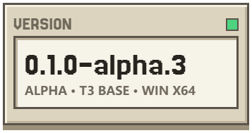
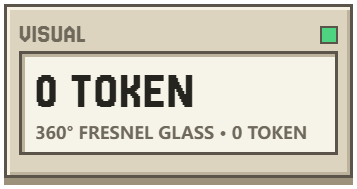
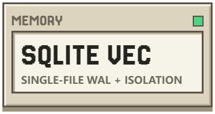
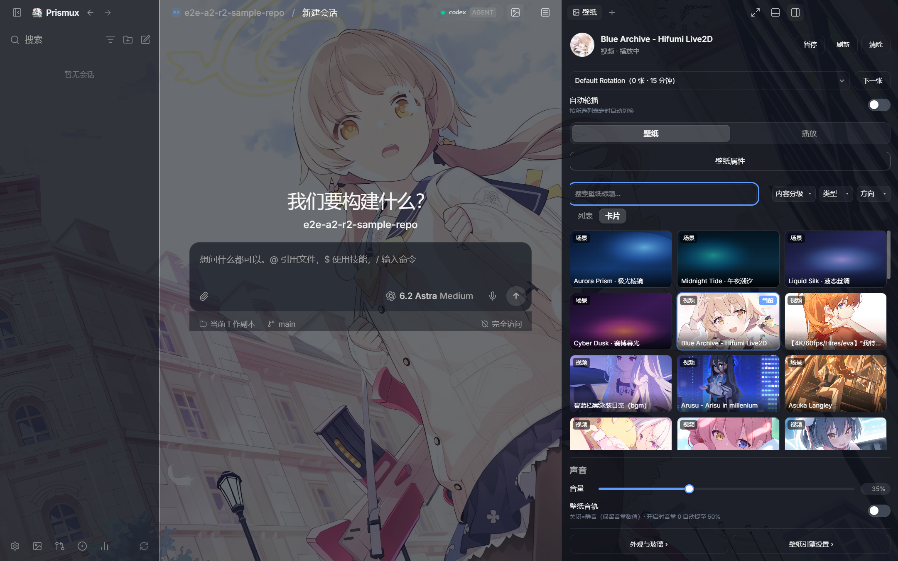
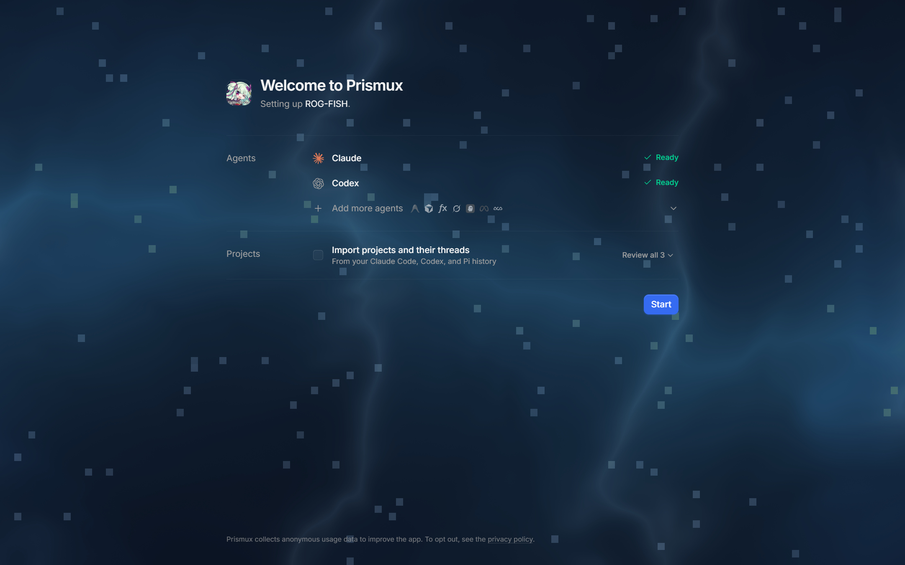
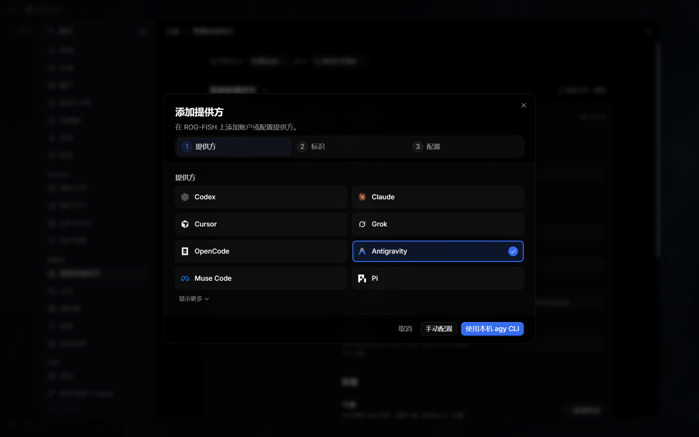
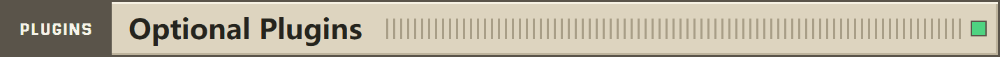
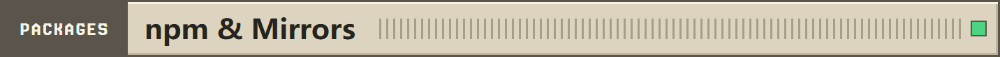

<div align="center">

<p>
  <a href="README.md"><picture><source media="(prefers-color-scheme: dark)" srcset="assets/readme/key-zh-en-dark.png"></picture></a>
  <a href="README.en.md"><picture><source media="(prefers-color-scheme: dark)" srcset="assets/readme/key-en-en-dark.png"></picture></a>
  <a href="#install"><picture><source media="(prefers-color-scheme: dark)" srcset="assets/readme/key-start-en-dark.png"></picture></a>
</p>

<picture>
  <source media="(prefers-color-scheme: dark)" srcset="assets/readme/hero-en-dark.png">
  
</picture>

<p>
  <a href="https://github.com/Fish-under-sea/Prismux/releases/tag/v0.1.0-alpha.3"><picture><source media="(prefers-color-scheme: dark)" srcset="assets/readme/stat-version-en-dark.png"></picture></a>
  <a href="#preview"><picture><source media="(prefers-color-scheme: dark)" srcset="assets/readme/stat-visual-en-dark.png"></picture></a>
  <a href="#features"><picture><source media="(prefers-color-scheme: dark)" srcset="assets/readme/stat-memory-en-dark.png"></picture></a>
  <a href="#plugins"><picture><source media="(prefers-color-scheme: dark)" srcset="assets/readme/stat-plugins-en-dark.png"></picture></a>
</p>

<p>
  = 24.12">
  
  
  
  
  
</p>

<p><strong>Prismux · Minimalist Liquid-Glass AI Super Workbench &amp; 24/7 Secretary</strong><br>Built on a minimal-invasion T3 Code runtime (Electron 44 + <code>apps/server</code> + <code>apps/web</code>), uniting a 1:1 FISH-Dock Celestial tri-state capsule, live 4K video wallpapers across Light / Dark / Liquid-Glass modes, local <code>agy</code> CLI sign-in reuse for Antigravity, isolated single-file SQLite memory, four strictly optional plugins, and dual-route updates.</p>

<p>
  <a href="#install"><picture><source media="(prefers-color-scheme: dark)" srcset="assets/readme/key-download-en-dark.png"></picture></a>
  <a href="https://github.com/Fish-under-sea/Prismux/releases/tag/v0.1.0-alpha.3"><picture><source media="(prefers-color-scheme: dark)" srcset="assets/readme/key-release-en-dark.png"></picture></a>
  <a href="https://github.com/Fish-under-sea/Prismux/issues"><picture><source media="(prefers-color-scheme: dark)" srcset="assets/readme/key-issues-en-dark.png"></picture></a>
</p>

</div>

<h2 id="intro"><picture><source media="(prefers-color-scheme: dark)" srcset="assets/readme/section-intro-en-dark.png"></picture></h2>

Prismux is an AI Super Workbench and 24/7 headless secretary built around **a real T3 Code core, an isolated 0-Token visual layer, and strictly on-demand plugins**. Powered by a managed **T3 Code fork** (Electron 44 + `apps/server` + `apps/web` integrated via [`docs/t3code-patch-manifest.md`](docs/t3code-patch-manifest.md) with zero changes to `vendor/t3code/pnpm-lock.yaml`), `v0.1.0-alpha.3` delivers four major user-reported improvements and onboarding polish:

- **Branded `/welcome` Onboarding Restored**: First-time desktop launches enter the Prismux-branded `/welcome` setup wizard (Ciallo mascot, offline cloud-hide, zero white flash), with a "Reopen onboarding" button under General and About settings.
- **End-to-End Live Wallpaper Playback & Dual-Mode Transparency**: Fixed legacy 99% scrim blackout, cold-start daemon timing, and non-glass background occlusion so Steam `431960` 4K videos, local media, and WebWallGL shaders render cleanly in Dark, Light, and Liquid-Glass modes while dropping to 0 FPS when occluded.
- **Zero-Duplicate Appearance & Wallpaper Settings + Full Chinese Localization**: Consolidated all 6 appearance cards into `/settings/appearance`, streamlined `/settings/wallpaper` (4 tabs) and the right sidebar (`Wallpaper / Playback`), and shipped full `gt-react` `zh.json` translations across all 10 locales.
- **Built-In Antigravity 100% Pure Official ACP Compliance**: Launches local `agy acp` cleanly with honest `prismux` client identification—**zero local OAuth token/keyring extraction, zero `cloudcode-pa` `v1internal` polling, zero forged User-Agents, and zero legacy `"zed"` spoofing**—while surfacing official `_meta.antigravity.tier` subscription plans and per-model `thought_level` sync (directing users to official `agy` `/usage` and `/credits` for quota/credit balances).
- **Four Official Plugins Never Preinstalled**: `qq`, `pet`, `fishdock-hook`, and `ssh` ship solely as independent `.wb-plugin` archives and script-free npm packages, with zero external database servers (`~/.prismux/` or portable `data/`).

The current pre-release is **`v0.1.0-alpha.3`**, shipping `Prismux-Setup-0.1.0-alpha.3-win-x64.exe` across GitHub Releases and Gitee Releases.

<h2 id="preview"><picture><source media="(prefers-color-scheme: dark)" srcset="assets/readme/section-preview-en-dark.png"></picture></h2>

> All screenshots below are captured directly from the running **Prismux `v0.1.0-alpha.3` Electron 44 Windows binary (`1440×900`)** during R2 sign-off—no mockups:

<table>
  <tr>
    <td width="50%" align="center" valign="top">
      
      <br>
      <sub><strong>4K Video Wallpaper Playback (Dark Mode) &amp; Two-Tab Sidebar</strong>: Steam <code>431960</code> 4K H.264 video plays via <code>206</code> streaming directly behind the dark workbench while the deduplicated right sidebar focuses on <code>Wallpaper / Playback</code> with direct links to Appearance &amp; Wallpaper Settings.</sub>
    </td>
    <td width="50%" align="center" valign="top">
      
      <br>
      <sub><strong>Liquid-Glass Mode over Live 4K Video</strong>: Real <code>backdrop-filter</code> frosted diffusion, 360° Fresnel glass borders, and a seamless left sidebar layered over live video while maintaining ≥ 4.5:1 text contrast.</sub>
    </td>
  </tr>
  <tr>
    <td width="50%" align="center" valign="top">
      
      <br>
      <sub><strong>Localized Settings Sidebar &amp; Unified 6-Card Appearance Hub</strong>: Full Simplified Chinese sidebar navigation for the <code>Prismux</code> group alongside the 1:1 FISH-Dock Celestial tri-state capsule and consolidated glass/corners/palette/font controls (<strong>0 LLM tokens</strong>).</sub>
    </td>
    <td width="50%" align="center" valign="top">
      
      <br>
      <sub><strong><code>Welcome to Prismux</code> First-Run Onboarding</strong>: Branded welcome screen with the Ciallo logo, automatic Claude / Codex readiness checks, project history import, and zero-block offline flow into the workbench.</sub>
    </td>
  </tr>
  <tr>
    <td width="50%" align="center" valign="top">
      
      <br>
      <sub><strong>Built-In Antigravity Local <code>agy</code> CLI Reuse</strong>: One-click "Use local agy CLI" setup via the official <code>agy acp</code> channel with the native Google Antigravity icon, official tier label, and per-model <code>thought_level</code> sync.</sub>
    </td>
    <td width="50%" align="center" valign="top">
      
      <br>
      <sub><strong><code>v0.1.0-alpha.3</code> Dual-Route Update Center</strong>: Live daemon-backed updater displaying runtime version and portable status, racing <strong>GitHub ↔ Gitee</strong> and <strong>npmjs ↔ npmmirror</strong> with optional mirror prefixes.</sub>
    </td>
  </tr>
</table>

<h2 id="features"><picture><source media="(prefers-color-scheme: dark)" srcset="assets/readme/section-features-en-dark.png"></picture></h2>

<table>
  <tr>
    <td width="50%" valign="top">
      <strong>1. T3 Code Mount Core, Local <code>agy</code> CLI &amp; 24/7 Daemon</strong>
      <p>The Electron 44 desktop app (<code>PrismuxDaemonService</code>) supervises <code>@prismux/daemon</code> with <code>ELECTRON_RUN_AS_NODE=1</code> strictly scoped to the daemon child process, opens the branded <code>/welcome</code> wizard on fresh runs, and lets you hot-swap Claude, Codex, Antigravity, or OpenCode in the <code>Chief Thread Slot</code>.</p>
      <p>Built-in Antigravity runs strictly over the official <code>agy acp</code> channel in <code>local-cli</code> mode—zero token/keyring scraping and zero <code>v1internal</code> quota bypasses—while surfacing official subscription tiers and per-model <code>thought_level</code> capabilities on model switches.</p>
    </td>
    <td width="50%" valign="top">
      <strong>2. Five Core Primitives (Zero Bloat Panels)</strong>
      <p>Replaces Task Boards, AgentTeam DAGs, Skill Lens, Visual Companions, and Session Archives with five sharp engineering primitives:</p>
      <ul>
        <li><code>PersistentPtyPool</code>: <code>2 MB</code> per-terminal ring buffer &amp; lossless reconnect replay</li>
        <li><code>HandoffEngine</code>: <code>/handoff</code> distillation &amp; <code>agent / oracle / review</code> dial modes</li>
        <li><code>CollectorAndGuard</code>: Multi-format slicing, identity injection &amp; <code>60 s</code> breaker</li>
        <li><code>LifecycleHookBus</code>: 6 deterministic hook events, exit-code <code>2</code> blocks &amp; <code>onFailure: "block"</code></li>
        <li><code>WorktreeSandbox</code>: OS-level write isolation &amp; domain-allowlisted proxy gateway</li>
      </ul>
    </td>
  </tr>
  <tr>
    <td width="50%" valign="top">
      <strong>3. Single-File Isolated Memory &amp; <code>OvernightFactory</code></strong>
      <p>All memories reside inside <code>~/.prismux/data/memory.db</code> (SQLite WAL + FTS5 + <code>sqlite-vec</code> hybrid RRF search) with a <code>POST /v1/memory/import-obsidian</code> migration API. <code>forwardIdentity</code> overwrites <code>_callerScope</code> at the transport layer so <code>qq_group:&lt;gid&gt;</code> can never read <code>private/chief</code> or <code>workspace/*</code>.</p>
      <p><code>OvernightFactory</code> automates Gmail OAuth2 / IMAP <code>#factory</code> ingestion → memory-enriched Handoff → sandboxed <code>git worktree</code> coding &amp; branch commit → read-only Oracle <code>review</code> → HTML morning report with diff &amp; <code>prismux://review/&lt;threadId&gt;</code> deep link.</p>
    </td>
    <td width="50%" valign="top">
      <strong>4. 1:1 Celestial Capsule, Dual-Mode Wallpapers &amp; 0-FPS</strong>
      <p><code>@prismux/appearance</code> replicates FISH-Dock's 11-layer Celestial capsule and 244px color popover, consolidating all 6 appearance cards into <code>/settings/appearance</code> with 3 solid fallback layers and WCAG ≥ 4.5:1 contrast clamping at <strong>0 LLM tokens</strong>.</p>
      <p><code>@prismux/wallpaper</code> + daemon HTTP <code>206</code> streaming render Steam <code>431960</code> 4K videos, local imports (up to 512 MB), and 4 WebWallGL shaders cleanly across Dark, Light, and Glass modes, suspending to <strong>0 FPS</strong> when occluded.</p>
    </td>
  </tr>
  <tr>
    <td width="50%" valign="top">
      <strong>5. Cordis Dual-Realm Plugins &amp; Magpie E2EE Sync</strong>
      <p><code>@prismux/cordis-kernel</code> enforces top-level <code>engines.prismux</code> SemVer, rolls back all routes, hooks, styles, and panels via <code>ctx.effect()</code>, stores per-plugin secrets in <code>0600</code> encrypted files under <code>distribution: "managed"</code> locks, and enforces secondary permission audits when <code>modelVisible: true</code>.</p>
      <p><code>@prismux/sync-vault</code> seals <code>.prismux-backup</code> payloads using Argon2id + AEAD across independent WebDAV, S3 (<code>path-style</code>), and GitHub channels with <code>If-Match</code> optimistic locking, a <code>60 s</code> stall watchdog, and portable <code>data/</code> mode.</p>
    </td>
    <td width="50%" valign="top">
      <strong>6. Dual-Route Auto-Switching Updates &amp; 10-Locale i18n</strong>
      <p><code>AppUpdater</code> coordinates Electron's native <code>setUpdateFeedUrl</code> with the Update Center for <code>Auto / Domestic First / Global First</code> routing across <strong>GitHub ↔ Gitee</strong> and <strong>npm ↔ npmmirror</strong>, verifying 64-hex <code>.sha256</code> digests before installation.</p>
      <p>Backed by a synchronized 10-locale <code>gt-react</code> catalog (<code>zh.json</code> complete for all Prismux panels, search items, onboarding, and local CLI prompts).</p>
    </td>
  </tr>
</table>

<h2 id="plugins"><picture><source media="(prefers-color-scheme: dark)" srcset="assets/readme/section-plugins-en-dark.png"></picture></h2>

> [!NOTE]
> **Four Official Plugins Are Never Preinstalled**: Neither `Prismux-Setup-0.1.0-alpha.3-win-x64.exe` nor the unpacked desktop bundle contains any directory from `plugins-official/` (verified at 0 hits across the packaged tree). Each official plugin ships separately as a verified `.wb-plugin` archive and script-free npm single package, installs on demand, and rolls back cleanly with `ctx.effect()`.

| Plugin ID | Archive (`.wb-plugin`) | npm Package (Unscoped / GitHub Packages) | Realms | Capabilities &amp; Isolation |
| :--- | :--- | :--- | :--- | :--- |
| `qq` | `qq-0.1.0-alpha.3.wb-plugin` | `prismux-plugin-qq`<br><code>@fish-under-sea/prismux-plugin-qq</code> | `daemon`, `ui` | OneBot v11 forward/reverse WebSocket probe (NapCatQQ / Lagrange.Core); owner DMs route to the Chief slot while authorized QQ groups use anti-spam pacing locked to <code>social/qq-group-&lt;gid&gt;</code> |
| `pet` | `pet-0.1.0-alpha.3.wb-plugin` | `prismux-plugin-pet`<br><code>@fish-under-sea/prismux-plugin-pet</code> | `ui`, `daemon` | Desktop mascot bridge implementing targeted instance binding, expiring Lease Tokens, read-only playback subscriptions, and staged motion/bubble handover |
| `fishdock-hook` | `fishdock-hook-0.1.0-alpha.3.wb-plugin` | `prismux-plugin-fishdock-hook`<br><code>@fish-under-sea/prismux-plugin-fishdock-hook</code> | `daemon` | Bridges `PreToolUse` risk approvals, priority mail alerts, and Overnight Factory completions to FISH-Dock Dynamic Island cards with instant approve/reject actions |
| `ssh` | `ssh-0.1.0-alpha.3.wb-plugin` | `prismux-plugin-ssh`<br><code>@fish-under-sea/prismux-plugin-ssh</code> | `daemon`, `ui` | Optional remote ops plugin offering an isolated SSH host pool, Web PTY session bridging, path validation, and SFTP file browsing |

<h2 id="install"><picture><source media="(prefers-color-scheme: dark)" srcset="assets/readme/section-install-en-dark.png"></picture></h2>

### Dual-Route Release Channels (GitHub Releases ↔ Gitee Releases)

| Channel | Best For | Release &amp; Download Details |
| :--- | :--- | :--- |
| **GitHub Releases** (Global) | Direct global network / GitHub CLI environments | [Release (`v0.1.0-alpha.3`)](https://github.com/Fish-under-sea/Prismux/releases/tag/v0.1.0-alpha.3) · [Direct `Prismux-Setup-0.1.0-alpha.3-win-x64.exe`](https://github.com/Fish-under-sea/Prismux/releases/download/v0.1.0-alpha.3/Prismux-Setup-0.1.0-alpha.3-win-x64.exe) |
| **Gitee Releases** (Mainland China Mirror) | High-speed direct downloads inside mainland China | [Release (`v0.1.0-alpha.3`)](https://gitee.com/Fish-under-sea/Prismux/releases/tag/v0.1.0-alpha.3) (includes all checksum/plugin files plus 80 MB split `.7z.001..003` volumes for 100 MB attachment limit compatibility) |
| **In-App Update Center** (Recommended) | Concurrent latency probing, `Range` resume &amp; mandatory `.sha256` checks | Open Settings → **Prismux Updates** (`/settings/updates`) to switch between `Auto / Domestic First / Global First` |

### Release Assets &amp; Integrity Verification (Windows x64)

| Release Asset | Filename | Details &amp; Isolation |
| :--- | :--- | :--- |
| **Windows Installer (Electron 44 NSIS)** | `Prismux-Setup-0.1.0-alpha.3-win-x64.exe` | Full T3 Code Electron 44 desktop app with bundled `resources/prismux-daemon/` and `t3-resource-monitor.exe`; supports `/D=<dir>` custom install paths; keeps state in `~/.prismux/` (plus portable `data/` mode support); **zero preinstalled official plugins** |
| **4 Official Plugin Archives** | `*-0.1.0-alpha.3.wb-plugin` | Deterministic ustar + gzip bundles for `qq`, `pet`, `fishdock-hook`, and `ssh` alongside `official.json` for on-demand import via `/settings/plugins` |
| **Integrity Checksums** | `SHA256SUMS.txt` &amp; per-asset `.sha256` | Verify manual downloads with `Get-FileHash Prismux-Setup-0.1.0-alpha.3-win-x64.exe -Algorithm SHA256` or `7z t` |

<h2 id="packages"><picture><source media="(prefers-color-scheme: dark)" srcset="assets/readme/section-packages-en-dark.png"></picture></h2>

Each official plugin is also published as a **script-free (`preinstall / install / postinstall` disabled)** single npm package bundling its SHA-256-verified `<id>-0.1.0-alpha.3.wb-plugin` archive and overwrite-safe copy CLI (`prismux-plugin-<id>`). Inside the Plugin Center, Track 2 streams tarballs directly over HTTPS with automatic failover between **`registry.npmjs.org` ↔ `registry.npmmirror.com`** and zero local `git` invocation.

```powershell
# 1. Install and extract a verified .wb-plugin archive from npmjs
npm install prismux-plugin-qq@0.1.0-alpha.3
npx prismux-plugin-qq --out ./plugins-stage

# 2. Use the npmmirror domestic registry in mainland China
npm install prismux-plugin-qq@0.1.0-alpha.3 --registry=https://registry.npmmirror.com
npx prismux-plugin-qq --out ./plugins-stage
```

- **Other Official Plugins**: Swap `qq` for `pet`, `fishdock-hook`, or `ssh`, then import the extracted `.wb-plugin` file via Settings → **Plugins** (`/settings/plugins`).
- **GitHub Packages Mirror**: Published releases sync `@fish-under-sea/prismux-plugin-{qq,pet,fishdock-hook,ssh}` to `https://npm.pkg.github.com`.

<h2 id="develop"><picture><source media="(prefers-color-scheme: dark)" srcset="assets/readme/section-develop-en-dark.png"></picture></h2>

> **Prerequisites**: `Node.js >= 24.12.0`, `pnpm >= 10.0.0` (repo pins `pnpm@12.3.4`), `Electron 44`, and `Rust >= 1.85` (for `vendor/t3code/native/resource-monitor`; pass `-j 1` and `NO_PROXY=*` on Windows). Read [`AGENTS.md`](AGENTS.md), [`docs/t3code-patch-manifest.md`](docs/t3code-patch-manifest.md), and your contributor profile `docs/agents/local/<normalized-username>.md` first.

```powershell
# 1. Install workspace dependencies (12 TypeScript workspace packages)
pnpm install

# 2. Build, typecheck, and test all root workspace packages and ops scripts
pnpm -r build
pnpm -r typecheck
pnpm -r --if-present test
pnpm test:scripts

# 3. Verify the vendor/t3code managed-fork lock contract and patch manifest
pnpm upstream:check

# 4. Typecheck and build the Electron 44 T3 Code runtime (web + server + desktop)
pnpm --dir vendor/t3code exec vp run --filter @t3tools/web typecheck
pnpm --dir vendor/t3code exec vp run --filter @t3tools/desktop typecheck
pnpm --dir vendor/t3code exec vp run build:desktop

# 5. Orchestrate full desktop build & Windows NSIS installer (with 7z check & .sha256)
pnpm desktop:build
pnpm desktop:installer

# 6. Deterministically pack an official plugin (.wb-plugin + gunzip loopback check + .sha256)
pnpm plugin:pack -- --plugin plugins-official/plugin-qq
```

<details>
<summary><strong>Expand: Monorepo Structure &amp; T3 Code Minimal-Invasion Boundary</strong></summary>

```text
prismux/
├── AGENTS.md                            # Cross-machine engineering rules, guardrails & DoD gates
├── LICENSE                              # Standard MIT License
├── README.md / README.en.md             # Bilingual project homepages
├── UPSTREAM_LOCK.json                   # pingdotgg/t3code baseline SHA, managed-fork mode & manifest pointer
├── pnpm-workspace.yaml                  # 12 TS workspace packages (excludes vendor/t3code & desktop-tauri)
├── package.json                         # Root orchestration scripts (v0.1.0-alpha.3)
├── tsconfig.base.json                   # Shared strict TypeScript 5.8+ baseline (ES2024 + NodeNext)
├── assets/
│   ├── logo.png                         # Transparent 1024×1024 mascot master icon
│   └── readme/                          # Pixel-art headers, section banners, R2 screenshots & templates
├── docs/
│   ├── t3code-patch-manifest.md         # Authoritative registry of MP-01 ~ MP-07 T3 Code mounts & extensions
│   ├── agents/                          # Per-developer local environment profiles & templates
│   ├── releases/v0.0.1-alpha.1.md       # Archived initial prototype alpha release notes
│   └── specs/
│       ├── master-prompt-v1.3.md        # Full-stack architectural constitution
│       └── ui-ux-design-mandate.md      # Mandatory UI/UX, theme & installer specification
├── scripts/                             # Operational tooling & README renderer (Node 24 native TS / ESM)
│   ├── build-prismux-desktop.ts         # Unified desktop & NSIS installer orchestrator (--installer / --skip-rust)
│   ├── release-all.ts                   # Desktop + 4 official plugins + npm packages + SHA256SUMS bundler
│   ├── sync-t3-upstream.ts              # managed-fork / upstream lock verifier (--check / --sync)
│   ├── pack-plugin.ts                   # Deterministic ustar + gunzip loopback plugin packer
│   ├── build-npm-plugin-packages.ts     # Script-free npm & GitHub Packages generator
│   ├── rename-brand.ts                  # Safe repository-wide brand identifier renamer
│   ├── render-readme.mjs                # Edge CDP pixel-header & section-banner renderer
│   └── __tests__/scripts.test.ts        # node:test regression suite
├── vendor/
│   └── t3code/                          # T3 Code base (Electron 44 + server + web), tracked by MP-01 ~ MP-07
├── packages/                            # 6 core workspace packages
│   ├── protocol/                        # @prismux/protocol: brand, RPC, hooks, memory, plugin & updater types
│   ├── cordis-kernel/                   # @prismux/cordis-kernel: dual-realm host, SemVer, dual-route installer & 0600 secrets
│   ├── memory-core/                     # @prismux/memory-core: SQLite WAL + FTS5 + sqlite-vec & query isolation
│   ├── sync-vault/                      # @prismux/sync-vault: Argon2id + AEAD sync, optimistic locks & 60 s watchdog
│   ├── prismux-appearance/              # @prismux/appearance: 1:1 FISH-Dock Celestial capsule, 6 cards & T3 glass bridge
│   └── prismux-wallpaper/               # @prismux/wallpaper: 2-tab sidebar, 4-tab settings, Z-0 stage & Steam 431960
├── apps/                                # Headless daemon (+ retiring prototype & historical shell)
│   ├── daemon/                          # @prismux/daemon: 24h supervisor, Chief slot, 5 primitives, 206 media gateway & factory
│   ├── workbench-ui/                    # @prismux/workbench-ui: [retiring prototype] v0.0.1 shell superseded by T3 Code base
│   └── desktop-tauri/                   # prismux-desktop: [historical shell] superseded by T3 Code Electron 44 in v0.1.0
└── plugins-official/                    # 4 optional official plugins (workspace packages) + catalog
    ├── catalog/official.json            # Authoritative plugin index (SHA-256 / bytes / engines / status)
    ├── plugin-qq/                       # @prismux/plugin-qq
    ├── plugin-pet/                      # @prismux/plugin-pet
    ├── plugin-fishdock-hook/            # @prismux/plugin-fishdock-hook
    └── plugin-ssh/                      # @prismux/plugin-ssh
```

</details>

<details>
<summary><strong>Expand: Five Non-Negotiable Engineering Guardrails</strong></summary>

1. **Minimal-Invasion Layering on T3 Code**: `vendor/t3code/` changes remain strictly registered under MP-01 ~ MP-07 in [`docs/t3code-patch-manifest.md`](docs/t3code-patch-manifest.md) with zero changes to `vendor/t3code/pnpm-lock.yaml`; heavy domain logic and visual engines reside in root `packages/*` and `apps/daemon`.
2. **Never reintroduce the 5 eliminated bloat modules**: Task Board, AgentTeam DAG, Skill Lens, Visual Companion, and Session Archive remain permanently excluded in favor of the five core primitives.
3. **Single-file hybrid memory & physical isolation**: All memories reside in `~/.prismux/data/memory.db` (SQLite WAL + FTS5 + `sqlite-vec`) with zero PostgreSQL / Qdrant / MinIO / Obsidian client dependencies, enforced at transport level via `_callerScope`.
4. **Four official plugins are never preinstalled**: `qq`, `pet`, `fishdock-hook`, and `ssh` remain isolated in `plugins-official/` and are excluded from desktop installers, installed strictly on demand.
5. **Zero model token cost for the visual layer**: Wallpapers, 360° Fresnel liquid glass, typography tinting, audio FFT sync, desktop pet staging, and installer screens inject zero tool schemas or prompts into any LLM.

</details>

<details>
<summary><strong>Expand: M1–M5 &amp; v0.1.0 Integration Milestones</strong></summary>

| Milestone | Scope Delivered | Status |
| :--- | :--- | :--- |
| **M1** | Monorepo scaffold, T3 Code baseline lock, `apps/daemon` supervision, env sanitization, Chief Thread Slot &amp; `2 MB` ring-buffered `PersistentPtyPool` | Complete &amp; Verified |
| **M2** | Single-file SQLite WAL + FTS5 + `sqlite-vec` memory, Obsidian importer, `forwardIdentity` isolation, `LifecycleHookBus` (`onFailure: "block"`), `HandoffEngine` (`Dial`) &amp; `WorktreeSandbox` | Complete &amp; Verified |
| **M3** | `cordis-kernel` (top-level `engines.prismux`, zero-leak `ctx.effect()`, script-free npm tarball installer, `managed` lock) &amp; `sync-vault` (Argon2id + AEAD, `If-Match`, `60 s` stall watchdog, portable `data/`) | Complete &amp; Verified |
| **M4 / v0.1.0** | `@prismux/appearance` + `@prismux/wallpaper` extraction, T3 Code Electron 44 MP-01 ~ MP-07 integration (dual-mode live wallpapers, deduplicated settings, 10-locale `zh.json`, `/welcome` onboarding, local `agy` CLI &amp; `thought_level` sync), R2 desktop sign-off | Complete &amp; R2 Signed Off |
| **M5** | `OvernightFactory` end-to-end closed loop, deterministic `.wb-plugin` packaging/verification (`0.1.0-alpha.3`) for `qq`, `pet`, `fishdock-hook`, and `ssh`, plus dual-route auto-updates | Complete &amp; Verified |

</details>

<h2 id="thanks"><picture><source media="(prefers-color-scheme: dark)" srcset="assets/readme/section-thanks-en-dark.png"></picture></h2>

### Documentation Index

| Document | Purpose |
| :--- | :--- |
| [`AGENTS.md`](AGENTS.md) | Cross-machine engineering rules, five guardrails, script/plugin contracts &amp; commit conventions |
| [`docs/t3code-patch-manifest.md`](docs/t3code-patch-manifest.md) | Authoritative registry of MP-01 ~ MP-07 mounts, Provider extensions &amp; upstream merge guide |
| [`docs/specs/ui-ux-design-mandate.md`](docs/specs/ui-ux-design-mandate.md) | UI/UX craftsmanship, Celestial tri-state capsule, four-region glass sync &amp; installer mandate |
| [`docs/specs/master-prompt-v1.3.md`](docs/specs/master-prompt-v1.3.md) | Full-stack autonomous build specification (architectural constitution) |
| [`docs/agents/README.md`](docs/agents/README.md) | Contributor local environment profile naming rules, template &amp; maintenance workflow |
| [`docs/releases/v0.0.1-alpha.1.md`](docs/releases/v0.0.1-alpha.1.md) | Archived `v0.0.1-alpha.1` initial prototype alpha release notes |
| [`assets/readme/MAINTAINING.md`](assets/readme/MAINTAINING.md) | README pixel-art header/banner rendering workflow, dimensions &amp; CDN cache guide |

### Upstream Credits &amp; Inspirations

- [pingdotgg/t3code](https://github.com/pingdotgg/t3code): Upstream Electron 44 + `apps/server` + `apps/web` runtime and provider bridge core.
- [yetone/magpie](https://github.com/yetone/magpie): Inspiration for passphrase-sealed AEAD sync, `If-Match` optimistic locking, 60-second stall watchdogs, and portable mode.
- [stablyai/orca](https://github.com/stablyai/orca): Inspiration for server-side persistent PTY ring buffers and worktree state trees.
- [Amp](https://ampcode.com/): Inspiration for `/handoff` distillation and `agent / oracle / review` dial workflows.
- [FISH-Dock](https://github.com/Fish-under-sea/FISH-Dock): Reference for the Warm Paper / Dark Olive stereomorphic README design system, 1:1 Celestial capsule &amp; 360° Fresnel liquid-glass theme hooks, and Dynamic Island approval bridging.

### License Boundary

Prismux core source code and README layout tooling are licensed under the **MIT License** (see [`LICENSE`](LICENSE)); the bundled pixel font `Jersey20-Regular.ttf` is licensed under [SIL Open Font License 1.1](assets/readme/OFL-Jersey20.txt); the managed `vendor/t3code` fork retains its upstream `pingdotgg/t3code` (MIT) license and notices.

<p align="center"><sub>Prismux · 24/7 Agent-Agnostic Super Workbench · 0-Token Visual Layer · 4 Official Optional Plugins</sub></p>
