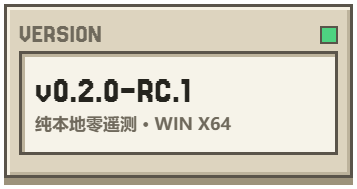
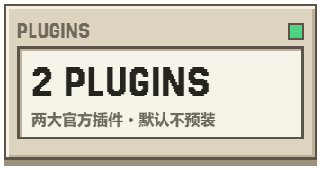
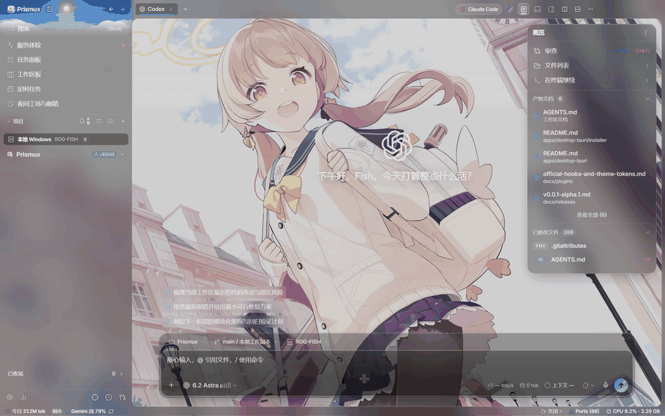
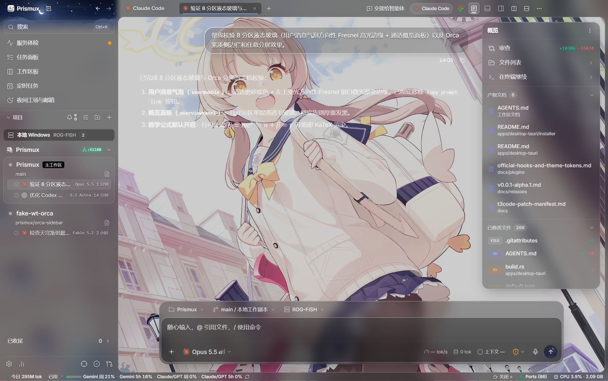
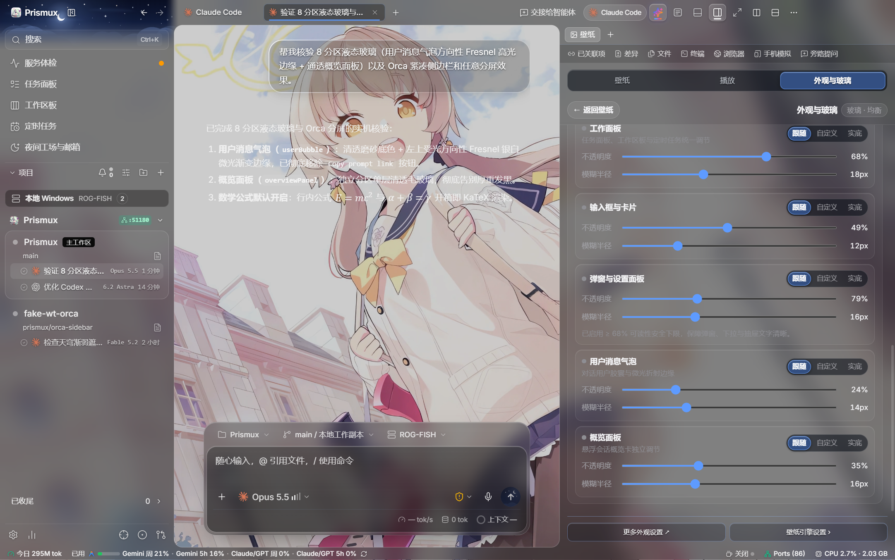

<div align="center">

<p>
  <a href="README.md"><picture><source media="(prefers-color-scheme: dark)" srcset="assets/readme/key-zh-zh-dark.png"></picture></a>
  <a href="README.en.md"><picture><source media="(prefers-color-scheme: dark)" srcset="assets/readme/key-en-zh-dark.png"></picture></a>
  <a href="#install"><picture><source media="(prefers-color-scheme: dark)" srcset="assets/readme/key-start-zh-dark.png"></picture></a>
</p>

<picture>
  <source media="(prefers-color-scheme: dark)" srcset="assets/readme/hero-zh-dark.png">
  
</picture>

<p>
  <a href="https://github.com/Fish-under-sea/Prismux/releases/tag/v0.2.0-rc.1"><picture><source media="(prefers-color-scheme: dark)" srcset="assets/readme/stat-version-zh-dark.png"></picture></a>
  <a href="#preview"><picture><source media="(prefers-color-scheme: dark)" srcset="assets/readme/stat-visual-zh-dark.png"></picture></a>
  <a href="#features"><picture><source media="(prefers-color-scheme: dark)" srcset="assets/readme/stat-memory-zh-dark.png"></picture></a>
  <a href="#plugins"><picture><source media="(prefers-color-scheme: dark)" srcset="assets/readme/stat-plugins-zh-dark.png"></picture></a>
</p>

<p>
  
  
  
  = 24.12">
  
  
</p>

<p><strong>Prismux · 纯本地零遥测的 8 分区液态玻璃 AI 超级工作台与 24 小时常驻秘书</strong><br>
基于 <strong>Electron 44 + TypeScript + React 19</strong>，在一个桌面窗口里统一驾驭 Claude Code、Codex、Antigravity、<code>dsh</code>、OpenCode 与 OMP；集 Orca 紧凑侧边栏、2×2 全要素任意分屏、DSH 完整思考与工具调用工作流、0 Token 8 分区液态玻璃、单文件 SQLite 混合记忆与夜间全自动工场于一身。<br>
默认全栈零遥测、纯本地扫码远控（零云端账号绑定）、官方插件严格按需零预装——把效率、质感与隐私控制权完完整整还给你。</p>

<p>
  <a href="#install"><picture><source media="(prefers-color-scheme: dark)" srcset="assets/readme/key-download-zh-dark.png"></picture></a>
  <a href="https://github.com/Fish-under-sea/Prismux/releases/tag/v0.2.0-rc.1"><picture><source media="(prefers-color-scheme: dark)" srcset="assets/readme/key-release-zh-dark.png"></picture></a>
  <a href="https://github.com/Fish-under-sea/Prismux/issues"><picture><source media="(prefers-color-scheme: dark)" srcset="assets/readme/key-issues-zh-dark.png"></picture></a>
</p>

<br>

<p>
  
  <br>
  <sub><strong>8 秒实机 Electron 44 GPU 动态实录</strong>（<a href="assets/readme/hero-demo-v02.webp">查看 1200×750 16 FPS 高清 Animated WebP</a>）：① 右侧壁纸抽屉实时调节 <strong>8 分区液态玻璃</strong> 折射通透度；② Codex 模型选择器滑动 <strong><code>dsh-fish</code> 奔跑小人 7 档推理强度条</strong>（<code>Mini → Ultra</code>）并秒切 <code>Fast / Ultra Fast</code>；③ 一键展开 <strong>2×2 Orca 全要素任意分屏</strong>（内部零圆角、<code>1 px</code> 细线）与 <strong>24 小时动态天穹</strong> 昼夜平滑演化。</sub>
</p>

</div>

<h2 id="intro"><picture><source media="(prefers-color-scheme: dark)" srcset="assets/readme/section-intro-zh-dark.png"></picture></h2>

**Prismux** 是以真实 T3 Code 桌面运行时（**Electron 44 + TypeScript + React 19**）为底座、搭配独立 **0 Token 视觉壳** 与 **按需双域插件内核** 打造的纯本地 AI 超级工作台与 24 小时常驻秘书系统。无论你同时在跑哪几家 Coding Agent，Prismux 都能把多端会话、原生协作、长期记忆、系统状态与桌面美学收束进一处冷静而顺手的工作空间：

- **纯本地、零遥测与纯扫码远控**：彻底切断上游全部静默遥测、账号指纹与冷启动外联，全面移除 T3 Connect / Clerk 云端账号绑定、付费导流与 `Copy prompt link`，手机远控仅保留兼容 T3 App 与手机浏览器的**局域网 / Tailscale 纯二维码配对**；所有运行态数据与记忆默认 100% 留驻本机。
- **多 Agent 统一驾驭与原生 `dsh` 接入**：Claude Code、Codex、Antigravity（官方 `agy acp`）、原生一级接入的 **`DeepSeek Harness (dsh)`**、OpenCode 与 OMP 同台并行，支持设置页 **提供方与模型拖拽排序并全局同步**、常驻纯 Logo 代理切换、真实系统 OS 用户名问候，以及原生 AGY 像素蜂群与 Claude Code / Codex 只读协作侧边栏。
- **0 Token 8 分区液态玻璃与多源动态壁纸**：全宽 1:1 光学天体三态胶囊一键切换浅色、深色与玻璃态，**8 大工作台分区**（含独立方向性 Fresnel 微光「用户消息气泡」与通透「概览面板」）实时微调通透与模糊并保持 ≥ 4.5:1 对比度；Z-0 多源壁纸舞台支持图片、视频、网页、WebWallGL 与 Steam Wallpaper Engine（`431960`），内置 SHA-256 永久去重与遮挡 `0 FPS` 挂起，对大模型严格保持 **0 Token** 开销。
- **Orca 紧凑侧边栏、全要素任意分屏与 DSH 完整工作步骤**：源码级对标 Orca 树状侧边栏（宿主机分组、工作区卡片、模型简称规范化与每轮简体中文自动总结命名）与 **Split Anything** 递归任意网格分屏（内部零圆角 + `1 px` 可拖分割线）；内置 DSH 完整思考与工具调用工作流（`简洁 / 标准 / 详细 / 完全展开`、收起时机与保留回复 3 项设置）及开箱即用 KaTeX 数学公式渲染。
- **单文件混合记忆、夜间全自动工场与零预装插件生态**：全部记忆收敛于单文件 `~/.prismux/data/memory.db`（SQLite WAL + FTS5 + `sqlite-vec`）并由传输层物理隔离群聊作用域；`夜间工场与邮箱` 移入左侧主导航一键开关；官方仅维护 `qq` 与 `fishdock-hook` 两款按需独立插件（默认零预装，卸载零残留），配套 Argon2id + AEAD 端到端加密同步与 GitHub / Gitee 双源测速自动更新。

> [!TIP]
> **`Prismux v0.2.0-RC.1` 大版本核心升级**
> - **Orca 紧凑侧边栏 + 模型简称规范化 + 中文每轮自动总结**：重做左侧树状结构（宿主机分组胶囊、工作区圆角卡片、单行高密度会话行），全站模型名统一规范化（如 `6.2 Astra`、`Opus 5.5`、`Fable 5.2`），每轮回复后自动提纯简体中文标题并永久锁定用户手动命名。
> - **重磅旗舰 · Orca 全要素任意分屏（Split Anything）**：支持将任意 Agent 会话、终端、浏览器、差异、文件与旁路提问自由拖入任意窗格边缘拆分为 2×2+ 递归嵌套网格；内部衔接强制零圆角（`rounded-none`），配备精致 `1 px` 拖拽分割线与双击均分复位。
> - **8 分区液态玻璃 + 方向性 Fresnel 微光气泡 + 24h 天穹右缘虚化**：在原 6 分区基础上独立拆出 **`userBubble`（用户消息气泡）** 与 **`overviewPanel`（概览面板）**，气泡升级为左上银白高光折射微光弧边；24 小时动态天穹柔和渐弱延伸至首会话标签左缘，发送按钮箭头按昼夜背景亮度自动切换黑白（全天 ≥ 4.5:1）。
> - **DSH 完整思考与工具调用流程 + 原生 `dsh` 接入与拖拽排序**：在「设置 → 外观 → 界面」收编 3 项 DSH 工作步骤控制（默认 `标准` / `回答结束后` / `全部回复`），默认开启 KaTeX 公式、`bars` 推理条与 12/12 会话详情；原生纳入 `DeepSeek Harness (dsh)` 并将 `Cursor` 下沉至更多区；支持提供方与模型列表 `@dnd-kit` 拖拽排序并全局同步。
> - **模型加速参数精简大写 + 7 档零截断短标签**：Claude 仅保留 `Fast Mode` / `Ultracode`，GPT/Codex 仅保留互斥 `Fast` / `Ultra Fast`；7 档推理滑条统一规范为 `Mini / Low / Med / High / XHigh / Max / Ultra` 彻底告别省略号截断。
> - **全面去 T3 云端独立化、设置瘦身与升级旧残留清扫**：移除 T3 Connect 云端账号与 `Copy prompt link`，保留纯二维码扫码远控；默认工作树分支前缀改为 `prismux`；欢迎语改用真实操作系统用户名；`夜间工场与邮箱` 移入左侧栏且四大工作面板 / Issue / PR 全部支持原按钮 Toggle 与无双顶栏内屏画框；退役早期原型壳并内置 NSIS + 首次启动升级清扫器。

当前最新发行版本为 **`Prismux v0.2.0-RC.1`**（发布标签 `v0.2.0-rc.1`），率先提供 Windows x64 安装包 `Prismux-Setup-0.2.0-rc.1-win-x64.exe`（GitHub Releases 与 Gitee Releases 双源同步发布），macOS 与 Linux 安装包通道已预留。

<h2 id="preview"><picture><source media="(prefers-color-scheme: dark)" srcset="assets/readme/section-preview-zh-dark.png"></picture></h2>

> 以下均为 **Prismux v0.2.0-RC.1 Electron 44 Windows 实机 GPU 渲染**全窗口高清截图，零修图、零合成：

<table>
  <tr>
    <td width="50%" align="center" valign="top">
      
      <br>
      <sub><strong>Orca 紧凑侧边栏 + 真实 OS 问候 + 24h 天穹右缘虚化</strong>：左侧呈现宿主机分组胶囊、工作区卡片与规范化模型简称（<code>Opus 5.5</code> / <code>6.2 Astra</code> / <code>Fable 5.2</code>），24 小时动态天穹柔和消融至首标签左缘，主画布以真实系统用户名问候并搭配白昼黑箭头发送键与 <code>20 px</code> 额度状态栏。</sub>
    </td>
    <td width="50%" align="center" valign="top">
      
      <br>
      <sub><strong>8 分区液态玻璃：方向性 Fresnel 微光气泡 + 独立清透概览</strong>：新增 <code>userBubble</code> 与 <code>overviewPanel</code> 独立分区，用户消息胶囊采用左上受光渐弱的银白折射弧边（已移除上游 <code>Copy prompt link</code>），开箱支持 KaTeX 行内公式，夜空下发送箭头自动翻白保高对比。</sub>
    </td>
  </tr>
  <tr>
    <td width="50%" align="center" valign="top">
      
      <br>
      <sub><strong>旗舰 2×2 Orca 全要素任意分屏（Split Anything）</strong>：多 Agent 对话与多终端自由并排/上下递归拆分，仅保留外画布圆角、全部分屏内部交界严格零圆角（<code>rounded-none</code>），搭配 <code>1 px</code> 细微边界线与流畅拖拽调比，在动态壁纸与液态玻璃下零闪烁。</sub>
    </td>
    <td width="50%" align="center" valign="top">
      
      <br>
      <sub><strong>Codex 7 档零截断 <code>dsh-fish</code> 奔跑小人滑条 + <code>Fast / Ultra Fast</code></strong>：常驻纯 Logo 一键切换代理，7 档推理强度规范缩写为 <code>Mini / Low / Med / High / XHigh / Max / Ultra</code> 零省略号截断，底部仅保留英文首字母大写互斥加速开关。</sub>
    </td>
  </tr>
  <tr>
    <td width="50%" align="center" valign="top">
      
      <br>
      <sub><strong>右侧壁纸与 8 分区实时玻璃工作台</strong>：在工作台内就地展开「外观与玻璃」抽屉，无需离开当前对话即可实时微调窗口外框、右侧边栏、主内容画布、工作面板、输入框、弹窗、<strong>用户消息气泡</strong>与<strong>概览面板</strong> 8 大分区的通透度与模糊半径。</sub>
    </td>
    <td width="50%" align="center" valign="top">
      
      <br>
      <sub><strong>4 分组精简设置导航 + DSH 完整思考与工具步骤控制</strong>：设置侧栏瘦身并彻底清除 T3 Connect 与重复项，终端字体预览统一品牌为 <code>prismux git:(main)</code>，界面区原生收编工作步骤展示、收起时机与收起后显示回复 3 项控制并默认开启条形强度与 KaTeX。</sub>
    </td>
  </tr>
</table>

<h2 id="features"><picture><source media="(prefers-color-scheme: dark)" srcset="assets/readme/section-features-zh-dark.png"></picture></h2>

<table>
  <tr>
    <td width="50%" valign="top">
      <strong>1. 多 Agent 统一驾驭、原生 <code>dsh</code> 接入与零遥测隐私底线</strong>
      <p>Electron 44 桌面端托管 24 小时守护进程 <code>@prismux/daemon</code>，支持 Claude Code、Codex、Antigravity（官方 <code>agy acp</code>，零凭据窃读）、原生一级接入的 <strong><code>DeepSeek Harness (dsh)</code></strong>、OpenCode 与 <code>omp acp</code> 同台并行并随时接任 <code>Chief Thread Slot</code> 主秘书。</p>
      <p>提供方与模型列表均支持 <code>@dnd-kit</code> 丝滑拖拽排序并全局同步至 Logo 切换条与 <code>Ctrl+1..9</code>；内置 AGY 1:1 像素蜂群、Claude/Codex 原生只读协作侧边栏与 1:1 <code>/btw</code> 只读旁路提问；彻底切断上游遥测与 T3 Connect 云端，手机远控仅保留兼容 T3 App 的本地/Tailscale 纯二维码配对。</p>
    </td>
    <td width="50%" valign="top">
      <strong>2. Orca 侧边栏、全要素任意分屏、DSH 工作流与五大内化原语</strong>
      <p>全面落地 Orca 树状紧凑侧边栏（宿主机分组、工作区卡片、模型简称规范化、每轮简体中文自动总结命名与用户改名锁）、<strong>Split Anything 2×2+ 递归任意分屏</strong>（内部零圆角 + <code>1 px</code> 可拖分割线）及 <strong>DSH 思考与工具调用完整流程</strong>（3 项展示与收起策略）。</p>
      <p>坚持克制减法（永久排除脱离会话的重型看板、AgentTeam DAG、Skill Lens 与 Visual Companion），聚焦五大核心原语：</p>
      <ul>
        <li><code>PersistentPtyPool</code>：每终端 <code>2 MB</code> 环形缓冲与断线无损回放</li>
        <li><code>HandoffEngine</code>：<code>/handoff</code> 上下文提纯交接与 <code>agent / oracle / review</code> 三档拨盘</li>
        <li><code>CollectorAndGuard</code>：多格式切片、传输层身份注入与 <code>60 s</code> 熔断保护</li>
        <li><code>LifecycleHookBus</code>：6 类生命周期钩子、退出码 <code>2</code> 拦截与默认 <code>onFailure: "block"</code></li>
        <li><code>WorktreeSandbox</code>：OS 级写隔离、默认 <code>prismux</code> 分支前缀与域名白名单网关</li>
      </ul>
    </td>
  </tr>
  <tr>
    <td width="50%" valign="top">
      <strong>3. 单文件混合记忆、主秘书定制与左侧栏夜间全自动工场</strong>
      <p>全部长期记忆收敛于单文件 <code>~/.prismux/data/memory.db</code>（SQLite WAL + FTS5 + <code>sqlite-vec</code>，非 <code>.asar</code> <code>vec0.dll</code> 开箱可用），融合 Mnemopi Prompt-Cache 友好召回、主秘书自定义命名与 <code>~/.prismux/chief/AGENTS.md</code> 持久规则，并支持 Obsidian Vault 策展迁移；传输层 <code>forwardIdentity</code> 物理锁定群聊作用域，杜绝读取私密与工作区记忆。</p>
      <p><code>夜间工场与邮箱</code> 升级为左侧主导航独立工作面板（与任务面板 / 工作区板 / 定时任务及左下角 Issue / PR 均支持原按钮 Toggle 关闭与统一圆角画框），自动完成邮件立项 → 记忆补全 → Worktree 编码 → Oracle 只读评审 → HTML 完工早报回信。</p>
    </td>
    <td width="50%" valign="top">
      <strong>4. 0 Token 8 分区液态玻璃、24h 动态天穹与多源壁纸舞台</strong>
      <p><code>@prismux/appearance</code> 提供全宽 1:1 光学天体三态胶囊、<strong>8 大工作台分区独立实时液态玻璃</strong>（窗口外框、右侧功能边栏、主内容画布、工作面板、输入框与卡片、弹窗与设置、方向性 Fresnel 微光<strong>用户消息气泡</strong>、独立通透<strong>概览面板</strong>）与 ≥ 4.5:1 对比度自动钳制，并内嵌 <code>dsh-fish</code> 7 档奔跑小人思考滑条。</p>
      <p>顶部 24 小时 288 帧声明式 SVG 动态天穹向右柔和虚化消融至首标签左缘，发送按钮箭头按昼夜自动切换黑白；<code>@prismux/wallpaper</code> 驱动 Z-0 多源舞台（图片 / 视频 / 网页 / WebWallGL / Steam <code>431960</code>），SHA-256 永久去重与遮挡 <code>0 FPS</code> 挂起，对大模型严格保持 <strong>0 Token 开销</strong>。</p>
    </td>
  </tr>
  <tr>
    <td width="50%" valign="top">
      <strong>5. 桌面微交互、20 px 信息底栏与真实 OS 欢迎体验</strong>
      <p>欢迎页直接读取本机真实 <code>osUsername</code>（告别路径硬猜与云端账号依赖）；收起态为 <code>54 px</code> 图标导轨配共享 <code>100 ms</code> 右侧气泡；右侧辅助边栏 7 项精简并支持双向拖拽排序，内置浏览器配置完整汉化（<code>默认配置 / 无痕模式</code>）。</p>
      <p><code>20 px</code> 底部状态栏整合实时日用量、Orca 多窗口额度条、Electron + Daemon + PTY 进程资源归因、本机端口监控、真 Electron <code>powerSaveBlocker</code> 防休眠（<code>开启 / 代理 / 关闭</code>）、Windows 系统托盘、零依赖手机模拟器与四级液态玻璃服务体检。</p>
    </td>
    <td width="50%" valign="top">
      <strong>6. Cordis 按需插件、端到端加密同步与双源升级清扫体系</strong>
      <p><code>@prismux/cordis-kernel</code> 强制校验顶层 <code>engines.prismux</code> SemVer，以 <code>ctx.effect()</code> 保障卸载零残留；内置 <code>512 KiB</code> 预算声明式液态玻璃 UI、托管单写锁与 <code>0600</code> 独立加密凭据；社区 npm 导入免本机 Git 且禁用安装脚本。</p>
      <p><code>@prismux/sync-vault</code> 使用跨运行时 <code>PRXC02</code> <code>aes-256-gcm</code> / Argon2id+AEAD 密封 <code>.prismux-backup</code>（支持 WebDAV / S3 / GitHub 独立开关、<code>If-Match</code> 乐观锁与便携 <code>data/</code> 模式）；双源更新器在 <strong>GitHub ↔ Gitee</strong> 与 <strong>npm ↔ npmmirror</strong> 间测速切换，NSIS 安装包与启动迁移钩子自动清扫旧版残留且严格守护记忆库与凭据零丢失。</p>
    </td>
  </tr>
</table>

<h2 id="plugins"><picture><source media="(prefers-color-scheme: dark)" srcset="assets/readme/section-plugins-zh-dark.png"></picture></h2>

> [!NOTE]
> **官方插件严格默认零预装**：`Prismux-Setup-0.2.0-rc.1-win-x64.exe` 安装包及解压态目录**绝不包含**任何 `plugins-official/` 插件（发布前通过全目录 0 命中扫描校验）。以下 2 款活跃官方插件（`qq`、`fishdock-hook`）均以独立 `.wb-plugin` 归档（配套 `prismux-plugins-official.json` 与 `prismux-plugins-0.2.0-rc.1-SHA256SUMS.txt`）及无脚本 npm 单包分发，按需安装并支持 `ctx.effect()` 零残留卸载。
>
> **已停用插件说明**：原 `pet`（`@prismux/plugin-pet`，桌宠联动）与 `ssh`（`@prismux/plugin-ssh`，SSH 远程主机终端）已彻底移出官方目录与发布链路——**已停用：已被 Prismux 内置功能取代**。

| 插件 ID | 独立归档包（`.wb-plugin`） | npm 包名（无作用域 / GitHub Packages） | 运行域（`realms`） | 核心能力与隔离边界 |
| :--- | :--- | :--- | :--- | :--- |
| `qq` | `prismux-plugin-qq-0.2.0-rc.1.wb-plugin` | `prismux-plugin-qq`<br><code>@fish-under-sea/prismux-plugin-qq</code> | `daemon`、`ui` | OneBot v11 正 / 反向 WebSocket 自动探测（NapCatQQ / Lagrange.Core）；私聊主人直连主秘书，群聊启用防刷屏节奏器并硬隔离至 <code>social/qq-group-&lt;gid&gt;</code> |
| `fishdock-hook` | `prismux-plugin-fishdock-hook-0.2.0-rc.1.wb-plugin` | `prismux-plugin-fishdock-hook`<br><code>@fish-under-sea/prismux-plugin-fishdock-hook</code> | `daemon` | FISH-Dock 灵动岛桥接插件；将 `PreToolUse` 中文风险审批、重要邮件提醒与夜间工场完工回执推送至灵动岛卡片并支持快捷放行或驳回 |

### 插件创作与官方文档

想为 Prismux 编写自定义扩展，或让 Coding Agent 自动生成合规插件？开工前请查阅以下两份对照真实源码维护的权威文档（也可在软件内打开 **设置 → 插件中心**，点击「创作指引」一键复制 Agent 提示词）：

- **《Prismux 插件创作完全指南》**：[`docs/plugins/plugin-development-guide.md`](docs/plugins/plugin-development-guide.md) — 涵盖 Cordis 双域内核、`engines.prismux` 顶层校验、`ctx.effect()` 卸载零残留、`ui: "components"` 声明式液态玻璃 UI、`0600` 加密凭据、`pnpm plugin:pack` 打包回环自检与最小可运行骨架。
- **《官方 Hook 钩子与浅色 / 深色 / 液态玻璃主题样式参考》**：[`docs/plugins/official-hooks-and-theme-tokens.md`](docs/plugins/official-hooks-and-theme-tokens.md) — 涵盖 `LifecycleHookBus` 6 大生命周期钩子（`SessionStart` / `PreToolUse` / `PostToolUse` / `Notification` / `SubagentStop` / `Stop`）、退出码 `2` 拦截与四档权限矩阵，以及 **8 大液态玻璃分区**与浅色 / 深色 / 玻璃语义样式 Token 全清单。

<h2 id="install"><picture><source media="(prefers-color-scheme: dark)" srcset="assets/readme/section-install-zh-dark.png"></picture></h2>

### 双网络发行入口（GitHub Releases ↔ Gitee Releases）

| 分发渠道 | 适用场景 | 入口与下载说明 |
| :--- | :--- | :--- |
| **GitHub Releases**（国际直连） | 海外网络 / GitHub CLI 环境 | [Prismux v0.2.0-RC.1 发布页](https://github.com/Fish-under-sea/Prismux/releases/tag/v0.2.0-rc.1) · [直下 `Prismux-Setup-0.2.0-rc.1-win-x64.exe`](https://github.com/Fish-under-sea/Prismux/releases/download/v0.2.0-rc.1/Prismux-Setup-0.2.0-rc.1-win-x64.exe) |
| **Gitee Releases**（国内镜像） | 中国大陆直连加速下载 | [Prismux v0.2.0-RC.1 发布页](https://gitee.com/Fish-under-sea/Prismux/releases/tag/v0.2.0-rc.1)（含 `80 MB` 7z 无损分卷、分卷汇总校验与全部活跃官方插件归档） |
| **软件内更新中心**（推荐） | 自动测速 GitHub / Gitee、分卷实时加权下载与 SHA-256 强制校验 | 在工作台打开 **设置 → 关于与更新**（`/settings/about#prismux-updates`），在 `智能测速 / 国内优先 / 国际优先` 间秒切，查看完整富文本更新日志并一键安装重启 |

### 平台下载矩阵与完整性校验

| 平台 / 发行资产 | 文件名 / 状态 | 说明与隔离策略 |
| :--- | :--- | :--- |
| **Windows x64 安装包（Electron 44 NSIS）** | `Prismux-Setup-0.2.0-rc.1-win-x64.exe`（Gitee 同步提供 7z 分卷） | 内含完整 Electron 44 桌面端、内置 `resources/prismux-daemon/`、非 `.asar` `resources/native/sqlite-vec/vec0.dll`、`resources/tools/7za.exe` 与 `t3-resource-monitor.exe`；升级自动清扫旧版与历史残留文件且严守 `~/.prismux/` 核心数据零丢失；默认安装至 `%LOCALAPPDATA%\Programs\Prismux`（支持界面改路径与 `/D=<目录>`）；**官方独立插件零预装** |
| **macOS（Apple Silicon / Intel）** | `暂未发布（已预留通道）` | 后续版本将提供 `.dmg` 安装镜像，遵循同一套 `0-Token` 视觉与 `~/.prismux/` 隔离规范 |
| **Linux（x86_64 / arm64）** | `暂未发布（已预留通道）` | 后续版本将提供 `.AppImage` / `.deb` 发行包，同样支持双源更新与独立插件验签导入 |
| **2 款官方独立插件包** | `prismux-plugin-{qq,fishdock-hook}-0.2.0-rc.1.wb-plugin` 与 `prismux-plugins-official.json` | 确定性 ustar + gzip 归档，下载后在 **设置 → 插件中心**（`/settings/plugins`）按需验签导入（`pet` / `ssh` 已停用：已被内置功能取代） |
| **分离式合并校验清单** | `Prismux-0.2.0-rc.1-SHA256SUMS.txt` 与 `prismux-plugins-0.2.0-rc.1-SHA256SUMS.txt` | 手动下载后可通过 `Get-FileHash Prismux-Setup-0.2.0-rc.1-win-x64.exe -Algorithm SHA256` 或 `7z t` 核对完整性 |

<h2 id="packages"><picture><source media="(prefers-color-scheme: dark)" srcset="assets/readme/section-packages-zh-dark.png"></picture></h2>

每款活跃官方插件均额外发布为**零 `preinstall / install / postinstall` 脚本**的独立 npm 单包，内置通过 SHA-256 核验的 `prismux-plugin-<id>-0.2.0-rc.1.wb-plugin` 归档与防覆盖导出命令（`prismux-plugin-<id>`）；软件内插件市场支持在 **`registry.npmjs.org` ↔ `registry.npmmirror.com`** 间免本机 Git 纯流式拉取与自动故障回退。

```powershell
# 1. 从 npm 官方源安装并提取 .wb-plugin 归档（内置 SHA-256 核对，目标文件已存在时不覆盖）
npm install prismux-plugin-qq@0.2.0-rc.1
npx prismux-plugin-qq --out ./plugins-stage

# 2. 中国大陆网络使用 npmmirror 国内镜像加速安装
npm install prismux-plugin-qq@0.2.0-rc.1 --registry=https://registry.npmmirror.com
npx prismux-plugin-qq --out ./plugins-stage
```

- **切换另一款官方插件**：将上方命令中的 `qq` 替换为 `fishdock-hook` 即可导出对应归档，随后在 **设置 → 插件中心**（`/settings/plugins`）选择「导入本地 `.wb-plugin`」（原 `pet` / `ssh` 已停用：已被 Prismux 内置功能取代）。
- **GitHub Packages 同步包**：发版流水线同步推送 `@fish-under-sea/prismux-plugin-{qq,fishdock-hook}` 至 `https://npm.pkg.github.com`，便于企业内网或 CI 环境拉取校验。

<h2 id="develop"><picture><source media="(prefers-color-scheme: dark)" srcset="assets/readme/section-develop-zh-dark.png"></picture></h2>

> **前置工具链**：`Node.js >= 24.12.0`、`pnpm >= 10.0.0`（主仓锁定 `pnpm@12.3.4`）、`Electron 44`、`React 19` 与 `Rust >= 1.85`（仅用于编译 `vendor/t3code/native/resource-monitor` 原生资源监控二进制；Windows 下运行 Cargo 请固定传入 `-j 1` 与 `NO_PROXY=*`）。开工前请先阅读 [`AGENTS.md`](AGENTS.md)、[`docs/t3code-patch-manifest.md`](docs/t3code-patch-manifest.md) 与对应的本机环境档案 `docs/agents/local/<规范化用户名>.md`。

```powershell
# 1. 安装主仓工作区依赖（9 个自研 TypeScript 工作区包）
pnpm install

# 2. 全仓构建、独立类型检查与全仓测试
pnpm -r build
pnpm -r typecheck
pnpm -r --if-present test
pnpm test:scripts

# 3. 校验 vendor/t3code managed-fork 契约、基线提交与补丁台账
pnpm upstream:check

# 4. 在 vendor/t3code 下检查并构建真实 Electron 44 桌面端（web + server + desktop）
pnpm --dir vendor/t3code exec vp run --filter @t3tools/web typecheck
pnpm --dir vendor/t3code exec vp run --filter @t3tools/desktop typecheck
pnpm --dir vendor/t3code exec vp run build:desktop

# 5. 一键串联主仓构建 + T3 底座构建 + Windows NSIS 安装包打包（含 7z 校验与 SHA256SUMS）
pnpm desktop:build
pnpm desktop:installer

# 6. 为指定官方插件生成确定性 .wb-plugin（内置 gunzip 回环校验）
pnpm plugin:pack -- --plugin plugins-official/plugin-qq
```

<details>
<summary><strong>展开查看：Monorepo 目录树与 T3 Code 最小入侵边界</strong></summary>

```text
prismux/
├── AGENTS.md                            # 跨机器统配入口、五大工程红线与验收门禁
├── LICENSE                              # 标准 MIT 开源许可证
├── README.md / README.en.md             # 中英双语项目主页（含 8 秒 GPU 动态演示）
├── .gitattributes                       # 标注 vendor/t3code/** linguist-vendored，聚焦自研代码统计
├── UPSTREAM_LOCK.json                   # pingdotgg/t3code 基线 SHA、managed-fork 模式与台账指针
├── pnpm-workspace.yaml                  # 9 个自研 TS 工作区包白名单（排除独立 workspace 的 vendor/t3code）
├── package.json                         # 根任务编排脚本（0.2.0-rc.1）
├── tsconfig.base.json                   # TypeScript 5.8+ 严格共享基线（ES2024 + NodeNext）
├── assets/
│   ├── logo.png                         # 透明 1024×1024 吉祥物主图标
│   └── readme/                          # 立体像素头图、8 秒 GPU 演示动图、实机高清截图与渲染模板
├── docs/
│   ├── t3code-patch-manifest.md         # T3 Code 最小入侵挂载与扩展点权威台账
│   ├── agents/                          # 按人存放的本机环境档案说明、模板与个人档案
│   ├── plugins/                         # 源码级插件创作完全指南、Hook 与 8 分区主题样式参考
│   └── specs/
│       ├── master-prompt-v1.3.md        # 全栈自主施工总指令书（架构宪法）
│       └── ui-ux-design-mandate.md      # UI/UX、主题与背景及安装包强制设计规范
├── scripts/                             # 运维脚本与 README 渲染器（纯 Node 24 原生 TS / ESM）
│   ├── build-prismux-desktop.ts         # 一键桌面构建与 NSIS 安装包编排器（--installer / --skip-rust）
│   ├── release-all.ts                   # 桌面安装包 + 2 款活跃官方插件 + npm 单包 + SHA256SUMS 统一发布
│   ├── sync-t3-upstream.ts              # managed-fork / 上游锁校验脚本（--check / --sync）
│   ├── pack-plugin.ts                   # 确定性 ustar + gunzip 回环校验插件打包器
│   ├── build-npm-plugin-packages.ts     # 生成无脚本 npm / GitHub Packages 插件单包
│   ├── rename-brand.ts                  # 全局品牌标识安全替换脚本
│   ├── render-readme.mjs                # Edge CDP 立体像素头图与分栏横幅渲染器
│   └── __tests__/scripts.test.ts        # node:test 回归测试
├── vendor/
│   └── t3code/                          # T3 Code 运行底座（Electron 44 + server + web），受控于补丁台账
├── packages/                            # 6 个核心 workspace 包
│   ├── protocol/                        # @prismux/protocol：品牌常量、RPC、Hook、记忆、插件与更新契约
│   ├── cordis-kernel/                   # @prismux/cordis-kernel：双域插件内核、声明式 UI、双源流式安装器与 0600 凭据
│   ├── memory-core/                     # @prismux/memory-core：SQLite WAL + FTS5 + sqlite-vec、Mnemopi 召回与物理防泄密
│   ├── sync-vault/                      # @prismux/sync-vault：Argon2id + AEAD 同步、乐观锁与 60 s 看门狗
│   ├── prismux-appearance/              # @prismux/appearance：全宽天体胶囊、8 分区液态玻璃、Fresnel 气泡与动态思考滑条
│   └── prismux-wallpaper/               # @prismux/wallpaper：精简壁纸边栏、Z-0 多源舞台、SHA-256 去重与 Steam 431960 扫描
├── apps/
│   └── daemon/                          # @prismux/daemon：24h 守护、主秘书槽位、五大原语、服务体检与夜间工场
└── plugins-official/                    # 2 款活跃官方独立插件（workspace 包）与权威索引（pet / ssh 已停用）
    ├── catalog/official.json            # 官方插件权威发布索引（活跃 qq / fishdock-hook + retiredPlugins 停用说明）
    ├── plugin-qq/                       # @prismux/plugin-qq
    └── plugin-fishdock-hook/            # @prismux/plugin-fishdock-hook
```

</details>

<details>
<summary><strong>展开查看：五大绝对工程红线</strong></summary>

1. **T3 Code 本体最小入侵与业务外置原则**：`vendor/t3code/` 仅允许保留已登记于 [`docs/t3code-patch-manifest.md`](docs/t3code-patch-manifest.md) 的标准化挂载与扩展点（且零修改 `vendor/t3code/pnpm-lock.yaml`），严禁散落业务逻辑；重逻辑全部沉淀于主仓 `packages/*` 与 `apps/daemon`。
2. **严禁混入已砍掉的 4 项冗余模块（保留原生轻量线程归档与 Orca 轻量工作区 / 任务视图）**：禁止实现脱离会话体系的重型项目看板（Task Board）、AgentTeam DAG、Skill Lens、Visual Companion 及自建重型会话归档系统，统一由五大内化原语替代；T3 Code 原生轻量 `/settings/archived` 与 Orca 轻量工作区板 / 任务面板按项目决策予以保留。
3. **内生单文件记忆中枢与物理防泄密**：记忆引擎固定为 `~/.prismux/data/memory.db`（SQLite WAL + FTS5 + `sqlite-vec`），零 PostgreSQL / Qdrant / MinIO / Obsidian 客户端依赖；查询层强制绑定 `_callerScope` 物理隔离。
4. **官方独立插件默认绝不预装**：活跃官方插件 `qq`、`fishdock-hook` 全部作为独立包存放于 `plugins-official/`，主程序与安装包均不含插件包，按需从市场安装（原 `pet`、`ssh` 已停用：已被 Prismux 内置功能取代）。
5. **视觉层对模型 0 Token 开销与强制设计规范**：壁纸、8 分区 360° Fresnel 液态玻璃、24 小时动态天穹、模型识别动态思考条、字体调色、系统音频律动与安装引导均不向任何大模型注入工具定义或提示词。

</details>

<details>
<summary><strong>展开查看：M1–M5 与 v0.1.0 ~ v0.2.0-RC.1 演进里程碑</strong></summary>

| 里程碑 | 核心交付内容 | 验收状态 |
| :--- | :--- | :--- |
| **M1** | Monorepo 骨架、T3 Code 基线接入、`apps/daemon` 进程监督、环境变量净化、主秘书槽位与 `2 MB` 环形 `PersistentPtyPool` | 已完成并通过门禁 |
| **M2** | 单文件 SQLite WAL + FTS5 + `sqlite-vec` 混合记忆（非 `.asar` `vec0.dll` 开箱即用）、Mnemopi 召回与分域缓存、`forwardIdentity` 隔离、`LifecycleHookBus`、`HandoffEngine` 与 `WorktreeSandbox` | 已完成并通过门禁 |
| **M3** | `cordis-kernel`（预发布兼容 SemVer 校验、`ctx.effect()` 零残留、多源验签与免 Git 流式安装、声明式液态玻璃 UI）与 `sync-vault`（Argon2id + AEAD、`If-Match` 乐观锁、`60 s` 看门狗、便携 `data/` 模式） | 已完成并通过门禁 |
| **M4 / v0.1.0–v0.1.2** | `@prismux/appearance` 与 `@prismux/wallpaper` 外置沉淀、T3 Code 真实 Electron 44 底座融合、全宽天体胶囊、`dsh-fish` 思考条、Windows Codex 零壳直启、官方 `agy acp` 额度联动、NSIS 用户目录安装包与插件中心重设计 | 已完成并通过实机签收 |
| **M5** | `OvernightFactory` 夜间全自动工场前后端闭环、两大活跃官方独立插件（`qq`、`fishdock-hook`）确定性打包验签与双源分卷自动更新体系（`pet` / `ssh` 已停用并移除） | 已完成并通过门禁 |
| **v0.1.3-Preview.1~3** | 全栈零静默遥测硬切断、AGY 蜂群与 Claude/Codex 只读协作侧边栏、右侧栏 7 项精简与双向拖拽、1:1 原生 `/btw` 旁路提问、24 小时 288 帧动态天穹、常驻纯 Logo 切代理与双语图标 `/` 面板、`54 px` 图标导轨、`20 px` 多窗口额度状态栏与 Electron 44 BoringSSL 端到端加密同步加固 | 已完成并通过实机签收 |
| **v0.2.0-RC.1** | Orca 紧凑树状侧边栏与模型简称规范化、中文每轮自动总结命名、**2×2+ Orca 全要素任意分屏（内部零圆角 + 1 px 拖拽分割线）**、**8 分区液态玻璃（独立 Fresnel 微光用户气泡与通透概览）**、24h 天穹右缘渐弱虚化与昼夜发送箭头自适应、DSH 完整思考与工具步骤 3 项设置、原生一级接入 `dsh` 与提供方/模型拖拽排序、Claude/Codex 加速参数精简大写与 7 档零截断标签、全面去 T3 Connect 纯二维码远控与设置瘦身、真实 OS 用户名问候、退役历史壳与 NSIS 升级残留清扫 | 已完成并通过实机签收 |

</details>

<h2 id="thanks"><picture><source media="(prefers-color-scheme: dark)" srcset="assets/readme/section-thanks-zh-dark.png"></picture></h2>

### 工程文档索引

| 文档 | 说明 |
| :--- | :--- |
| [`AGENTS.md`](AGENTS.md) | 跨机器统配入口、五大工程红线、脚本与插件打包契约、环境排障与提交流程 |
| [`docs/t3code-patch-manifest.md`](docs/t3code-patch-manifest.md) | T3 Code 最小入侵挂载与 Provider 扩展点权威登记台账 |
| [`docs/plugins/plugin-development-guide.md`](docs/plugins/plugin-development-guide.md) | Prismux 插件创作完全指南（Cordis 双域、声明式 UI、凭据隔离与打包发布） |
| [`docs/plugins/official-hooks-and-theme-tokens.md`](docs/plugins/official-hooks-and-theme-tokens.md) | 官方 6 大生命周期 Hook 钩子与浅色 / 深色 / 8 分区液态玻璃主题样式 Token 参考 |
| [`docs/specs/ui-ux-design-mandate.md`](docs/specs/ui-ux-design-mandate.md) | 世界级 UI/UX、天体三态胶囊、液态玻璃同步契约与安装包强制设计规范 |
| [`docs/specs/master-prompt-v1.3.md`](docs/specs/master-prompt-v1.3.md) | Prismux 全栈自主施工总指令书（架构宪法） |
| [`docs/agents/README.md`](docs/agents/README.md) | 贡献者本机环境档案命名规范、模板与维护流程 |
| [`assets/readme/MAINTAINING.md`](assets/readme/MAINTAINING.md) | README 立体像素头图、分栏横幅与动态演示维护指南 |

### 上游项目与 MIT 开源致谢

- [pingdotgg/t3code](https://github.com/pingdotgg/t3code)（MIT）：提供 Electron 44 + `apps/server` + `apps/web` 运行底座与 Provider 桥接内核。
- [stablyai/orca](https://github.com/stablyai/orca)（MIT）：提供紧凑树状项目/工作区侧边栏、全要素任意分屏（Split Anything）、端口扫描与资源监控、超紧凑状态栏、多窗口额度条与声明式插件 UI 参考对标。
- [can1357/oh-my-pi](https://github.com/can1357/oh-my-pi)（MIT）：提供 Mnemopi Prompt-Cache 召回与分域缓存、`omp acp` `_session/steering` / `_omp/usage` 协议及状态栏刻度参考。
- `dsh-better-reasoning-effort-fish`（[HanaAyane/dsh-reasoning-effort](https://github.com/HanaAyane/dsh-reasoning-effort) PR #9 + [HaoyueQin/dsh-better-reasoning-effort](https://github.com/HaoyueQin/dsh-better-reasoning-effort)，MIT）与 `DeepSeek Harness (dsh)`：提供模型自动识别动态思考强度滑条（`<PrismuxReasoningEffortSlider />`、8 大家族主题与 RGBA WebP 奔跑小人）及对话思考与工具调用工作步骤展示参考。
- [yetone/magpie](https://github.com/yetone/magpie)：启发口令密封 AEAD 加密同步、`If-Match` 乐观锁、60 秒停滞看门狗与便携模式设计规范。
- [Amp](https://ampcode.com/)：启发 `/handoff` 上下文提纯交接与 `agent / oracle / review` 三档角色拨盘工作流。
- [FISH-Dock](https://github.com/Fish-under-sea/FISH-Dock)：提供 Warm Paper / Dark Olive 立体像素视觉体系、1:1 光学天体胶囊与 360° Fresnel 液态玻璃主题规范及灵动岛审批回执联动灵感。

### 许可边界

Prismux 本仓核心代码与排版工具链遵循 **MIT License**（见仓库根 [`LICENSE`](LICENSE)）；随视觉资产分发的像素字体 `Jersey20-Regular.ttf` 遵循 [SIL Open Font License 1.1](assets/readme/OFL-Jersey20.txt)；基于 `pingdotgg/t3code`（MIT）托管的 `vendor/t3code` 及上述参考移植源码均严格保留各自原始 MIT 许可证与归属声明。

<p align="center"><sub>Prismux v0.2.0-RC.1 · Electron 44 + TypeScript + React 19 · 纯本地零遥测 · 8 分区液态玻璃 · Orca 任意分屏 · 2 款按需官方插件</sub></p>
