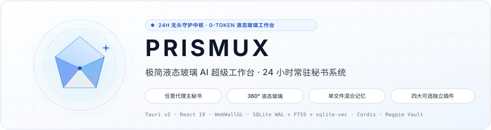
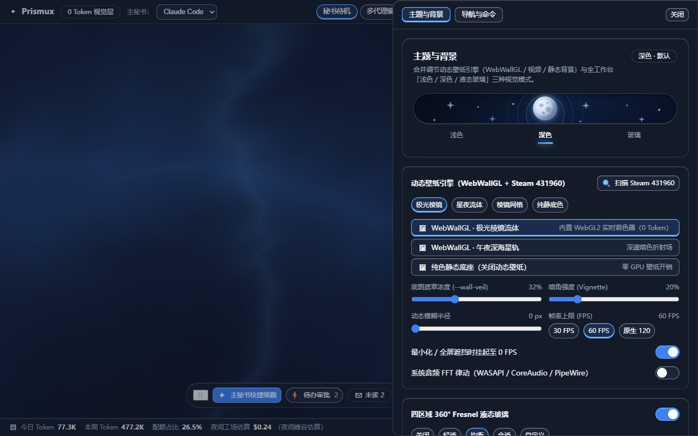
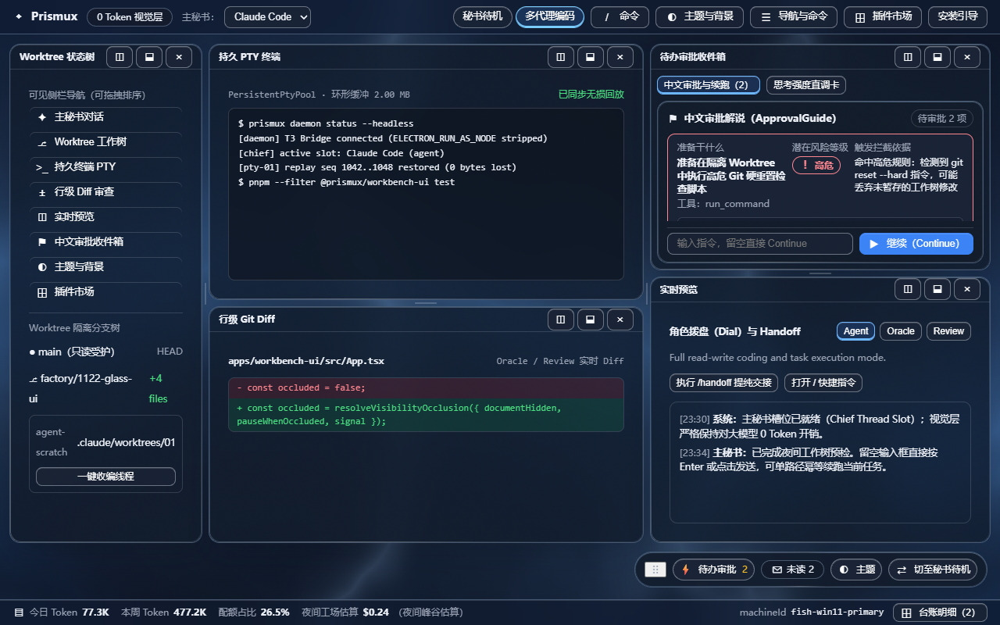
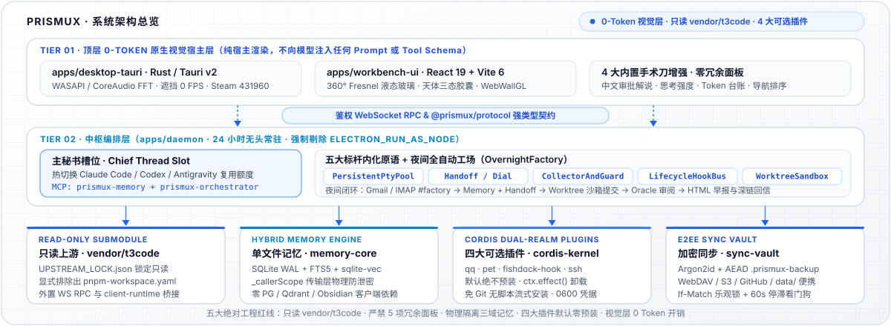

<div align="center">

<p>
  <a href="README.md"><strong>简体中文</strong></a> ·
  <a href="README.en.md">English</a> ·
  <a href="#preview">界面预览</a> ·
  <a href="#features">核心特性</a> ·
  <a href="#architecture">系统架构</a> ·
  <a href="#plugins">插件生态</a> ·
  <a href="#quickstart">快速开始</a> ·
  <a href="#docs">文档索引</a>
</p>

<picture>
  <source media="(prefers-color-scheme: dark)" srcset="assets/readme/hero-zh-dark.svg">
  
</picture>

<p>
  = 24.12">
  
  
  
  
  
  
</p>

<p><strong>极简液态玻璃 AI 超级工作台与 24 小时常驻秘书系统</strong><br>以只读方式桥接 <code>t3code</code> 服务，融合代理无关主秘书、单文件三域物理隔离记忆、360° Fresnel 液态玻璃与夜间全自动工场。</p>

<table>
  <tr>
    <td align="center" width="25%"><strong>0 Token</strong><br><sub>纯宿主视觉层开销</sub></td>
    <td align="center" width="25%"><strong>100% 只读</strong><br><sub><code>vendor/t3code</code> 上游隔离</sub></td>
    <td align="center" width="25%"><strong>单文件</strong><br><sub>SQLite + FTS5 + vec 记忆</sub></td>
    <td align="center" width="25%"><strong>4 大官方插件</strong><br><sub>默认绝不预装，按需单装</sub></td>
  </tr>
</table>

</div>

<h2 id="preview">界面实景预览</h2>

<p align="center">
  
  <br>
  <sub><strong>秘书待机预设</strong>：收起全部重型编码面板，保留 85%–90% 纯净 <code>WebWallGL</code> 实时壁纸视野、底部浮动玻璃胶囊与 <code>UsageLedger</code> 用量速览条。</sub>
</p>

<table>
  <tr>
    <td width="50%" align="center" valign="top">
      
      <br>
      <sub><strong>天体三态胶囊与四区液态玻璃</strong>：全宽内凹星芒月球三态切换胶囊、<code>WebWallGL + Steam 431960</code> 壁纸引擎与四区域玻璃调控。</sub>
    </td>
    <td width="50%" align="center" valign="top">
      
      <br>
      <sub><strong>多代理分屏编码与中文审批引导</strong>：Worktree 状态树、持久 PTY 环形回放终端、行级 Git Diff、三栏中文风险审批卡与 <code>Dial / Handoff</code> 预览。</sub>
    </td>
  </tr>
</table>

<h2 id="features">核心能力</h2>

<table>
  <tr>
    <td width="50%" valign="top">
      <strong>1. 代理无关主秘书槽位与只读 <code>t3code</code> 桥接</strong>
      <p><code>apps/daemon</code> 24 小时无头托管只读 <code>vendor/t3code/apps/server</code>，并在创建子进程前强制剔除 <code>ELECTRON_RUN_AS_NODE</code> 等宿主污染变量。</p>
      <p>通过常驻 <code>Chief Thread Slot</code> 在顶栏热切换 Claude Code、Codex、Antigravity 与 OpenCode，直接复用已有订阅额度并自动挂载 <code>prismux-memory</code> 与 <code>prismux-orchestrator</code> 回环 MCP。</p>
    </td>
    <td width="50%" valign="top">
      <strong>2. 五大标杆内化原语（零重型冗余面板）</strong>
      <p>彻底舍弃 Task Board、AgentTeam、Skill Lens、Visual Companion 与 Session Archive，凝练为五大高精度原语：</p>
      <ul>
        <li><code>PersistentPtyPool</code>：每终端 <code>2 MB</code> 环形缓冲与断线无损回放</li>
        <li><code>HandoffEngine</code>：<code>/handoff</code> 无损提纯与 <code>agent / oracle / review</code> 三档拨盘</li>
        <li><code>CollectorAndGuard</code>：多格式切片 + 传输层身份注入与 <code>60 s</code> 熔断</li>
        <li><code>LifecycleHookBus</code>：6 类确定性钩子、退出码 <code>2</code> 拦截与 <code>onFailure: "block"</code></li>
        <li><code>WorktreeSandbox</code>：OS 级写隔离与域名白名单本地代理网关</li>
      </ul>
    </td>
  </tr>
  <tr>
    <td width="50%" valign="top">
      <strong>3. 单文件三域混合记忆与物理防泄密</strong>
      <p>全部记忆收敛于单文件 <code>~/.prismux/data/memory.db</code>（SQLite WAL + FTS5 中文分词 + <code>sqlite-vec</code> 稠密向量 RRF 混合检索），零 PostgreSQL、Qdrant、MinIO 或本地 Obsidian 客户端依赖，提供 <code>POST /v1/memory/import-obsidian</code> 迁移接口。</p>
      <p>传输层通过 <code>forwardIdentity</code> 强制覆写 <code>_callerScope</code>：群聊作用域 <code>qq_group:&lt;gid&gt;</code> 在 SQL 底层硬编码锁定 <code>social/qq-group-&lt;gid&gt;</code>，物理杜绝越权读取 <code>private/chief</code> 与 <code>workspace/*</code>。</p>
    </td>
    <td width="50%" valign="top">
      <strong>4. 360° Fresnel 液态玻璃、天体三态胶囊与 <code>WebWallGL</code></strong>
      <p>基于 Tauri v2 与 React 19 实现四区域（<code>sidebar / content / overlay / control</code>）独立 <code>fill</code> 与 <code>blur</code> 调节、独立浅/深文字调色、<code>FishDock.theme</code> 联动与 <code>.wb-theme</code> 剥离路径分享包。</p>
      <p>支持 Steam <code>431960</code> 壁纸扫描、WASAPI / CoreAudio / PipeWire 音频 FFT 律动、<code>visibility: occluded</code> 自动 0 FPS 挂起，并原生内置 <code>ApprovalGuide</code>、<code>ReasoningEffortCard</code>、<code>UsageLedger</code> 与 <code>NavAndCommandOrder</code> 四把效率手术刀。</p>
    </td>
  </tr>
  <tr>
    <td width="50%" valign="top">
      <strong>5. Cordis 双域可逆插件与 Magpie 加密同步</strong>
      <p><code>@prismux/cordis-kernel</code> 强制校验顶层 <code>engines.prismux</code> SemVer，依托 <code>ctx.effect()</code> 实现卸载零残留，提供免 Git 无脚本流式 <code>npm</code> Tarball 安装器、<code>distribution: "managed"</code> 单写锁与 <code>0600</code> 独立插件凭据。</p>
      <p><code>@prismux/sync-vault</code> 对标 Magpie 使用 Argon2id + AEAD 密封 <code>.prismux-backup</code>，支持 WebDAV / S3（<code>path-style</code>） / GitHub 独立开关、<code>If-Match</code> 乐观锁、<code>60 s</code> 停滞看门狗与同级 <code>data/</code> 便携模式。</p>
    </td>
    <td width="50%" valign="top">
      <strong>6. 夜间全自动工场（<code>OvernightFactory</code>）</strong>
      <p>打通 Gmail OAuth2 / IMAP <code>#factory</code> 灵感邮件入站 → Stage A 记忆补全与 Handoff 立项 → Stage B 隔离 <code>git worktree</code> 沙箱编码与自愈提交（绝不强推主分支）→ Stage C Oracle 只读 <code>review</code> 独立挑刺 → Stage D 生成带 Diff、单测输出与 <code>prismux://review/&lt;threadId&gt;</code> 深链的 HTML 完工早报。</p>
    </td>
  </tr>
</table>

<h2 id="architecture">系统架构总览</h2>

<p align="center">
  <picture>
    <source media="(prefers-color-scheme: dark)" srcset="assets/readme/arch-zh-dark.svg">
    
  </picture>
</p>

<h2 id="plugins">四大官方独立插件（默认绝不预装）</h2>

> [!NOTE]
> **极简内核铁律**：Prismux 主程序与安装包仅保留轻量核心，**四大官方独立插件默认绝不预装**。所有官方插件源码独立维护于 `plugins-official/`，通过 `scripts/pack-plugin.ts` 生成确定性 `.wb-plugin` 与 `.sha256` 归档包，安装后按需在内置插件市场手动选装，停用或卸载通过 `ctx.effect()` 零残留回滚。

| 插件 ID | npm 包名 | 运行域（`realms`） | 核心能力与安全隔离特性 |
| :--- | :--- | :--- | :--- |
| `qq` | `@prismux/plugin-qq` | `daemon`、`ui` | OneBot v11 正/反向 WebSocket 自动探测（兼容 NapCatQQ / Lagrange.Core）；私聊主人接入主秘书线程，授权 QQ 群启用防刷屏节奏器并物理隔离锁定 <code>social/qq-group-&lt;gid&gt;</code> 记忆域 |
| `pet` | `@prismux/plugin-pet` | `ui`、`daemon` | 桌宠联动插件；完整实现定向实例绑定、带过期校验的租约锁（Lease Token）、只读播放进度订阅与动作/气泡分阶段交还 |
| `fishdock-hook` | `@prismux/plugin-fishdock-hook` | `daemon` | FISH-Dock 灵动岛桥接插件；将 `PreToolUse` 中文风险审批、邮件提醒与夜间工场完工回执推送至灵动岛卡片并支持快捷放行或驳回 |
| `ssh` | `@prismux/plugin-ssh` | `daemon`、`ui` | 按需选装的运维插件；提供隔离 SSH 主机池、Web PTY 会话桥接、路径校验与 SFTP 文件浏览 |

<h2 id="quickstart">快速开始</h2>

> **前置工具链要求**：`Node.js >= 24.12.0`、`pnpm >= 10.0.0`（仓库声明 `pnpm@12.3.4`）、`Rust >= 1.85`（构建桌面壳时启用）。Windows 下执行 Cargo 命令请固定传入 `-j 1` 规避 MSVC 并发链接冲突。

```powershell
# 1. 安装全部工作区依赖
pnpm install

# 2. 构建并类型检查全部 TypeScript 工作区包（支持零 dist 独立 typecheck）
pnpm -r build
pnpm -r typecheck

# 3. 运行工作区测试与内置零依赖脚本单元测试
pnpm test
pnpm test:scripts

# 4. 校验只读上游 vendor/t3code 契约与锁定状态
pnpm upstream:check

# 5. 无界面启动 24 小时守护进程 CLI
node apps/daemon/dist/cli.js start --headless

# 6. 为指定官方独立插件执行确定性 ustar + gunzip 回环打包与 SHA-256 校验
pnpm plugin:pack -- --plugin plugins-official/plugin-qq

# 7. 检查并测试 Rust / Tauri v2 桌面原生壳（如使用自定义工具链目录，请先按 docs/agents/local/<用户名>.md 激活 RUSTUP_HOME / CARGO_HOME / PATH）
cargo check -j 1 --offline --manifest-path apps/desktop-tauri/Cargo.toml
cargo test -j 1 --offline --manifest-path apps/desktop-tauri/Cargo.toml
```

<h2 id="details">工程结构与治理细节</h2>

<details>
<summary><strong>展开查看：Monorepo 10 包目录树</strong></summary>

```text
prismux/
├── AGENTS.md                            # 跨机器统配入口、工程红线与验收门禁
├── README.md / README.en.md             # 中英双语项目主页
├── UPSTREAM_LOCK.json                   # vendor/t3code 只读锁定提交与必选路径清单
├── pnpm-workspace.yaml                  # 10 个 TS 工作区包白名单（显式排除 vendor/t3code 与 desktop-tauri）
├── package.json                         # 根任务编排脚本
├── tsconfig.base.json                   # TypeScript 5.8+ 严格共享基线（ES2024 + NodeNext）
├── assets/readme/                       # README 暗/亮 SVG 视觉资产与实机截图
├── docs/
│   ├── agents/                          # 按人存放的本机环境档案说明、模板与个人档案
│   └── specs/
│       ├── master-prompt-v1.3.md        # 全栈自主施工总指令书（架构宪法）
│       └── ui-ux-design-mandate.md      # UI/UX、主题与背景及安装包强制规范
├── scripts/                             # 零第三方依赖 Node 24 原生 TS 运维脚本与单测
│   ├── rename-brand.ts                  # 全局品牌标识安全替换脚本
│   ├── sync-t3-upstream.ts              # 只读校验（--check）与上游同步（--sync）
│   ├── pack-plugin.ts                   # 确定性 ustar + gunzip 回环校验插件打包器
│   └── __tests__/scripts.test.ts        # node:test 回归测试
├── vendor/
│   └── t3code/                          # 100% 只读上游 pingdotgg/t3code 子模块（不纳入 pnpm workspace）
├── packages/                            # 4 个核心 workspace 包
│   ├── protocol/                        # @prismux/protocol：品牌常量、RPC、Hook、记忆、Handoff 与插件契约
│   ├── cordis-kernel/                   # @prismux/cordis-kernel：双域插件内核、SemVer、流式安装器与 0600 凭据
│   ├── memory-core/                     # @prismux/memory-core：SQLite WAL + FTS5 + sqlite-vec 与物理防泄密
│   └── sync-vault/                      # @prismux/sync-vault：Argon2id + AEAD 同步、乐观锁与 60 s 看门狗
├── apps/                                # 2 个 TS workspace 应用 + 1 个独立 Rust crate
│   ├── daemon/                          # @prismux/daemon：24h 无头守护、主秘书槽位、五大原语与夜间工场
│   ├── workbench-ui/                    # @prismux/workbench-ui：React 19 + Vite + WebWallGL + 360° Fresnel 玻璃
│   └── desktop-tauri/                   # prismux-desktop：Rust + Tauri v2 透明原生壳与 NSIS 静奢安装器
└── plugins-official/                    # 4 个官方独立插件（workspace 包）与权威索引
    ├── catalog/official.json            # 官方插件权威发布索引（SHA-256 / bytes / engines / status）
    ├── plugin-qq/                       # @prismux/plugin-qq
    ├── plugin-pet/                      # @prismux/plugin-pet
    ├── plugin-fishdock-hook/            # @prismux/plugin-fishdock-hook
    └── plugin-ssh/                      # @prismux/plugin-ssh
```

</details>

<details>
<summary><strong>展开查看：五大绝对工程红线</strong></summary>

1. **严禁修改 `vendor/t3code/` 内任何一行上游源码**：保持 `git status --porcelain` 为空并与 `UPSTREAM_LOCK.json` 一致；全部扩展能力通过鉴权 WebSocket RPC、`client-runtime` 与外置 MCP 实现。
2. **严禁混入已砍掉的 5 项冗余模块**：不包含 Task Board、AgentTeam、Skill Lens、Visual Companion 与 Session Archive，统一由五大内化原语替代。
3. **内生单文件记忆中枢与物理防泄密**：记忆引擎固定为 `~/.prismux/data/memory.db`（SQLite WAL + FTS5 + `sqlite-vec`），零 PostgreSQL / Qdrant / MinIO / Obsidian 客户端依赖；查询层强制绑定 `_callerScope` 物理隔离。
4. **四大官方插件默认绝不预装**：`qq`、`pet`、`fishdock-hook`、`ssh` 全部作为独立包存放于 `plugins-official/`，主程序安装包仅含极简核心，按需从市场安装。
5. **视觉层对模型 0 Token 开销与强制设计规范**：壁纸、360° Fresnel 液态玻璃、字体调色、系统音频律动、桌宠演出与安装引导均不向任何大模型注入工具定义或提示词。

</details>

<details>
<summary><strong>展开查看：M1–M5 已交付里程碑矩阵</strong></summary>

| 里程碑 | 核心交付内容 | 验收状态 |
| :--- | :--- | :--- |
| **M1** | Monorepo 骨架、只读 `vendor/t3code` 锁定接入、`apps/daemon` 进程监督、环境变量净化、主秘书槽位与 `2 MB` 环形 `PersistentPtyPool` | 已完成并通过门禁 |
| **M2** | 单文件 SQLite WAL + FTS5 + `sqlite-vec` 混合记忆、Obsidian 导入接口、`forwardIdentity` 越权隔离、`LifecycleHookBus`（`onFailure: "block"`）、`HandoffEngine`（三档拨盘）与 `WorktreeSandbox` | 已完成并通过门禁 |
| **M3** | `cordis-kernel`（顶层 `engines.prismux` 校验、`ctx.effect()` 卸载零残留、免 Git 无脚本流式安装与 `managed` 锁）与 `sync-vault`（Argon2id + AEAD、`If-Match`、`60 s` 看门狗与 `data/` 便携模式） | 已完成并通过门禁 |
| **M4** | `apps/desktop-tauri`（音频 FFT、`visibility: occluded` 0 FPS 挂起、Steam `431960` 扫描、静奢 5 步 NSIS 安装包）与 `apps/workbench-ui`（天体三态胶囊、四区液态玻璃、双预设、`WebWallGL` 与四项内置手术刀） | 已完成并通过门禁 |
| **M5** | `OvernightFactory` 夜间全自动工场闭环与四大官方独立插件（`qq`、`pet`、`fishdock-hook`、`ssh`）确定性打包验签 | 已完成并通过门禁 |

</details>

<h2 id="docs">文档索引与上游致谢</h2>

### 工程文档索引

| 文档 | 说明 |
| :--- | :--- |
| [`AGENTS.md`](AGENTS.md) | 跨机器统配入口、五大工程红线、脚本与插件打包契约、环境排障与提交流程 |
| [`docs/specs/ui-ux-design-mandate.md`](docs/specs/ui-ux-design-mandate.md) | 世界级 UI/UX、天体三态胶囊、四区液态玻璃同步契约与 5 步安装包强制设计规范 |
| [`docs/specs/master-prompt-v1.3.md`](docs/specs/master-prompt-v1.3.md) | Prismux 全栈自主施工总指令书（最高架构宪法） |
| [`docs/agents/README.md`](docs/agents/README.md) | 贡献者本机环境档案命名规范、模板与维护流程 |
| [`apps/desktop-tauri/README.md`](apps/desktop-tauri/README.md) | Rust / Tauri v2 桌面原生壳模块说明与 `-j 1` 编译门禁 |
| [`apps/desktop-tauri/installer/README.md`](apps/desktop-tauri/installer/README.md) | Windows NSIS 静奢安装包钩子、`data/` 便携模式与零预装声明对照 |

### 上游项目与灵感致谢

Prismux 的构建得益于以下优秀开源工程与工程实践的启发与基座支持：

- [pingdotgg/t3code](https://github.com/pingdotgg/t3code)：提供只读挂载的底层会话、Provider 桥接与服务内核。
- [yetone/magpie](https://github.com/yetone/magpie)：提供口令密封 AEAD 加密同步、`If-Match` 乐观锁、60 秒停滞看门狗与便携模式设计规范。
- [stablyai/orca](https://github.com/stablyai/orca)：启发服务端持久化 PTY 环形缓冲与 Worktree 状态树管理原语。
- [Amp](https://ampcode.com/)：启发 `/handoff` 上下文提纯交接与 `agent / oracle / review` 三档角色拨盘工作流。
- [FISH-Dock](https://github.com/Fish-under-sea/FISH-Dock)：提供 360° Fresnel 液态玻璃主题桥接规范与灵动岛审批回执联动灵感。

<p align="center"><sub>Prismux · 24/7 Agent-Agnostic Super Workbench · 0-Token Visual Layer · 4 Official Optional Plugins</sub></p>
