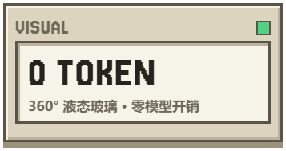
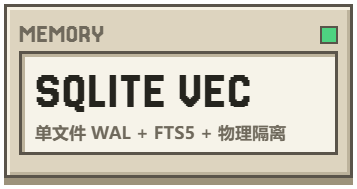
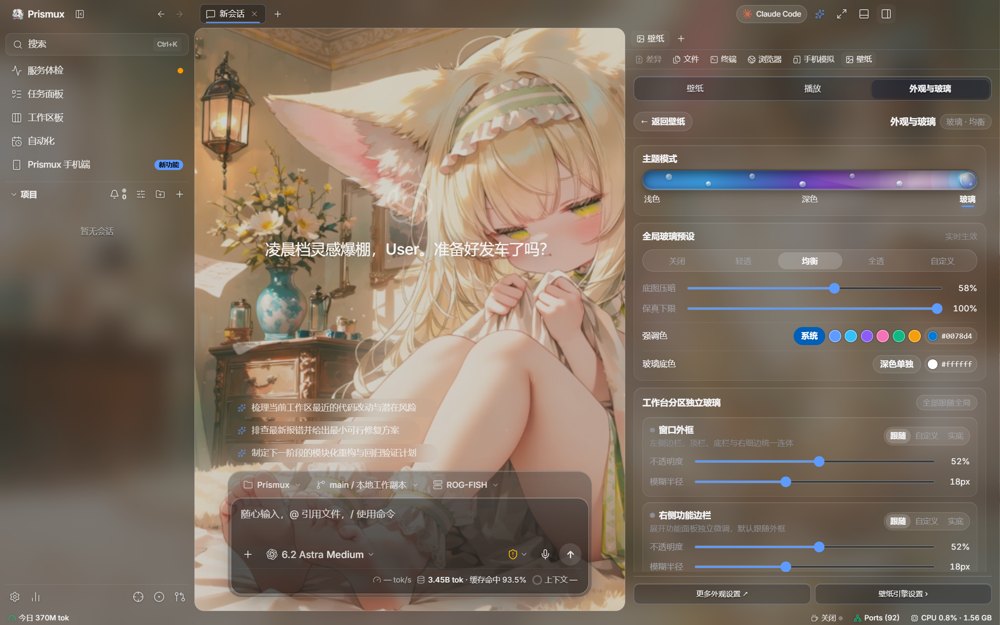
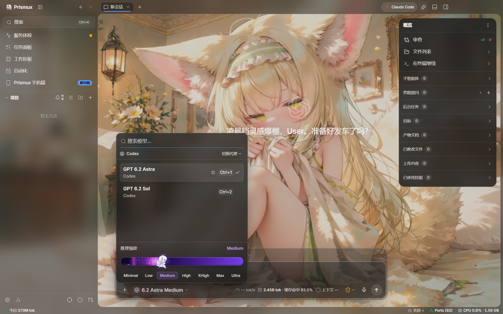
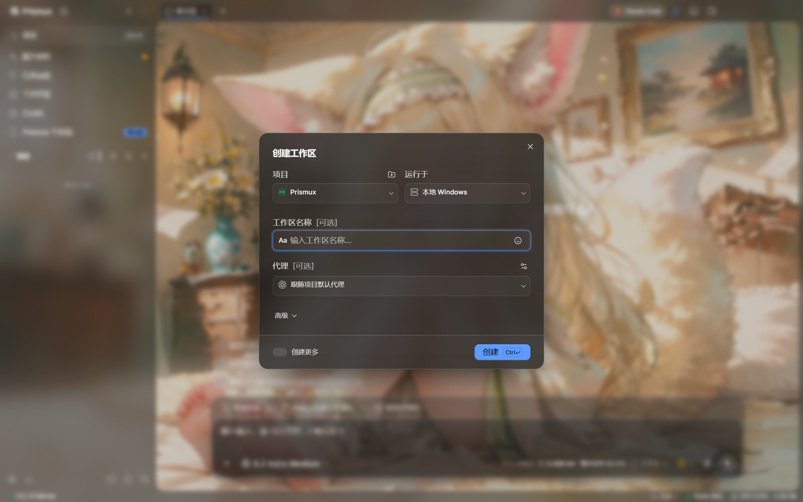

<div align="center">

<p>
  <a href="README.md"><picture><source media="(prefers-color-scheme: dark)" srcset="assets/readme/key-zh-zh-dark.png"></picture></a>
  <a href="README.en.md"><picture><source media="(prefers-color-scheme: dark)" srcset="assets/readme/key-en-zh-dark.png"></picture></a>
  <a href="#install"><picture><source media="(prefers-color-scheme: dark)" srcset="assets/readme/key-start-zh-dark.png"></picture></a>
</p>

<picture>
  <source media="(prefers-color-scheme: dark)" srcset="assets/readme/hero-zh-dark.png">
  
</picture>

<p>
  <a href="https://github.com/Fish-under-sea/Prismux/releases/tag/v0.1.2-preview.1"><picture><source media="(prefers-color-scheme: dark)" srcset="assets/readme/stat-version-zh-dark.png"></picture></a>
  <a href="#preview"><picture><source media="(prefers-color-scheme: dark)" srcset="assets/readme/stat-visual-zh-dark.png"></picture></a>
  <a href="#features"><picture><source media="(prefers-color-scheme: dark)" srcset="assets/readme/stat-memory-zh-dark.png"></picture></a>
  <a href="#plugins"><picture><source media="(prefers-color-scheme: dark)" srcset="assets/readme/stat-plugins-zh-dark.png"></picture></a>
</p>

<p>
  = 24.12">
  
  
  
  
  
</p>

<p><strong>Prismux · 极简液态玻璃 AI 超级工作台与 24 小时常驻秘书系统</strong><br>基于真实 T3 Code 本体（Electron 44 + <code>apps/server</code> + <code>apps/web</code>）最小入侵挂载构建，融合单层 SVG Mask 镂空一体外壳与 5 分区实时液态玻璃、Orca 多标签递归分屏与任务面板 / 工作区板、AGY 2.0 欢迎页与双层修长液态玻璃输入框、模型识别奔跑小人思考条（0-Token）、AGY 概览面板、20px 真机资源归因与防休眠底栏、系统托盘、主秘书定制与 Obsidian Agent 策展导入、自动更新全闭环通知及国内外双源分卷自动更新。</p>

<p>
  <a href="#install"><picture><source media="(prefers-color-scheme: dark)" srcset="assets/readme/key-download-zh-dark.png"></picture></a>
  <a href="https://github.com/Fish-under-sea/Prismux/releases/tag/v0.1.2-preview.1"><picture><source media="(prefers-color-scheme: dark)" srcset="assets/readme/key-release-zh-dark.png"></picture></a>
  <a href="https://github.com/Fish-under-sea/Prismux/issues"><picture><source media="(prefers-color-scheme: dark)" srcset="assets/readme/key-issues-zh-dark.png"></picture></a>
</p>

</div>

<h2 id="intro"><picture><source media="(prefers-color-scheme: dark)" srcset="assets/readme/section-intro-zh-dark.png"></picture></h2>

Prismux 是一个围绕 **「真实 T3 Code 内核 + 外置独立 0-Token 视觉壳 + 按需独立插件」** 构建的 AI 超级工作台与 24 小时无头秘书系统。**Prismux v0.1.2 Preview 1**（`v0.1.2-preview.1`）在真实 **T3 Code 本体底座**（Electron 44 + `apps/server` + `apps/web`，全部挂载点与 Provider 扩展点严格登记于 [`docs/t3code-patch-manifest.md`](docs/t3code-patch-manifest.md)，零修改 `vendor/t3code/pnpm-lock.yaml`）之上，带来全链路架构打磨与旗舰视觉交互升级：

- **单层 SVG Mask 镂空一体外壳、5 分区玻璃与 0-Token 启动闪屏**：`@prismux/appearance` 全新落地单层连续外壳 SVG `<mask>` 圆角镂空（零角隅色差与亚像素接缝）、5 分区独立液态玻璃与就地「外观与玻璃」实时工作台（天体三态胶囊 `0.00px` 精确对齐、全局单层圆角零直角外突弹窗）；新增纯 CSS/SVG 居中彩虹扫光 + 右下角 6 面棱镜 3D 旋转魔方启动闪屏（对大模型 **0 Token**）。
- **单顶栏融合、Orca 多标签分屏、工作区板与任务面板**：彻底消除冗余双顶栏，将主秘书呼吸厂商 Logo 胶囊与概览开关优雅并入单行 `WorkspaceTabBar`，支持 2–3 窗格递归分屏与右栏内嵌 `+` 新代理会话；左侧 280px Orca 侧栏齐备 5 项快捷导航（`服务体检 → 任务面板 → 工作区板 → 自动化 → Prismux 手机端`）、54px 收起态悬浮液态玻璃抽屉、1:1 Orca 项目头与 `Ctrl+N` 创建工作区弹窗，原生引入轻量 **工作区板（`/workspace-board`）** 与 **任务面板（`/tasks`）**。
- **AGY 2.0 欢迎页、双层修长液态玻璃输入框与按 Agent 聚焦模型选择器**：6 时段双语问候与动态半透明厂商水印（含 5 连击彩蛋），支持左右对称拖拽调宽；双层液态玻璃输入框具备外层工作区/分支/主机托盘、4 档中文权限盾牌与窄宽零重叠实时 `TPS` / 缓存命中率遥测；左缘锁定 `<= 1px` 对齐的聚焦模型弹层完整保留 **`dsh-better-reasoning-effort-fish`** 8 大家族动态奔跑小人思考强度条与 Codex/Claude **`⚡ 快速`（Fast Mode）**。
- **AGY 概览面板、20px 精致状态栏、真机进程归因与系统托盘**：右侧「概览（Overview）」面板整合 `审查 / 文件列表 / 在终端继续`、8 大结构化区块与旁路提问；底部状态栏精炼至 `20px`，聚合实时 `今日用量`、真 Electron `powerSaveBlocker` ☕「防止电脑休眠」（`开启 / 代理 / 关闭`）、双栈去重 `Ports` 与 Electron + Daemon 真机进程树 `CPU / RAM` 归因；新增 Windows 系统托盘（活跃代理数 + `连接到手机端 >` 二级菜单）。
- **主秘书自定义命名、总控 `AGENTS.md` 与 Obsidian Agent 策展导入**：支持自定义 `secretaryName`、`@主秘书` 识别前缀与 `~/.prismux/chief/AGENTS.md` 持久化总控规则编辑，一键发起由主秘书策展整理的 Obsidian Vault 导入，并将同步引擎全面更名为 **Prismux 端到端加密同步**；设置页移除水平分割线并拆分「外观」与「壁纸」，新增智能体提供方删除持久化（防重启复活）。
- **自动更新全闭环通知、双源分卷更新、纯官方 ACP 与零预装插件**：自动更新支持启动静默检查、右下角液态玻璃提醒卡片、居中更新日志弹窗与 FLIP 飞入侧边栏胶囊，底层支持 GitHub ↔ Gitee（80 MB `.7z.001..003` + 随包 `resources/tools/7za.exe` 无损重组与强制 SHA-256 校验，OpenAPI 403 自动回退 Web Releases）；全面净化可见界面品牌文案，坚守纯官方 `agy acp` / `omp acp` 与四大官方插件 **100% 默认零预装**。

当前发行版本为 **`Prismux v0.1.2 Preview 1`**（`v0.1.2-preview.1`），率先提供 Windows x64 安装包 `Prismux-Setup-0.1.2-preview.1-win-x64.exe`（GitHub Releases 与 Gitee Releases 双源发布），macOS 与 Linux 安装包通道已预留。

<h2 id="preview"><picture><source media="(prefers-color-scheme: dark)" srcset="assets/readme/section-preview-zh-dark.png"></picture></h2>

> 以下均为 **Prismux Electron 44 Windows 实机 GPU 渲染**全窗口高清截图（未做任何 P 图修饰）：

<table>
  <tr>
    <td width="50%" align="center" valign="top">
      
      <br>
      <sub><strong>Orca 多标签分屏 + AGY 2.0 双层输入框 + 呼吸主秘书胶囊</strong>：默认 280px Orca 侧栏呈 <code>[Logo+Prismux 菜单][收缩]</code> 与底栏左右分区；主工作台采用 <code>14px</code> 内屏圆角、多标签左右分屏、6 时段问候与动态厂商水印、双层液态玻璃输入框（窄宽自动独立二行遥测零重叠）及顶栏呼吸厂商 Logo 胶囊。</sub>
    </td>
    <td width="50%" align="center" valign="top">
      
      <br>
      <sub><strong>右侧壁纸边栏真毛玻璃 + 就地「外观与玻璃」6 分区实时精调</strong>：玻璃态透出底层暖金壁纸绝无死黑底色；点击「外观与玻璃」不跳设置页、就地展开紧凑实时工作台，天体三态胶囊球心与标签 <code>0.00px</code> 对齐，左侧边栏、右侧边栏、主画布、输入框、顶底栏与弹窗层 6 大分区 100% 独立可控。</sub>
    </td>
  </tr>
  <tr>
    <td width="50%" align="center" valign="top">
      
      <br>
      <sub><strong>按 Agent 聚焦模型选择器 + <code>dsh-fish</code> 思考条 + 右侧 AGY 概览面板</strong>：模型弹层聚焦当前 Agent 列表配实时搜索与两行精致卡片，底栏完整保留模型自动识别奔跑小人思考强度条（对大模型 <strong>0 Token</strong>）；右侧「概览」收编 <code>审查</code> / <code>文件列表</code> / <code>在终端继续</code> 与 8 大结构化区块（含轻量旁路提问）。</sub>
    </td>
    <td width="50%" align="center" valign="top">
      
      <br>
      <sub><strong>4 分组设置侧栏 + <code>0.00px</code> 对齐天体胶囊 + 6 分区精细玻璃控制台</strong>：设置侧栏收敛为 4 个纯中文分组（保留 <code>归档</code>）与阻尼滑动指示器；「外观与壁纸」移除多余圆角滑块改为默认内屏圆角，内置三态 <code>0.00px</code> 对齐天体胶囊与 6 分区玻璃双向实时同步，并保持 ≥ 4.5:1 亮度钳制。</sub>
    </td>
  </tr>
  <tr>
    <td width="50%" align="center" valign="top">
      
      <br>
      <sub><strong>1:1 Orca 项目栏 + <code>Ctrl+N</code> 创建工作区液态玻璃弹窗</strong>：完整复原 Orca 左侧栏项目头（悬停 <code>↕ Ctrl+Shift+H</code>、<code>🔔</code> 代理活动筛选视图、<code>🎛</code> 筛选与视图菜单、<code>📁+</code> 添加项目菜单及 <code>Ctrl+N</code> 液态玻璃「创建工作区」弹窗，支持项目/环境/Emoji 命名/代理选择与 <code>创建更多</code>）。</sub>
    </td>
    <td width="50%" align="center" valign="top">
      
      <br>
      <sub><strong>24px 底栏真实进程资源归因 + 实时用量 + ☕ 防休眠三态</strong>：精简移除冗余 <code>Ctx/Cache</code>，保留实时 <code>今日用量</code>、真 Electron <code>powerSaveBlocker</code> ☕「防止电脑休眠」（<code>开启/代理/关闭</code>）、<code>Ports</code> 与 Electron+Daemon 混合真机 12 进程资源归因，全部弹层采用单层圆角液态玻璃零直角外突。</sub>
    </td>
  </tr>
</table>

<h2 id="features"><picture><source media="(prefers-color-scheme: dark)" srcset="assets/readme/section-features-zh-dark.png"></picture></h2>

<table>
  <tr>
    <td width="50%" valign="top">
      <strong>1. T3 Code 底座、<code>omp acp</code> 与纯官方 <code>agy acp</code></strong>
      <p>Electron 44 桌面端（<code>PrismuxDaemonService</code>）监督托管 <code>@prismux/daemon</code>（仅向守护子进程注入 <code>ELECTRON_RUN_AS_NODE=1</code> 并透传真实 T3 Server 地址），首启进入 <code>/welcome</code> 引导后常驻工作台，支持 Claude / Codex / Antigravity / OpenCode / OMP 担任 <code>Chief Thread Slot</code> 主秘书。</p>
      <p>内置 Antigravity 100% 走官方 <code>agy acp</code>（<code>local-cli</code>，零窃读本地凭据、零 <code>v1internal</code> 旁路）；<code>omp acp</code> 一等公民方言完整打通 <code>_session/steering</code> 转向、纯 ACP <code>_omp/usage</code>、Shell 清洗与断线重连。</p>
    </td>
    <td width="50%" valign="top">
      <strong>2. 五大标杆内化原语（严禁 4 项冗余看板）</strong>
      <p>永久裁撤脱离会话体系的重型权威项目看板（Task Board）、AgentTeam DAG、Skill Lens、Visual Companion 及自建重型会话归档系统（保留 T3 Code 原生轻量 <code>/settings/archived</code> 与 Orca 轻量工作区板 / 任务面板），凝练为五大高精度原语：</p>
      <ul>
        <li><code>PersistentPtyPool</code>：每终端 <code>2 MB</code> 环形缓冲与断线无损回放</li>
        <li><code>HandoffEngine</code>：<code>/handoff</code> 提纯续跑、<code>agent / oracle / review</code> 三档拨盘与 Orca 动态围栏延续</li>
        <li><code>CollectorAndGuard</code>：多格式切片 + 传输层身份注入与 <code>60 s</code> 熔断</li>
        <li><code>LifecycleHookBus</code>：6 类钩子、退出码 <code>2</code> 拦截与默认 <code>onFailure: "block"</code></li>
        <li><code>WorktreeSandbox</code>：OS 级写隔离与域名白名单本地 HTTP 代理网关</li>
      </ul>
    </td>
  </tr>
  <tr>
    <td width="50%" valign="top">
      <strong>3. Mnemopi 记忆召回、主秘书定制与夜间工场</strong>
      <p>全部记忆收敛于单文件 <code>~/.prismux/data/memory.db</code>（SQLite WAL + FTS5 + <code>sqlite-vec</code>），融合 <strong>Mnemopi Prompt-Cache</strong> 友好召回（<code>&lt;memories&gt;</code>/<code>&lt;memory-delta&gt;</code> XML 转义防护、两阶段 <code>prepare/commit</code> 与 4 级分域缓存）、主秘书自定义命名与 <code>~/.prismux/chief/AGENTS.md</code> 持久化规则，以及 Obsidian Agent 策展导入。<code>forwardIdentity</code> 在传输层强制覆写 <code>_callerScope</code>，<code>qq_group:&lt;gid&gt;</code> 绝不可读取 <code>private/chief</code> 或 <code>workspace/*</code>。</p>
      <p><code>OvernightFactory</code> 串联 Gmail OAuth2 / IMAP <code>#factory</code> 入站 → 记忆立项 → Worktree 沙箱编码提交 → Oracle 只读 <code>review</code> → 带 Diff 与 <code>prismux://review/&lt;threadId&gt;</code> 的 HTML 早报。</p>
    </td>
    <td width="50%" valign="top">
      <strong>4. 0-Token 视觉矩阵、单层镂空玻璃与思考强度滑条</strong>
      <p><code>@prismux/appearance</code> 沉淀单层 SVG Mask 镂空一体外壳、5 分区实时液态玻璃、1:1 FISH-Dock 天体三态胶囊与 <code>&lt;PrismuxReasoningEffortSlider /&gt;</code>（<code>dsh-better-reasoning-effort-fish</code> 8 大模型家族识别 + 内嵌 RGBA WebP 奔跑小人 + Canvas 像素辐射），结合 <code>@prismux/wallpaper</code>（Steam <code>431960</code> / WebWallGL / 遮挡 <code>0 FPS</code> 挂起）、20px 精致状态栏与无分割线设置导航，保持对大模型 <strong>0 Token 开销</strong>与 ≥ 4.5:1 对比度。</p>
      <p>0-Token 彩虹魔方启动闪屏、全局 300ms 悬停预测锥、54px 图标栏悬浮抽屉、双层液态玻璃输入框与实时遥测均纯本地真实渲染。</p>
    </td>
  </tr>
  <tr>
    <td width="50%" valign="top">
      <strong>5. Cordis 声明式插件中心与 Prismux 端到端加密同步</strong>
      <p><code>@prismux/cordis-kernel</code> 强制校验顶层 <code>engines.prismux</code> SemVer，以 <code>ctx.effect()</code> 实现卸载零残留回滚，内置 <code>512 KiB</code> 预算声明式液态玻璃 UI（<code>DeclarativeGlassRenderer</code>）与 4 态插件中心（<code>distribution: "managed"</code> 锁与 <code>0600</code> 独立凭据）；社区 npm 导入免 Git 禁安装脚本。</p>
      <p><code>@prismux/sync-vault</code>（Prismux 端到端加密同步）采用 Argon2id + AEAD 密封 <code>.prismux-backup</code>，支持 WebDAV / S3 / GitHub 独立开关、<code>If-Match</code> 乐观锁、<code>60 s</code> 停滞看门狗与便携 <code>data/</code> 模式。</p>
    </td>
    <td width="50%" valign="top">
      <strong>6. 手机模拟器、系统托盘与双源全闭环自动更新</strong>
      <p>内置零依赖手机模拟器结合 Electron CDP（<code>deviceScaleFactor: 0</code> + 触控注入）与单层 CSS 缩放，保障高 DPI 四边 0 裁切；新增系统托盘（活跃代理数 + <code>连接到手机端 &gt;</code> 二级菜单）与真 Electron <code>powerSaveBlocker</code> 防休眠。</p>
      <p><code>AppUpdater</code> 在 <strong>GitHub ↔ Gitee</strong> 与 <strong>npm ↔ npmmirror</strong> 间测速选优（OpenAPI 403 自动降级 Web Releases 解析），支持右下角更新提醒卡片 + FLIP 侧栏胶囊、Gitee 3 分卷 <code>7za.exe</code> 重组、SHA-256 强制校验与桌面端一键安装重启；10 语种词典同步（<code>en/zh</code> <code>10,300</code> 词条 100% 对齐）。</p>
    </td>
  </tr>
</table>

<h2 id="plugins"><picture><source media="(prefers-color-scheme: dark)" srcset="assets/readme/section-plugins-zh-dark.png"></picture></h2>

> [!NOTE]
> **四大官方插件默认绝不预装**：`Prismux-Setup-0.1.2-preview.1-win-x64.exe` 安装包及解压态 `win-unpacked/` 均**绝不包含** `plugins-official/` 任何插件目录（打包后通过递归扫描 0 命中校验）。以下 4 个官方插件均以独立 `.wb-plugin` 归档（配合 `prismux-plugins-official.json` 与 `prismux-plugins-0.1.2-preview.1-SHA256SUMS.txt`）及无脚本 npm 单包形式分发，按需安装并支持 `ctx.effect()` 零残留卸载。

| 插件 ID | 独立归档包（`.wb-plugin`） | npm 包名（无作用域 / GitHub Packages） | 运行域（`realms`） | 核心能力与隔离边界 |
| :--- | :--- | :--- | :--- | :--- |
| `qq` | `prismux-plugin-qq-0.1.2-preview.1.wb-plugin` | `prismux-plugin-qq`<br><code>@fish-under-sea/prismux-plugin-qq</code> | `daemon`、`ui` | OneBot v11 正/反向 WebSocket 自动探测（NapCatQQ / Lagrange.Core）；私聊主人接入主秘书，群聊启用防刷屏节奏器并硬隔离至 <code>social/qq-group-&lt;gid&gt;</code> |
| `pet` | `prismux-plugin-pet-0.1.2-preview.1.wb-plugin` | `prismux-plugin-pet`<br><code>@fish-under-sea/prismux-plugin-pet</code> | `ui`、`daemon` | 桌宠联动插件；实现定向实例绑定、带过期校验的 Lease Token 租约锁、只读播放进度订阅与动作/气泡分阶段交还 |
| `fishdock-hook` | `prismux-plugin-fishdock-hook-0.1.2-preview.1.wb-plugin` | `prismux-plugin-fishdock-hook`<br><code>@fish-under-sea/prismux-plugin-fishdock-hook</code> | `daemon` | FISH-Dock 灵动岛桥接插件；将 `PreToolUse` 中文风险审批、重要邮件与夜间工场完工回执推送至灵动岛卡片并支持快捷放行/驳回 |
| `ssh` | `prismux-plugin-ssh-0.1.2-preview.1.wb-plugin` | `prismux-plugin-ssh`<br><code>@fish-under-sea/prismux-plugin-ssh</code> | `daemon`、`ui` | 按需选装的远程运维插件；提供隔离 SSH 主机池、Web PTY 会话桥接、路径安全校验与 SFTP 文件浏览 |

<h2 id="install"><picture><source media="(prefers-color-scheme: dark)" srcset="assets/readme/section-install-zh-dark.png"></picture></h2>

### 双网络发行入口（GitHub Releases ↔ Gitee Releases）

| 分发渠道 | 适用场景 | 入口 / 下载说明 |
| :--- | :--- | :--- |
| **GitHub Releases**（国际直连） | 海外网络 / GitHub CLI 环境 | [Release 页面（`v0.1.2-preview.1`）](https://github.com/Fish-under-sea/Prismux/releases/tag/v0.1.2-preview.1) · [直下 `Prismux-Setup-0.1.2-preview.1-win-x64.exe`](https://github.com/Fish-under-sea/Prismux/releases/download/v0.1.2-preview.1/Prismux-Setup-0.1.2-preview.1-win-x64.exe) |
| **Gitee Releases**（国内镜像） | 中国大陆直连加速下载 | [Release 页面（`v0.1.2-preview.1`）](https://gitee.com/Fish-under-sea/Prismux/releases/tag/v0.1.2-preview.1)（含 80 MB 7z 无损分卷 `.7z.001..003`、分卷汇总校验与全部官方插件归档） |
| **软件内更新中心**（推荐） | 自动测速 GitHub / Gitee、分卷重组与强制 SHA-256 校验 | 在工作台打开 **设置 → 关于与更新**（`/settings/about#prismux-updates`），可在 `智能测速 / 国内优先 / 国际优先` 间秒切并一键安装重启 |

### 平台下载矩阵与完整性校验

| 平台 / 发行资产 | 文件名 / 计划状态 | 说明与隔离策略 |
| :--- | :--- | :--- |
| **Windows x64 安装包（Electron 44 NSIS）** | `Prismux-Setup-0.1.2-preview.1-win-x64.exe`（Gitee 同步提供 `.7z.001..003`） | 内含完整 Electron 44 桌面端、Bundled `resources/prismux-daemon/`、`resources/tools/7za.exe` 与 `t3-resource-monitor.exe`；支持 `/D=<目录>` 自定义路径；状态目录隔离于 `~/.prismux/`（亦支持便携 `data/`）；**四大官方插件零预装** |
| **macOS（Apple Silicon / Intel）** | `暂未发布（已预留通道占位）` | 后续预览版将提供 `.dmg` 通用或分架构归档，复用同一套 `0-Token` 视觉与 `~/.prismux/` 隔离规范 |
| **Linux（x86_64 / arm64）** | `暂未发布（已预留通道占位）` | 后续预览版将提供 `.AppImage` / `.deb` 发行资产，同样支持双源更新与独立插件导入 |
| **4 个官方独立插件包** | `prismux-plugin-{qq,pet,fishdock-hook,ssh}-0.1.2-preview.1.wb-plugin` & `prismux-plugins-official.json` | 四枚确定性 ustar + gzip 归档，下载后在 **设置 → 插件中心**（`/settings/plugins`）按需验签导入 |
| **分离式合并校验清单** | `Prismux-0.1.2-preview.1-SHA256SUMS.txt` & `prismux-plugins-0.1.2-preview.1-SHA256SUMS.txt` | 手动下载后可通过 `Get-FileHash Prismux-Setup-0.1.2-preview.1-win-x64.exe -Algorithm SHA256` 或 `7z t` 核对完整性 |

<h2 id="packages"><picture><source media="(prefers-color-scheme: dark)" srcset="assets/readme/section-packages-zh-dark.png"></picture></h2>

每个官方独立插件均额外发布为**零 `preinstall / install / postinstall` 脚本**的单包归档，内部携带已校验的 `prismux-plugin-<id>-0.1.2-preview.1.wb-plugin` 与防覆盖导出 CLI（`prismux-plugin-<id>`）；软件内插件市场同样支持在 **`registry.npmjs.org` ↔ `registry.npmmirror.com`** 间免本机 Git 纯流式拉取与自动故障回退。

```powershell
# 1. 从 npm 官方源安装并提取 .wb-plugin 归档（含 SHA-256 核对，目标同名文件存在时不覆盖）
npm install prismux-plugin-qq@0.1.2-preview.1
npx prismux-plugin-qq --out ./plugins-stage

# 2. 中国大陆网络使用 npmmirror 国内镜像加速安装
npm install prismux-plugin-qq@0.1.2-preview.1 --registry=https://registry.npmmirror.com
npx prismux-plugin-qq --out ./plugins-stage
```

- **可选插件前缀替换**：将上方命令中的 `qq` 替换为 `pet`、`fishdock-hook` 或 `ssh` 即可获取对应官方插件归档，然后在设置页 **插件中心**（`/settings/plugins`）直接拖入或选择导入。
- **GitHub Packages 同步包**：发布后工作流同步推送 `@fish-under-sea/prismux-plugin-{qq,pet,fishdock-hook,ssh}` 至 `https://npm.pkg.github.com`，方便企业或 CI 流水线拉取校验。

<h2 id="develop"><picture><source media="(prefers-color-scheme: dark)" srcset="assets/readme/section-develop-zh-dark.png"></picture></h2>

> **前置工具链**：`Node.js >= 24.12.0`、`pnpm >= 10.0.0`（主仓锁定 `pnpm@12.3.4`）、`Electron 44` 与 `Rust >= 1.85`（用于编译 `vendor/t3code/native/resource-monitor`；Windows 下运行 Cargo 请固定传入 `-j 1` 与 `NO_PROXY=*`）。执行前请先读取 [`AGENTS.md`](AGENTS.md)、[`docs/t3code-patch-manifest.md`](docs/t3code-patch-manifest.md) 与对应的个人环境档案 `docs/agents/local/<规范化用户名>.md`。

```powershell
# 1. 安装主仓工作区依赖（12 个 TS 工作区包）
pnpm install

# 2. 全仓构建、独立类型检查与全仓测试
pnpm -r build
pnpm -r typecheck
pnpm -r --if-present test
pnpm test:scripts

# 3. 校验 vendor/t3code managed-fork 契约、基线提交与补丁台账
pnpm upstream:check

# 4. 在 vendor/t3code 下检查并构建真实 Electron 44 桌面端（web + server + desktop）
pnpm --dir vendor/t3code exec vp run --filter @t3tools/web typecheck
pnpm --dir vendor/t3code exec vp run --filter @t3tools/desktop typecheck
pnpm --dir vendor/t3code exec vp run build:desktop

# 5. 一键串联主仓构建 + T3 底座构建 + Windows NSIS 安装包打包（含 7z 校验与 SHA256SUMS）
pnpm desktop:build
pnpm desktop:installer

# 6. 为指定官方插件生成确定性 .wb-plugin（内置 gunzip 回环校验）
pnpm plugin:pack -- --plugin plugins-official/plugin-qq
```

<details>
<summary><strong>展开查看：Monorepo 目录树与 T3 Code 最小入侵边界</strong></summary>

```text
prismux/
├── AGENTS.md                            # 跨机器统配入口、五大工程红线与验收门禁
├── LICENSE                              # 标准 MIT 开源许可证
├── README.md / README.en.md             # 中英双语项目主页
├── UPSTREAM_LOCK.json                   # pingdotgg/t3code 基线 SHA、managed-fork 模式与台账指针
├── pnpm-workspace.yaml                  # 12 个 TS 工作区包白名单（排除 vendor/t3code 与 desktop-tauri）
├── package.json                         # 根任务编排脚本（0.1.2-preview.1）
├── tsconfig.base.json                   # TypeScript 5.8+ 严格共享基线（ES2024 + NodeNext）
├── assets/
│   ├── logo.png                         # 透明 1024×1024 吉祥物主图标
│   └── readme/                          # 立体像素头图、分栏横幅、Preview 1 实机截图与渲染模板
├── docs/
│   ├── t3code-patch-manifest.md         # T3 Code MP-01 ~ MP-07 最小入侵挂载与扩展点权威台账
│   ├── agents/                          # 按人存放的本机环境档案说明、模板与个人档案
│   ├── releases/v0.0.1-alpha.1.md       # 早期原型版本归档说明
│   └── specs/
│       ├── master-prompt-v1.3.md        # 全栈自主施工总指令书（架构宪法）
│       └── ui-ux-design-mandate.md      # UI/UX、主题与背景及安装包强制设计规范
├── scripts/                             # 运维脚本与 README 渲染器（纯 Node 24 原生 TS / ESM）
│   ├── build-prismux-desktop.ts         # 一键桌面构建与 NSIS 安装包编排器（--installer / --skip-rust）
│   ├── release-all.ts                   # 桌面安装包 + 4 大官方插件 + npm 单包 + SHA256SUMS 统一发布
│   ├── sync-t3-upstream.ts              # managed-fork / 上游锁校验脚本（--check / --sync）
│   ├── pack-plugin.ts                   # 确定性 ustar + gunzip 回环校验插件打包器
│   ├── build-npm-plugin-packages.ts     # 生成无脚本 npm / GitHub Packages 插件单包
│   ├── rename-brand.ts                  # 全局品牌标识安全替换脚本
│   ├── render-readme.mjs                # Edge CDP 立体像素头图与分栏横幅渲染器
│   └── __tests__/scripts.test.ts        # node:test 回归测试
├── vendor/
│   └── t3code/                          # T3 Code 运行底座（Electron 44 + server + web），受控于 MP-01 ~ MP-07 台账
├── packages/                            # 6 个核心 workspace 包
│   ├── protocol/                        # @prismux/protocol：品牌常量、RPC、Hook、记忆、插件与更新契约
│   ├── cordis-kernel/                   # @prismux/cordis-kernel：双域插件内核、声明式 UI 校验、双源流式安装器与 0600 凭据
│   ├── memory-core/                     # @prismux/memory-core：SQLite WAL + FTS5 + sqlite-vec、Mnemopi 召回与物理防泄密
│   ├── sync-vault/                      # @prismux/sync-vault：Argon2id + AEAD 同步、乐观锁与 60 s 看门狗
│   ├── prismux-appearance/              # @prismux/appearance：天体胶囊、声明式液态玻璃、模型识别动态思考强度滑条与 T3 玻璃桥
│   └── prismux-wallpaper/               # @prismux/wallpaper：双页签边栏、4 页签设置、Z-0 舞台与 Steam 431960 扫描
├── apps/                                # 核心守护进程（含待退役原型壳与历史壳）
│   ├── daemon/                          # @prismux/daemon：24h 守护、主秘书槽位、五大原语、服务体检/端口资源与夜间工场
│   ├── workbench-ui/                    # @prismux/workbench-ui：[待退役原型壳] v0.0.1 原型界面，已由真实 T3 Code 底座接替
│   └── desktop-tauri/                   # prismux-desktop：[历史原生壳] 主桌面端已切换为 T3 Code Electron 44
└── plugins-official/                    # 4 个官方独立插件（workspace 包）与权威索引
    ├── catalog/official.json            # 官方插件权威发布索引（SHA-256 / bytes / engines / status）
    ├── plugin-qq/                       # @prismux/plugin-qq
    ├── plugin-pet/                      # @prismux/plugin-pet
    ├── plugin-fishdock-hook/            # @prismux/plugin-fishdock-hook
    └── plugin-ssh/                      # @prismux/plugin-ssh
```

</details>

<details>
<summary><strong>展开查看：五大绝对工程红线</strong></summary>

1. **T3 Code 本体最小入侵与业务外置原则**：`vendor/t3code/` 仅允许保留已登记于 [`docs/t3code-patch-manifest.md`](docs/t3code-patch-manifest.md) 的 MP-01 ~ MP-07 标准化挂载与扩展点（且零修改 `vendor/t3code/pnpm-lock.yaml`），严禁散落业务逻辑；重逻辑全部沉淀于主仓 `packages/*` 与 `apps/daemon`。
2. **严禁混入已砍掉的 4 项冗余模块（保留 T3 Code 原生轻量线程归档与 Orca 轻量工作区/任务视图）**：禁止实现脱离会话体系的重型权威项目看板（Task Board）、AgentTeam DAG、Skill Lens、Visual Companion 及自建重型会话归档系统，统一由五大内化原语替代；**T3 Code 原生轻量线程归档（`/settings/archived`）及 Orca 轻量工作区板（`/workspace-board`）/ 任务面板（`/tasks`）按项目决策予以保留**。
3. **内生单文件记忆中枢与物理防泄密**：记忆引擎固定为 `~/.prismux/data/memory.db`（SQLite WAL + FTS5 + `sqlite-vec`），零 PostgreSQL / Qdrant / MinIO / Obsidian 客户端依赖；查询层强制绑定 `_callerScope` 物理隔离。
4. **四大官方插件默认绝不预装**：`qq`、`pet`、`fishdock-hook`、`ssh` 全部作为独立包存放于 `plugins-official/`，主程序与安装包均不含插件包，按需从市场安装。
5. **视觉层对模型 0 Token 开销与强制设计规范**：壁纸、360° Fresnel 液态玻璃、模型识别奔跑小人思考条、字体调色、系统音频律动、桌宠演出与安装引导均不向任何大模型注入工具定义或提示词。

</details>

<details>
<summary><strong>展开查看：M1–M5 与 Preview 1 里程碑矩阵</strong></summary>

| 里程碑 | 核心交付内容 | 验收状态 |
| :--- | :--- | :--- |
| **M1** | Monorepo 骨架、T3 Code 基线接入、`apps/daemon` 进程监督、环境变量净化、主秘书槽位与 `2 MB` 环形 `PersistentPtyPool` | 已完成并通过门禁 |
| **M2** | 单文件 SQLite WAL + FTS5 + `sqlite-vec` 混合记忆、Mnemopi 召回与分域缓存、`forwardIdentity` 隔离、`LifecycleHookBus`、`HandoffEngine` 与 `WorktreeSandbox` | 已完成并通过门禁 |
| **M3** | `cordis-kernel`（`engines.prismux` 校验、`ctx.effect()` 零残留、免 Git 流式安装、声明式 UI）与 `sync-vault`（Argon2id + AEAD、`If-Match`、`60 s` 看门狗、`data/` 便携模式） | 已完成并通过门禁 |
| **M4 / v0.1.0–v0.1.2 Preview 1** | `@prismux/appearance`（单层 SVG Mask 镂空一体外壳、5 分区玻璃与 `dsh-fish` 思考条）+ `@prismux/wallpaper` 外置沉淀、T3 Code MP-01 ~ MP-07 融合（0-Token 魔方启动闪屏、单顶栏多标签分屏、Orca 侧栏/工作区板/任务面板、AGY 2.0 欢迎页与双层输入框、AGY 概览面板、20px 真机归因与防休眠底栏、系统托盘、主秘书定制与 Obsidian 策展导入、自动更新全闭环通知、无分割线设置与纯官方 ACP） | 已完成并通过实机签收 |
| **M5** | `OvernightFactory` 夜间全自动工场闭环、四大官方独立插件确定性打包验签（`0.1.2-preview.1`）与双源分卷自动更新体系 | 已完成并通过门禁 |

</details>

<h2 id="thanks"><picture><source media="(prefers-color-scheme: dark)" srcset="assets/readme/section-thanks-zh-dark.png"></picture></h2>

### 工程文档索引

| 文档 | 说明 |
| :--- | :--- |
| [`AGENTS.md`](AGENTS.md) | 跨机器统配入口、五大工程红线、脚本与插件打包契约、环境排障与提交流程 |
| [`docs/t3code-patch-manifest.md`](docs/t3code-patch-manifest.md) | T3 Code MP-01 ~ MP-07 最小入侵挂载与 Provider 扩展点登记台账 |
| [`docs/specs/ui-ux-design-mandate.md`](docs/specs/ui-ux-design-mandate.md) | 世界级 UI/UX、天体三态胶囊、四区液态玻璃同步契约与安装包强制设计规范 |
| [`docs/specs/master-prompt-v1.3.md`](docs/specs/master-prompt-v1.3.md) | Prismux 全栈自主施工总指令书（架构宪法） |
| [`docs/agents/README.md`](docs/agents/README.md) | 贡献者本机环境档案命名规范、模板与维护流程 |
| [`docs/releases/v0.0.1-alpha.1.md`](docs/releases/v0.0.1-alpha.1.md) | 早期原型阶段发行说明归档 |
| [`assets/readme/MAINTAINING.md`](assets/readme/MAINTAINING.md) | README 立体像素头图与分栏横幅渲染、尺寸与图床缓存维护指南 |

### 上游项目与 MIT 开源致谢

- [pingdotgg/t3code](https://github.com/pingdotgg/t3code)（MIT）：提供 Electron 44 + `apps/server` + `apps/web` 运行底座与 Provider 桥接内核。
- [stablyai/orca](https://github.com/stablyai/orca)（MIT）：提供端口扫描与资源监控、24px 状态栏、可拖拽 Activity Bar、Orca 侧栏与单体输入框、`omp` 方言与声明式 UI 状态机等参考对标。
- [can1357/oh-my-pi](https://github.com/can1357/oh-my-pi)（MIT）：提供 Mnemopi Prompt-Cache 召回与分域缓存、`omp acp` `_session/steering` / `_omp/usage` 协议及状态栏 Context / Cache 刻度参考。
- `dsh-better-reasoning-effort-fish`（[HanaAyane/dsh-reasoning-effort](https://github.com/HanaAyane/dsh-reasoning-effort) PR #9 + [HaoyueQin/dsh-better-reasoning-effort](https://github.com/HaoyueQin/dsh-better-reasoning-effort)，MIT）：提供模型自动识别动态思考强度滑条（`<PrismuxReasoningEffortSlider />`、8 大家族主题与 RGBA WebP 奔跑小人）移植源。
- [yetone/magpie](https://github.com/yetone/magpie)：启发口令密封 AEAD 加密同步、`If-Match` 乐观锁、60 秒停滞看门狗与便携模式设计规范。
- [Amp](https://ampcode.com/)：启发 `/handoff` 上下文提纯交接与 `agent / oracle / review` 三档角色拨盘工作流。
- [FISH-Dock](https://github.com/Fish-under-sea/FISH-Dock)：提供 Warm Paper / Dark Olive 立体像素视觉体系、1:1 光学天体胶囊与 360° Fresnel 液态玻璃主题规范及灵动岛审批回执联动灵感。

### 许可边界

Prismux 本仓核心代码与排版工具链遵循 **MIT License**（见仓库根 [`LICENSE`](LICENSE)）；随视觉资产分发的像素字体 `Jersey20-Regular.ttf` 遵循 [SIL Open Font License 1.1](assets/readme/OFL-Jersey20.txt)；基于 `pingdotgg/t3code`（MIT）托管的 `vendor/t3code` 及上述参考移植源码均严格保留各自原始 MIT 许可证与归属声明。
