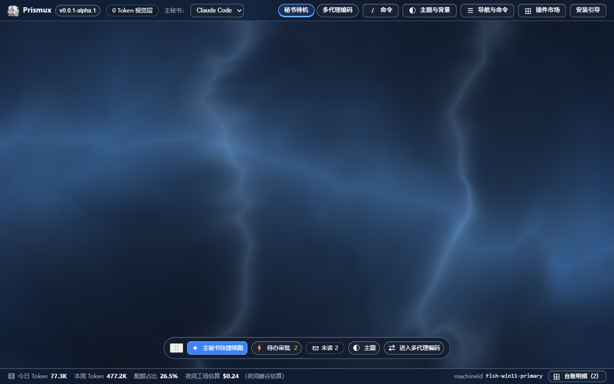

<div align="center">

<p>
  <a href="README.md"><picture><source media="(prefers-color-scheme: dark)" srcset="assets/readme/key-zh-zh-dark.png"></picture></a>
  <a href="README.en.md"><picture><source media="(prefers-color-scheme: dark)" srcset="assets/readme/key-en-zh-dark.png"></picture></a>
  <a href="#install"><picture><source media="(prefers-color-scheme: dark)" srcset="assets/readme/key-start-zh-dark.png"></picture></a>
</p>

<picture>
  <source media="(prefers-color-scheme: dark)" srcset="assets/readme/hero-zh-dark.png">
  
</picture>

<p>
  <a href="https://github.com/Fish-under-sea/Prismux/releases/tag/v0.0.1-alpha.1"><picture><source media="(prefers-color-scheme: dark)" srcset="assets/readme/stat-version-zh-dark.png"></picture></a>
  <a href="#preview"><picture><source media="(prefers-color-scheme: dark)" srcset="assets/readme/stat-visual-zh-dark.png"></picture></a>
  <a href="#features"><picture><source media="(prefers-color-scheme: dark)" srcset="assets/readme/stat-memory-zh-dark.png"></picture></a>
  <a href="#plugins"><picture><source media="(prefers-color-scheme: dark)" srcset="assets/readme/stat-plugins-zh-dark.png"></picture></a>
</p>

<p>
  = 24.12">
  
  
  
  
  
</p>

<p><strong>Prismux · 极简液态玻璃 AI 超级工作台与 24 小时常驻秘书系统</strong><br>只读桥接 <code>t3code</code> 服务，融合代理无关主秘书槽位、单文件三域隔离记忆、360° Fresnel 液态玻璃、国内外双源热更新与夜间全自动工场。</p>

<p>
  <a href="#install"><picture><source media="(prefers-color-scheme: dark)" srcset="assets/readme/key-download-zh-dark.png"></picture></a>
  <a href="docs/releases/v0.0.1-alpha.1.md"><picture><source media="(prefers-color-scheme: dark)" srcset="assets/readme/key-release-zh-dark.png"></picture></a>
  <a href="https://github.com/Fish-under-sea/Prismux/issues"><picture><source media="(prefers-color-scheme: dark)" srcset="assets/readme/key-issues-zh-dark.png"></picture></a>
</p>

</div>

<h2 id="intro"><picture><source media="(prefers-color-scheme: dark)" srcset="assets/readme/section-intro-zh-dark.png"></picture></h2>

Prismux 是一个围绕 **「极简高效内核 + 零模型 Token 视觉壳 + 按需独立插件」** 构建的 AI 超级工作台与 24 小时无头秘书系统。主程序默认只携带轻量守护进程（`apps/daemon`）、工作台前端（`apps/workbench-ui`）、桌面透明壳（`apps/desktop-tauri`）与单文件 SQLite 记忆中枢（`packages/memory-core`），已完成 **M1–M5 全栈能力与 `v0.0.1-alpha.1` 双源发行基础设施**。

- **100% 只读上游隔离**：上游 [`vendor/t3code`](vendor/t3code) 保持严格只读 Git 子模块并排除出 `pnpm-workspace.yaml`，所有扩展通过鉴权 WebSocket RPC 与外置 MCP 协议完成。
- **零重型外部依赖**：不使用 PostgreSQL、Qdrant、MinIO 或本地 Obsidian 客户端；记忆、缓存与配置全部收敛在 `~/.prismux/`（便携模式收敛于同级 `data/` 目录）。
- **四大官方插件默认绝不预装**：`qq`、`pet`、`fishdock-hook`、`ssh` 全部独立发布为 `.wb-plugin` 与无脚本 npm 包，安装后在内置插件市场按需选装。

当前公开内测版本为 **`v0.0.1-alpha.1`**，完整变更与校验清单见 [v0.0.1-alpha.1 发布说明](docs/releases/v0.0.1-alpha.1.md)。

<h2 id="preview"><picture><source media="(prefers-color-scheme: dark)" srcset="assets/readme/section-preview-zh-dark.png"></picture></h2>

<p align="center">
  
  <br>
  <sub><strong>秘书待机预设</strong>：收起重型编码面板，保留 85%–90% 纯净 <code>WebWallGL</code> 实时壁纸视野、底部浮动玻璃胶囊与紧凑 <code>UsageLedger</code> 台账条。</sub>
</p>

<table>
  <tr>
    <td width="50%" align="center" valign="top">
      
      <br>
      <sub><strong>天体三态胶囊与四区液态玻璃</strong>：全宽内凹星芒月球三态切换胶囊、<code>WebWallGL + Steam 431960</code> 壁纸引擎与四区域（<code>sidebar / content / overlay / control</code>）独立玻璃调控。</sub>
    </td>
    <td width="50%" align="center" valign="top">
      
      <br>
      <sub><strong>多代理分屏编码与中文审批引导</strong>：Worktree 状态树、持久 <code>2 MB</code> 环形 PTY 终端、行级 Git Diff、三栏中文风险审批卡与 <code>Dial / Handoff</code> 预览。</sub>
    </td>
  </tr>
</table>

<h2 id="features"><picture><source media="(prefers-color-scheme: dark)" srcset="assets/readme/section-features-zh-dark.png"></picture></h2>

<table>
  <tr>
    <td width="50%" valign="top">
      <strong>1. 代理无关主秘书槽位（<code>Chief Thread Slot</code>）</strong>
      <p><code>apps/daemon</code> 以 <code>--headless</code> 无界面模式 24 小时监督托管只读 <code>vendor/t3code/apps/server</code>，并在拉起任何 Provider 或子 Shell 前强制剔除 <code>ELECTRON_RUN_AS_NODE</code> 等宿主污染变量。</p>
      <p>支持在顶栏热切换 Claude Code、Codex、Antigravity 与 OpenCode 担任主秘书大脑，直接复用现有订阅额度，并自动挂载 <code>prismux-memory</code> 与 <code>prismux-orchestrator</code> 回环 MCP。</p>
    </td>
    <td width="50%" valign="top">
      <strong>2. 五大标杆内化原语（严禁 5 项冗余面板）</strong>
      <p>彻底砍掉 Task Board、AgentTeam、Skill Lens、Visual Companion 与 Session Archive，统一凝练为五大高精度原语：</p>
      <ul>
        <li><code>PersistentPtyPool</code>：每终端 <code>2 MB</code> 环形缓冲与断线无损回放</li>
        <li><code>HandoffEngine</code>：<code>/handoff</code> 提纯续跑与 <code>agent / oracle / review</code> 三档拨盘</li>
        <li><code>CollectorAndGuard</code>：多格式切片 + 传输层身份注入与 <code>60 s</code> 熔断</li>
        <li><code>LifecycleHookBus</code>：6 类钩子、退出码 <code>2</code> 拦截与默认 <code>onFailure: "block"</code></li>
        <li><code>WorktreeSandbox</code>：OS 级写隔离与域名白名单本地 HTTP 代理网关</li>
      </ul>
    </td>
  </tr>
  <tr>
    <td width="50%" valign="top">
      <strong>3. 单文件 SQLite 隔离记忆与 <code>OvernightFactory</code></strong>
      <p>全部记忆存储于单文件 <code>~/.prismux/data/memory.db</code>（SQLite WAL + FTS5 中文分词 + <code>sqlite-vec</code> 混合 RRF 检索），支持 <code>POST /v1/memory/import-obsidian</code> 迁移历史笔记。<code>forwardIdentity</code> 在传输层硬性覆写 <code>_callerScope</code>，<code>qq_group:&lt;gid&gt;</code> 绝不可读取 <code>private/chief</code> 或 <code>workspace/*</code>。</p>
      <p><code>OvernightFactory</code> 打通 Gmail OAuth2 / IMAP <code>#factory</code> 入站 → 记忆立项 → Worktree 沙箱编码提交 → Oracle 只读 <code>review</code> → 带 Diff 与 <code>prismux://review/&lt;threadId&gt;</code> 深链的 HTML 完工早报。</p>
    </td>
    <td width="50%" valign="top">
      <strong>4. 360° Fresnel 液态玻璃、0-FPS 壁纸与四把手术刀</strong>
      <p>原生内建「浅色 / 深色 / 液态玻璃」全宽内凹天体三态切换胶囊、四区域独立 <code>fill / blur</code>、独立浅/深文字调色、<code>FishDock.theme</code> 联动与剥离路径的 <code>.wb-theme</code> 导出包，视觉层保持对模型 <strong>0 Token 开销</strong>。</p>
      <p>集成 Steam <code>431960</code> 壁纸扫描、WASAPI / CoreAudio / PipeWire 音频 FFT 律动、<code>visibility: occluded</code> 自动 0 FPS 挂起，以及 <code>ApprovalGuide</code>、<code>ReasoningEffortCard</code>（DeepSeek 暗色深海军蓝轨道）、<code>UsageLedger</code> 与 <code>NavAndCommandOrder</code>。</p>
    </td>
  </tr>
  <tr>
    <td width="50%" valign="top">
      <strong>5. Cordis 双域插件内核与 Magpie 加密同步</strong>
      <p><code>@prismux/cordis-kernel</code> 强制校验顶层 <code>engines.prismux</code> SemVer，以 <code>ctx.effect()</code> 实现停用与卸载零残留回滚，每个插件独享 <code>0600</code> 加密凭据文件与 <code>distribution: "managed"</code> 单写锁。</p>
      <p><code>@prismux/sync-vault</code> 使用 Argon2id + AEAD 密封 <code>.prismux-backup</code> 载荷，支持 WebDAV / S3（<code>path-style</code>） / GitHub 独立开关、<code>If-Match</code> 乐观锁、<code>60 s</code> 停滞看门狗与便携 <code>data/</code> 模式。</p>
    </td>
    <td width="50%" valign="top">
      <strong>6. 软件内国内外双网络自动切换更新器</strong>
      <p><code>AppUpdater</code>（Daemon + Tauri + Workbench UI 更新中心）与 <code>StreamingInstaller</code> 共同支持「自动探测（推荐）/ 国内镜像优先 / 国际直连优先」三态策略。</p>
      <p>主程序更新自动在 <strong>GitHub Releases ↔ Gitee Releases</strong> 间探速优选并强制校验 64 位 <code>.sha256</code>（缺摘要或篡改立即拒装并清除 <code>.part</code>），支持 <code>Range</code> 断点续传与自定义可选加速前缀；插件下载同步在 <strong>npm ↔ npmmirror</strong> 间无脚本流式切换。</p>
    </td>
  </tr>
</table>

<h2 id="plugins"><picture><source media="(prefers-color-scheme: dark)" srcset="assets/readme/section-plugins-zh-dark.png"></picture></h2>

> [!NOTE]
> **四大官方插件默认绝不预装**：无论是 Windows Setup 安装版还是 Portable 便携版，安装包内部均**绝不包含** `plugins-official/` 任何插件目录。以下 4 个官方插件均以独立 `.wb-plugin` 归档（GitHub / Gitee Release）及无脚本 npm 单包形式分发，安装后在插件市场按需启用，卸载通过 `ctx.effect()` 零残留回滚。

| 插件 ID | 独立归档包（`.wb-plugin`） | npm 包名（无作用域 / GitHub Packages） | 运行域（`realms`） | 核心能力与隔离边界 |
| :--- | :--- | :--- | :--- | :--- |
| `qq` | `qq-0.0.1-alpha.1.wb-plugin` | `prismux-plugin-qq`<br><code>@fish-under-sea/prismux-plugin-qq</code> | `daemon`、`ui` | OneBot v11 正/反向 WebSocket 自动探测（NapCatQQ / Lagrange.Core）；私聊主人接入主秘书，群聊启用防刷屏节奏器并硬隔离至 <code>social/qq-group-&lt;gid&gt;</code> |
| `pet` | `pet-0.0.1-alpha.1.wb-plugin` | `prismux-plugin-pet`<br><code>@fish-under-sea/prismux-plugin-pet</code> | `ui`、`daemon` | 桌宠联动插件；实现定向实例绑定、带过期校验的 Lease Token 租约锁、只读播放进度订阅与动作/气泡分阶段交还 |
| `fishdock-hook` | `fishdock-hook-0.0.1-alpha.1.wb-plugin` | `prismux-plugin-fishdock-hook`<br><code>@fish-under-sea/prismux-plugin-fishdock-hook</code> | `daemon` | FISH-Dock 灵动岛桥接插件；将 `PreToolUse` 中文风险审批、重要邮件与夜间工场完工回执推送至灵动岛卡片并支持快捷放行/驳回 |
| `ssh` | `ssh-0.0.1-alpha.1.wb-plugin` | `prismux-plugin-ssh`<br><code>@fish-under-sea/prismux-plugin-ssh</code> | `daemon`、`ui` | 按需选装的远程运维插件；提供隔离 SSH 主机池、Web PTY 会话桥接、路径安全校验与 SFTP 文件浏览 |

<h2 id="install"><picture><source media="(prefers-color-scheme: dark)" srcset="assets/readme/section-install-zh-dark.png"></picture></h2>

### 双网络发行入口（GitHub Releases ↔ Gitee Releases）

| 分发渠道 | 适用场景 | 入口地址 |
| :--- | :--- | :--- |
| **GitHub Releases**（国际直连） | 海外网络 / GitHub CLI 环境 | [Fish-under-sea/Prismux Releases (`v0.0.1-alpha.1`)](https://github.com/Fish-under-sea/Prismux/releases/tag/v0.0.1-alpha.1) |
| **Gitee Releases**（国内镜像） | 中国大陆直连加速下载 | [Fish-under-sea/Prismux Gitee Releases (`v0.0.1-alpha.1`)](https://gitee.com/Fish-under-sea/Prismux/releases/tag/v0.0.1-alpha.1) |
| **软件内更新中心**（推荐） | 自动并发测速 GitHub / Gitee、断点续传与强制 `.sha256` 校验 | 在顶栏点击 `v0.0.1-alpha.1` 胶囊打开「软件更新」，可在 `自动探测 / 国内镜像优先 / 国际直连优先` 间秒切 |

### Setup 安装版 vs Portable 便携版（Windows x64）

| 发行包 | 文件名示例 | 适用方式 | 数据与隔离说明 |
| :--- | :--- | :--- | :--- |
| **完整安装版（NSIS EXE）** | `Prismux-Setup-0.0.1-alpha.1.exe` | 克制 5 步静奢安装向导（默认用户级 `$LOCALAPPDATA\Prismux`） | 运行态记忆库与插件凭据存放于 `~/.prismux/`；支持 `/D=<目录>` 自定义安装路径，四大官方插件默认不预装 |
| **便携免安装版（Portable ZIP）** | `Prismux-Portable-0.0.1-alpha.1-win-x64.zip` | 解压即用，适合 U 盘、NAS 挂载盘或多环境隔离 | 同级内置 `data/` 目录与 `PORTABLE_MODE.txt`，SQLite 数据库、日志与 `0600` 插件凭据全部收敛在 `data/` 内，系统用户目录零残留 |
| **安全校验清单** | `SHA256SUMS.txt` 与各包同名 `.sha256` | 本地 / 自动更新强校验基准 | 手动下载后请对照 [v0.0.1-alpha.1 发布说明](docs/releases/v0.0.1-alpha.1.md) 校验 SHA-256（`Get-FileHash <文件> -Algorithm SHA256`） |

<h2 id="packages"><picture><source media="(prefers-color-scheme: dark)" srcset="assets/readme/section-packages-zh-dark.png"></picture></h2>

每个官方独立插件均额外发布为**零 `preinstall / install / postinstall` 脚本**的单包归档，内部携带已校验的 `<id>-0.0.1-alpha.1.wb-plugin` 与防覆盖导出 CLI（`prismux-plugin-<id>`）；软件内插件市场同样支持在 **`registry.npmjs.org` ↔ `registry.npmmirror.com`** 间免本机 Git 纯流式拉取与自动故障回退。

```powershell
# 1. 从 npm 官方源安装并提取 .wb-plugin 归档（含 SHA-256 核对，目标同名文件存在时不覆盖）
npm install prismux-plugin-qq@0.0.1-alpha.1
npx prismux-plugin-qq --out ./plugins-stage

# 2. 中国大陆网络使用 npmmirror 国内镜像加速安装
npm install prismux-plugin-qq@0.0.1-alpha.1 --registry=https://registry.npmmirror.com
npx prismux-plugin-qq --out ./plugins-stage
```

- **可选插件前缀替换**：将上方命令中的 `qq` 替换为 `pet`、`fishdock-hook` 或 `ssh` 即可获取对应官方插件归档，然后在工作台「插件市场」直接拖入或选择导入。
- **GitHub Packages 同步包**：每次 GitHub Release 发布后由工作流同步推送带仓库关联的 `@fish-under-sea/prismux-plugin-{qq,pet,fishdock-hook,ssh}` 至 `https://npm.pkg.github.com`，方便企业或 GitHub Action 流水线拉取校验。

<h2 id="develop"><picture><source media="(prefers-color-scheme: dark)" srcset="assets/readme/section-develop-zh-dark.png"></picture></h2>

> **前置工具链**：`Node.js >= 24.12.0`、`pnpm >= 10.0.0`（仓库锁定 `pnpm@12.3.4`）、`Rust >= 1.85`（M4 原生壳；Windows 下运行 Cargo 请固定传入 `-j 1`）。执行前请先读取 [`AGENTS.md`](AGENTS.md) 与对应的个人环境档案 `docs/agents/local/<规范化用户名>.md`。

```powershell
# 1. 安装工作区依赖（10 个 TS 工作区包）
pnpm install

# 2. 全量构建与零 dist 独立类型检查
pnpm -r build
pnpm -r typecheck

# 3. 运行全仓业务单测与零第三方依赖运维脚本单测
pnpm test
pnpm test:scripts

# 4. 校验只读 vendor/t3code 子模块契约与锁定提交
pnpm upstream:check

# 5. 无界面启动 24 小时守护进程 CLI
node apps/daemon/dist/cli.js start --headless

# 6. 为指定官方插件生成确定性 .wb-plugin 与 .sha256（内置 gunzip 回环校验）
pnpm plugin:pack -- --plugin plugins-official/plugin-qq

# 7. 检查并测试 Rust / Tauri v2 原生桌面壳（如使用便携 Rust 工具链请先激活 RUSTUP_HOME / CARGO_HOME / PATH）
cargo check -j 1 --offline --all-targets --manifest-path apps/desktop-tauri/Cargo.toml
cargo test -j 1 --offline --manifest-path apps/desktop-tauri/Cargo.toml

# 8. 一键构建桌面安装包（Setup EXE）、便携版（Portable ZIP）、四大插件与 SHA256SUMS.txt
pnpm release:build
```

<details>
<summary><strong>展开查看：Monorepo 10 包目录树</strong></summary>

```text
prismux/
├── AGENTS.md                            # 跨机器统配入口、工程红线与验收门禁
├── LICENSE                              # 标准 MIT 开源许可证
├── README.md / README.en.md             # 中英双语项目主页
├── UPSTREAM_LOCK.json                   # vendor/t3code 只读锁定提交与必选路径清单
├── pnpm-workspace.yaml                  # 10 个 TS 工作区包白名单（显式排除 vendor/t3code 与 desktop-tauri）
├── package.json                         # 根任务编排脚本（v0.0.1-alpha.1）
├── tsconfig.base.json                   # TypeScript 5.8+ 严格共享基线（ES2024 + NodeNext）
├── assets/
│   ├── logo.png                         # 透明 1024×1024 吉祥物主图标
│   └── readme/                          # 立体像素头图、分栏横幅、界面实景截图与渲染模板
├── docs/
│   ├── agents/                          # 按人存放的本机环境档案说明、模板与个人档案
│   ├── releases/v0.0.1-alpha.1.md       # 首个公开内测版发布说明
│   └── specs/
│       ├── master-prompt-v1.3.md        # 全栈自主施工总指令书（架构宪法）
│       └── ui-ux-design-mandate.md      # UI/UX、主题与背景及安装包强制规范
├── scripts/                             # 运维脚本与 README 渲染器
│   ├── rename-brand.ts                  # 全局品牌标识安全替换脚本
│   ├── sync-t3-upstream.ts              # 只读校验（--check）与上游同步（--sync）
│   ├── pack-plugin.ts                   # 确定性 ustar + gunzip 回环校验插件打包器
│   ├── render-readme.mjs                # Edge CDP 立体像素头图与分栏横幅渲染器
│   ├── build-release-packages.ts        # 全量打包 Setup EXE / Portable ZIP / 4 大插件 / SHA256SUMS
│   ├── build-npm-plugin-packages.ts     # 生成无脚本 npm / GitHub Packages 插件单包
│   ├── publish-gitee-release.ts         # Gitee 自动建仓、推送 Tag 与校验回传发布器
│   └── __tests__/scripts.test.ts        # node:test 回归测试
├── vendor/
│   └── t3code/                          # 100% 只读上游 pingdotgg/t3code 子模块（不纳入 pnpm workspace）
├── packages/                            # 4 个核心 workspace 包
│   ├── protocol/                        # @prismux/protocol：品牌常量、RPC、Hook、记忆、Handoff、插件与更新契约
│   ├── cordis-kernel/                   # @prismux/cordis-kernel：双域插件内核、SemVer、双源流式安装器与 0600 凭据
│   ├── memory-core/                     # @prismux/memory-core：SQLite WAL + FTS5 + sqlite-vec 与物理防泄密
│   └── sync-vault/                      # @prismux/sync-vault：Argon2id + AEAD 同步、乐观锁与 60 s 看门狗
├── apps/                                # 2 个 TS workspace 应用 + 1 个独立 Rust crate
│   ├── daemon/                          # @prismux/daemon：24h 无头守护、主秘书槽位、五大原语、更新器与夜间工场
│   ├── workbench-ui/                    # @prismux/workbench-ui：React 19 + Vite + WebWallGL + 360° Fresnel 玻璃
│   └── desktop-tauri/                   # prismux-desktop：Rust + Tauri v2 透明原生壳与 NSIS 静奢安装器
└── plugins-official/                    # 4 个官方独立插件（workspace 包）与权威索引
    ├── catalog/official.json            # 官方插件权威发布索引（SHA-256 / bytes / engines / status）
    ├── plugin-qq/                       # @prismux/plugin-qq
    ├── plugin-pet/                      # @prismux/plugin-pet
    ├── plugin-fishdock-hook/            # @prismux/plugin-fishdock-hook
    └── plugin-ssh/                      # @prismux/plugin-ssh
```

</details>

<details>
<summary><strong>展开查看：五大绝对工程红线</strong></summary>

1. **严禁修改 `vendor/t3code/` 内任何一行上游源码**：保持 `git status --porcelain` 为空并与 `UPSTREAM_LOCK.json` 一致；全部扩展能力通过鉴权 WebSocket RPC、`client-runtime` 与外置 MCP 实现。
2. **严禁混入已砍掉的 5 项冗余模块**：不包含 Task Board、AgentTeam、Skill Lens、Visual Companion 与 Session Archive，统一由五大内化原语替代。
3. **内生单文件记忆中枢与物理防泄密**：记忆引擎固定为 `~/.prismux/data/memory.db`（SQLite WAL + FTS5 + `sqlite-vec`），零 PostgreSQL / Qdrant / MinIO / Obsidian 客户端依赖；查询层强制绑定 `_callerScope` 物理隔离。
4. **四大官方插件默认绝不预装**：`qq`、`pet`、`fishdock-hook`、`ssh` 全部作为独立包存放于 `plugins-official/`，主程序安装包仅含极简核心，按需从市场安装。
5. **视觉层对模型 0 Token 开销与强制设计规范**：壁纸、360° Fresnel 液态玻璃、字体调色、系统音频律动、桌宠演出与安装引导均不向任何大模型注入工具定义或提示词。

</details>

<details>
<summary><strong>展开查看：M1–M5 已交付里程碑矩阵</strong></summary>

| 里程碑 | 核心交付内容 | 验收状态 |
| :--- | :--- | :--- |
| **M1** | Monorepo 骨架、只读 `vendor/t3code` 锁定接入、`apps/daemon` 进程监督、环境变量净化、主秘书槽位与 `2 MB` 环形 `PersistentPtyPool` | 已完成并通过门禁 |
| **M2** | 单文件 SQLite WAL + FTS5 + `sqlite-vec` 混合记忆、Obsidian 导入接口、`forwardIdentity` 越权隔离、`LifecycleHookBus`（`onFailure: "block"`）、`HandoffEngine`（三档拨盘）与 `WorktreeSandbox` | 已完成并通过门禁 |
| **M3** | `cordis-kernel`（顶层 `engines.prismux` 校验、`ctx.effect()` 卸载零残留、免 Git 无脚本流式安装与 `managed` 锁）与 `sync-vault`（Argon2id + AEAD、`If-Match`、`60 s` 看门狗与 `data/` 便携模式） | 已完成并通过门禁 |
| **M4** | `apps/desktop-tauri`（音频 FFT、`visibility: occluded` 0 FPS 挂起、Steam `431960` 扫描、静奢 5 步 NSIS 安装包）与 `apps/workbench-ui`（天体三态胶囊、四区液态玻璃、双预设、`WebWallGL` 与四项内置手术刀） | 已完成并通过门禁 |
| **M5** | `OvernightFactory` 夜间全自动工场闭环、四大官方独立插件打包验签与双网络自动切换更新体系 | 已完成并通过门禁 |

</details>

<h2 id="thanks"><picture><source media="(prefers-color-scheme: dark)" srcset="assets/readme/section-thanks-zh-dark.png"></picture></h2>

### 工程文档索引

| 文档 | 说明 |
| :--- | :--- |
| [`AGENTS.md`](AGENTS.md) | 跨机器统配入口、五大工程红线、脚本与插件打包契约、环境排障与提交流程 |
| [`docs/releases/v0.0.1-alpha.1.md`](docs/releases/v0.0.1-alpha.1.md) | `v0.0.1-alpha.1` 公测发布说明、双源入口与校验摘要记录 |
| [`docs/specs/ui-ux-design-mandate.md`](docs/specs/ui-ux-design-mandate.md) | 世界级 UI/UX、天体三态胶囊、四区液态玻璃同步契约与 5 步安装包强制设计规范 |
| [`docs/specs/master-prompt-v1.3.md`](docs/specs/master-prompt-v1.3.md) | Prismux 全栈自主施工总指令书（最高架构宪法） |
| [`docs/agents/README.md`](docs/agents/README.md) | 贡献者本机环境档案命名规范、模板与维护流程 |
| [`assets/readme/MAINTAINING.md`](assets/readme/MAINTAINING.md) | README 立体像素头图与分栏横幅渲染、尺寸与图床缓存维护指南 |
| [`apps/desktop-tauri/README.md`](apps/desktop-tauri/README.md) | Rust / Tauri v2 桌面原生壳模块说明与 `-j 1` 编译门禁 |
| [`apps/desktop-tauri/installer/README.md`](apps/desktop-tauri/installer/README.md) | Windows NSIS 静奢安装包钩子、`data/` 便携模式与零预装声明对照 |

### 上游项目与灵感致谢

- [pingdotgg/t3code](https://github.com/pingdotgg/t3code)：提供只读挂载的底层会话、Provider 桥接与服务内核。
- [yetone/magpie](https://github.com/yetone/magpie)：提供口令密封 AEAD 加密同步、`If-Match` 乐观锁、60 秒停滞看门狗与便携模式设计规范。
- [stablyai/orca](https://github.com/stablyai/orca)：启发服务端持久化 PTY 环形缓冲与 Worktree 状态树管理原语。
- [Amp](https://ampcode.com/)：启发 `/handoff` 上下文提纯交接与 `agent / oracle / review` 三档角色拨盘工作流。
- [FISH-Dock](https://github.com/Fish-under-sea/FISH-Dock)：提供 Warm Paper / Dark Olive 立体像素视觉体系、360° Fresnel 液态玻璃主题桥接规范与灵动岛审批回执联动灵感。

### 许可边界

Prismux 本仓核心代码与排版工具链遵循 **MIT License**（见仓库根 [`LICENSE`](LICENSE)）；随视觉资产分发的像素字体 `Jersey20-Regular.ttf` 遵循 [SIL Open Font License 1.1](assets/readme/OFL-Jersey20.txt)；只读上游子模块 `vendor/t3code` 保留其原始许可证与归属声明。

<p align="center"><sub>Prismux · 24/7 Agent-Agnostic Super Workbench · 0-Token Visual Layer · 4 Official Optional Plugins</sub></p>
