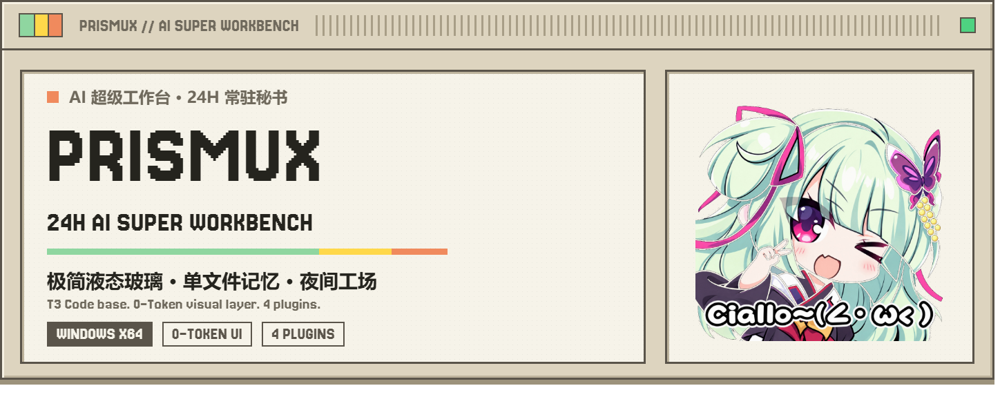
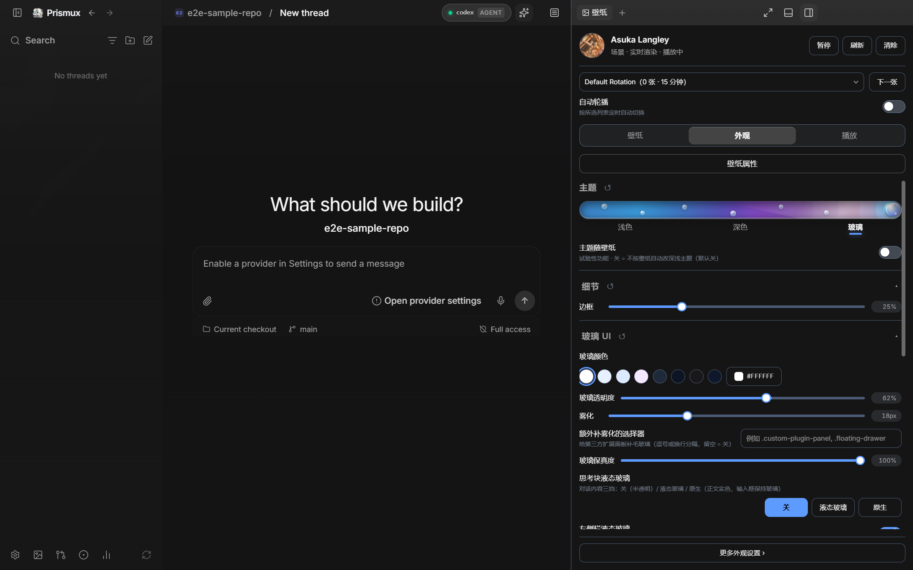
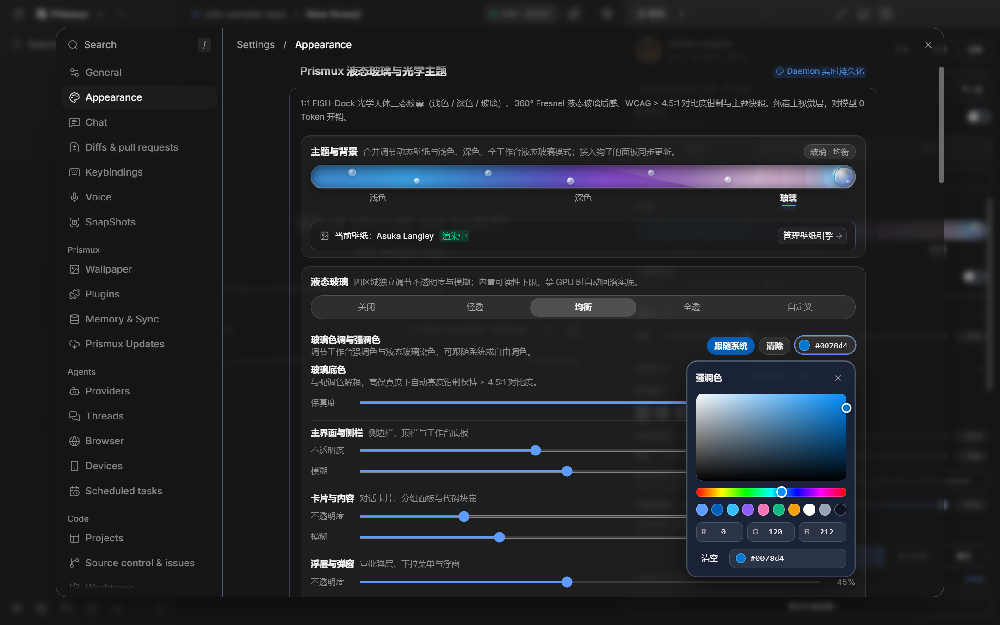
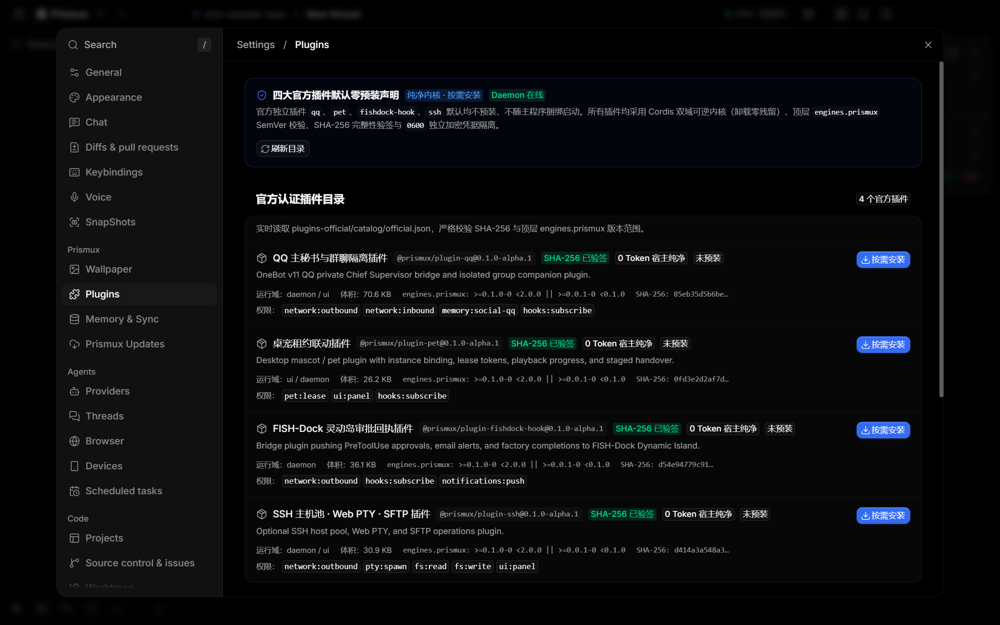
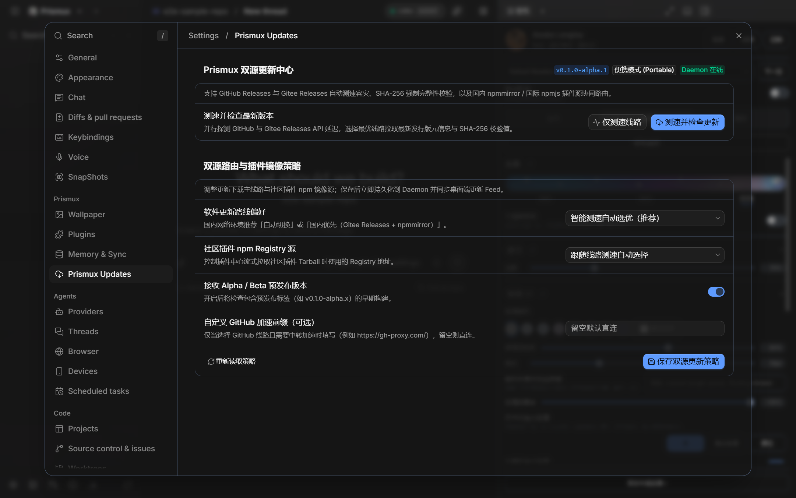

<div align="center">

<p>
  <a href="README.md"><picture><source media="(prefers-color-scheme: dark)" srcset="assets/readme/key-zh-zh-dark.png"></picture></a>
  <a href="README.en.md"><picture><source media="(prefers-color-scheme: dark)" srcset="assets/readme/key-en-zh-dark.png"></picture></a>
  <a href="#install"><picture><source media="(prefers-color-scheme: dark)" srcset="assets/readme/key-start-zh-dark.png"></picture></a>
</p>

<picture>
  <source media="(prefers-color-scheme: dark)" srcset="assets/readme/hero-zh-dark.png">
  
</picture>

<p>
  <a href="https://github.com/Fish-under-sea/Prismux/releases/tag/v0.1.0-alpha.1"><picture><source media="(prefers-color-scheme: dark)" srcset="assets/readme/stat-version-zh-dark.png"></picture></a>
  <a href="#preview"><picture><source media="(prefers-color-scheme: dark)" srcset="assets/readme/stat-visual-zh-dark.png"></picture></a>
  <a href="#features"><picture><source media="(prefers-color-scheme: dark)" srcset="assets/readme/stat-memory-zh-dark.png"></picture></a>
  <a href="#plugins"><picture><source media="(prefers-color-scheme: dark)" srcset="assets/readme/stat-plugins-zh-dark.png"></picture></a>
</p>

<p>
  = 24.12">
  
  
  
  
  
</p>

<p><strong>Prismux · 极简液态玻璃 AI 超级工作台与 24 小时常驻秘书系统</strong><br>基于真实 T3 Code 本体（Electron 44 + <code>apps/server</code> + <code>apps/web</code>）6 大最小入侵挂载点构建，融合 1:1 FISH-Dock 光学天体三态胶囊、<code>dsh-wallpaper-engine</code> 同款右侧壁纸边栏、单文件物理隔离 SQLite 记忆、四大按需零预装插件与国内外双源更新器。</p>

<p>
  <a href="#install"><picture><source media="(prefers-color-scheme: dark)" srcset="assets/readme/key-download-zh-dark.png"></picture></a>
  <a href="https://github.com/Fish-under-sea/Prismux/releases/tag/v0.1.0-alpha.1"><picture><source media="(prefers-color-scheme: dark)" srcset="assets/readme/key-release-zh-dark.png"></picture></a>
  <a href="https://github.com/Fish-under-sea/Prismux/issues"><picture><source media="(prefers-color-scheme: dark)" srcset="assets/readme/key-issues-zh-dark.png"></picture></a>
</p>

</div>

<h2 id="intro"><picture><source media="(prefers-color-scheme: dark)" srcset="assets/readme/section-intro-zh-dark.png"></picture></h2>

Prismux 是一个围绕 **「真实 T3 Code 内核 + 外置独立 0-Token 视觉壳 + 按需独立插件」** 构建的 AI 超级工作台与 24 小时无头秘书系统。`v0.1.0-alpha.1` 已正式切换为真实 **T3 Code 本体二次开发底座**（Electron 44 原生桌面端 + `apps/server` + `apps/web`，6 大标准化挂载点严格登记于 [`docs/t3code-patch-manifest.md`](docs/t3code-patch-manifest.md)），并与 `@prismux/appearance`、`@prismux/wallpaper`、`@prismux/daemon` 与单文件记忆引擎深度打通。

- **T3 Code 最小入侵 6 挂载点底座**：所有重型业务与视觉实现独立沉淀于主仓 `packages/*` 与 `apps/daemon`，[`vendor/t3code`](vendor/t3code) 仅保留 6 处标准化胶水挂载点且**零修改 `vendor/t3code/pnpm-lock.yaml`**，保留 [`UPSTREAM_LOCK.json`](UPSTREAM_LOCK.json) 以便周期合并上游更新。
- **零重型外部依赖与物理隔离记忆**：不使用 PostgreSQL、Qdrant、MinIO 或本地 Obsidian 客户端；配置、记忆库与加密凭据收敛于 `~/.prismux/`（便携模式收敛于同级 `data/` 目录）。
- **四大官方插件默认绝不预装**：`qq`、`pet`、`fishdock-hook`、`ssh` 全部独立发布为 `.wb-plugin` 归档与无脚本 npm 包，安装后在内置插件中心按需启用，卸载通过 `ctx.effect()` 零残留回滚。

当前公测版本为 **`v0.1.0-alpha.1`**，提供一键安装版 `Prismux-Setup-0.1.0-alpha.1-win-x64.exe`（GitHub / Gitee 双源直下）。

<h2 id="preview"><picture><source media="(prefers-color-scheme: dark)" srcset="assets/readme/section-preview-zh-dark.png"></picture></h2>

> 以下均为 **Prismux `v0.1.0-alpha.1` Electron 44 真实桌面二进制（`1440×900`）** 实机运行高清截图，零原型拼贴：

<table>
  <tr>
    <td width="50%" align="center" valign="top">
      
      <br>
      <sub><strong>液态玻璃主工作台 + 右侧壁纸外观边栏</strong>：连续一体式毛玻璃左栏、顶栏 <code>Chief</code> 槽位胶囊与壁纸快捷开关，右侧完整嵌入 <code>dsh-wallpaper-engine</code> 风边栏（40px 旋转黑胶、<code>壁纸 / 外观 / 播放</code> 滑动页签、Steam <code>431960</code> 与 6 节同序外观调控）。</sub>
    </td>
    <td width="50%" align="center" valign="top">
      
      <br>
      <sub><strong>1:1 FISH-Dock 光学天体胶囊 + 零透字浮窗调色盘</strong>：完整 11 层光学结构与 60fps 四子步弹簧三态切换胶囊、当前壁纸联动状态、四区玻璃预设滑块、WCAG ≥ 4.5:1 对比度钳制与 244px 零透字浮窗调色盘（全视觉层对模型 <strong>0 Token</strong> 开销）。</sub>
    </td>
  </tr>
  <tr>
    <td width="50%" align="center" valign="top">
      
      <br>
      <sub><strong>Cordis 插件市场 · 四大官方插件零预装</strong>：醒目展示纯净内核声明，实时索引 <code>qq</code>、<code>pet</code>、<code>fishdock-hook</code>、<code>ssh</code>（<code>@0.1.0-alpha.1</code>）的顶层 <code>engines.prismux</code> SemVer 范围、<code>SHA-256</code> 验签摘要与 <code>0 Token 宿主纯净 · 未预装</code> 状态。</sub>
    </td>
    <td width="50%" align="center" valign="top">
      
      <br>
      <sub><strong><code>v0.1.0-alpha.1</code> 国内外双源更新中心</strong>：实时连线 Daemon 与 Electron <code>AppUpdater</code>，展示运行态版本、便携模式标识，支持智能测速自动选优 / 国内镜像优先（<code>Gitee + npmmirror</code>）/ 国际直连优先（<code>GitHub + npmjs</code>）及加速前缀。</sub>
    </td>
  </tr>
</table>

<h2 id="features"><picture><source media="(prefers-color-scheme: dark)" srcset="assets/readme/section-features-zh-dark.png"></picture></h2>

<table>
  <tr>
    <td width="50%" valign="top">
      <strong>1. T3 Code 本体 6 挂载点 + 24h 守护中枢</strong>
      <p>Electron 44 桌面端（<code>PrismuxDaemonService</code>）随应用生命周期拉起 <code>@prismux/daemon</code>，仅在子进程内部隔离注入 <code>ELECTRON_RUN_AS_NODE=1</code>，严禁污染主进程、T3 Server 或业务子 Shell，并保持桌面冷启动 0 步直达工作台。</p>
      <p>支持在顶栏与设置页热切换 Claude Code、Codex、Antigravity 与 OpenCode 担任 <code>Chief Thread Slot</code> 主秘书大脑，自动挂载 <code>prismux-memory</code> 与 <code>prismux-orchestrator</code> 闭环工具。</p>
    </td>
    <td width="50%" valign="top">
      <strong>2. 五大标杆内化原语（严禁 5 项冗余面板）</strong>
      <p>彻底砍掉 Task Board、AgentTeam、Skill Lens、Visual Companion 与 Session Archive，统一凝练为五大高精度原语：</p>
      <ul>
        <li><code>PersistentPtyPool</code>：每终端 <code>2 MB</code> 环形缓冲与断线无损回放</li>
        <li><code>HandoffEngine</code>：<code>/handoff</code> 提纯续跑与 <code>agent / oracle / review</code> 三档拨盘</li>
        <li><code>CollectorAndGuard</code>：多格式切片 + 传输层身份注入与 <code>60 s</code> 熔断</li>
        <li><code>LifecycleHookBus</code>：6 类钩子、退出码 <code>2</code> 拦截与默认 <code>onFailure: "block"</code></li>
        <li><code>WorktreeSandbox</code>：OS 级写隔离与域名白名单本地 HTTP 代理网关</li>
      </ul>
    </td>
  </tr>
  <tr>
    <td width="50%" valign="top">
      <strong>3. 单文件 SQLite 隔离记忆与 <code>OvernightFactory</code></strong>
      <p>全部记忆存储于单文件 <code>~/.prismux/data/memory.db</code>（SQLite WAL + FTS5 中文分词 + <code>sqlite-vec</code> 混合 RRF 检索），支持 <code>POST /v1/memory/import-obsidian</code> 迁移历史笔记。<code>forwardIdentity</code> 在传输层硬性覆写 <code>_callerScope</code>，<code>qq_group:&lt;gid&gt;</code> 绝不可读取 <code>private/chief</code> 或 <code>workspace/*</code>。</p>
      <p><code>OvernightFactory</code> 打通 Gmail OAuth2 / IMAP <code>#factory</code> 入站 → 记忆立项 → Worktree 沙箱编码提交 → Oracle 只读 <code>review</code> → 带 Diff 与 <code>prismux://review/&lt;threadId&gt;</code> 深链的 HTML 完工早报。</p>
    </td>
    <td width="50%" valign="top">
      <strong>4. 1:1 天体三态胶囊、液态玻璃与 0-FPS 壁纸引擎</strong>
      <p><code>@prismux/appearance</code> 1:1 复刻 FISH-Dock 11 层光学天体三态胶囊与 244px 浮窗调色盘，接入 <code>t3-glass-bridge.css</code>（含三套实底兜底与 WCAG ≥ 4.5:1 对比度钳制），视觉层保持对模型 <strong>0 Token 开销</strong>。</p>
      <p><code>@prismux/wallpaper</code> 与 Daemon HTTP <code>206</code> 媒体网关打通 Steam <code>431960</code> 自动扫描、本地图片/视频导入与内置 4 套 WebWallGL 着色器，并订阅窗口遮挡（<code>onWindowOcclusionChange</code>）瞬间挂起至 <strong>0 FPS</strong>。</p>
    </td>
  </tr>
  <tr>
    <td width="50%" valign="top">
      <strong>5. Cordis 双域插件内核与 Magpie 加密同步</strong>
      <p><code>@prismux/cordis-kernel</code> 强制校验顶层 <code>engines.prismux</code> SemVer，以 <code>ctx.effect()</code> 实现停用与卸载零残留回滚，每个插件独享 <code>0600</code> 加密凭据文件与 <code>distribution: "managed"</code> 单写锁，社区 npm 导入免 Git 禁生命周期脚本并支持 <code>modelVisible: true</code> 二次权限审计。</p>
      <p><code>@prismux/sync-vault</code> 使用 Argon2id + AEAD 密封 <code>.prismux-backup</code> 载荷，支持 WebDAV / S3（<code>path-style</code>） / GitHub 独立开关、<code>If-Match</code> 乐观锁、<code>60 s</code> 停滞看门狗与便携 <code>data/</code> 模式。</p>
    </td>
    <td width="50%" valign="top">
      <strong>6. 软件内国内外双网络自动切换更新器</strong>
      <p><code>AppUpdater</code> 联动 Electron 原生 <code>setUpdateFeedUrl</code> 与设置中心更新页，共同支持「智能测速自动选优（推荐）/ 国内镜像优先 / 国际直连优先」三态策略。</p>
      <p>主程序更新自动在 <strong>GitHub Releases ↔ Gitee Releases</strong> 间探速优选并强制校验 64 位 <code>.sha256</code>（缺摘要或篡改立即拒装并清除 <code>.part</code>），支持 <code>Range</code> 断点续传与自定义加速前缀；插件下载同步在 <strong>npm ↔ npmmirror</strong> 间无脚本流式切换。</p>
    </td>
  </tr>
</table>

<h2 id="plugins"><picture><source media="(prefers-color-scheme: dark)" srcset="assets/readme/section-plugins-zh-dark.png"></picture></h2>

> [!NOTE]
> **四大官方插件默认绝不预装**：`Prismux-Setup-0.1.0-alpha.1-win-x64.exe` 安装包及解压态 `win-unpacked/` 均**绝不包含** `plugins-official/` 任何插件目录（打包后通过递归扫描 0 命中校验）。以下 4 个官方插件均以独立 `.wb-plugin` 归档（GitHub / Gitee Releases）及无脚本 npm 单包形式分发，按需安装并支持 `ctx.effect()` 零残留卸载。

| 插件 ID | 独立归档包（`.wb-plugin`） | npm 包名（无作用域 / GitHub Packages） | 运行域（`realms`） | 核心能力与隔离边界 |
| :--- | :--- | :--- | :--- | :--- |
| `qq` | `qq-0.1.0-alpha.1.wb-plugin` | `prismux-plugin-qq`<br><code>@fish-under-sea/prismux-plugin-qq</code> | `daemon`、`ui` | OneBot v11 正/反向 WebSocket 自动探测（NapCatQQ / Lagrange.Core）；私聊主人接入主秘书，群聊启用防刷屏节奏器并硬隔离至 <code>social/qq-group-&lt;gid&gt;</code> |
| `pet` | `pet-0.1.0-alpha.1.wb-plugin` | `prismux-plugin-pet`<br><code>@fish-under-sea/prismux-plugin-pet</code> | `ui`、`daemon` | 桌宠联动插件；实现定向实例绑定、带过期校验的 Lease Token 租约锁、只读播放进度订阅与动作/气泡分阶段交还 |
| `fishdock-hook` | `fishdock-hook-0.1.0-alpha.1.wb-plugin` | `prismux-plugin-fishdock-hook`<br><code>@fish-under-sea/prismux-plugin-fishdock-hook</code> | `daemon` | FISH-Dock 灵动岛桥接插件；将 `PreToolUse` 中文风险审批、重要邮件与夜间工场完工回执推送至灵动岛卡片并支持快捷放行/驳回 |
| `ssh` | `ssh-0.1.0-alpha.1.wb-plugin` | `prismux-plugin-ssh`<br><code>@fish-under-sea/prismux-plugin-ssh</code> | `daemon`、`ui` | 按需选装的远程运维插件；提供隔离 SSH 主机池、Web PTY 会话桥接、路径安全校验与 SFTP 文件浏览 |

<h2 id="install"><picture><source media="(prefers-color-scheme: dark)" srcset="assets/readme/section-install-zh-dark.png"></picture></h2>

### 双网络发行入口（GitHub Releases ↔ Gitee Releases）

| 分发渠道 | 适用场景 | 入口 / 直链地址 |
| :--- | :--- | :--- |
| **GitHub Releases**（国际直连） | 海外网络 / GitHub CLI 环境 | [Release 页面（`v0.1.0-alpha.1`）](https://github.com/Fish-under-sea/Prismux/releases/tag/v0.1.0-alpha.1) · [直下 `Prismux-Setup-0.1.0-alpha.1-win-x64.exe`](https://github.com/Fish-under-sea/Prismux/releases/download/v0.1.0-alpha.1/Prismux-Setup-0.1.0-alpha.1-win-x64.exe) |
| **Gitee Releases**（国内镜像） | 中国大陆直连加速下载 | [Release 页面（`v0.1.0-alpha.1`）](https://gitee.com/Fish-under-sea/Prismux/releases/tag/v0.1.0-alpha.1) · [直下 `Prismux-Setup-0.1.0-alpha.1-win-x64.exe`](https://gitee.com/Fish-under-sea/Prismux/releases/download/v0.1.0-alpha.1/Prismux-Setup-0.1.0-alpha.1-win-x64.exe) |
| **软件内更新中心**（推荐） | 自动并发测速 GitHub / Gitee、断点续传与强制 `.sha256` 校验 | 在工作台打开设置 → **Prismux Updates**（`/settings/updates`），可在 `智能测速 / 国内优先 / 国际优先` 间秒切 |

### 安装包与完整性校验（Windows x64）

| 发行资产 | 文件名 | 说明与隔离策略 |
| :--- | :--- | :--- |
| **Windows 安装包（Electron 44 NSIS）** | `Prismux-Setup-0.1.0-alpha.1-win-x64.exe` | 内含完整 T3 Code Electron 44 桌面端、Bundled `resources/prismux-daemon/` 与 `t3-resource-monitor.exe`；安装路径支持自定义 `/D=<目录>`；状态目录独立隔离于 `~/.prismux/`（亦支持同级 `data/` 便携模式）；**四大官方插件默认零预装** |
| **4 个官方独立插件包** | `*-0.1.0-alpha.1.wb-plugin` | 含 `qq`、`pet`、`fishdock-hook`、`ssh` 四枚确定性 ustar + gzip 归档，附带官方索引 `official.json`，安装后在 `/settings/plugins` 按需导入 |
| **安全校验清单** | `SHA256SUMS.txt` 与各资产同名 `.sha256` | 手动下载后可通过 `Get-FileHash Prismux-Setup-0.1.0-alpha.1-win-x64.exe -Algorithm SHA256` 或 `7z t` 核对完整性与零篡改 |

<h2 id="packages"><picture><source media="(prefers-color-scheme: dark)" srcset="assets/readme/section-packages-zh-dark.png"></picture></h2>

每个官方独立插件均额外发布为**零 `preinstall / install / postinstall` 脚本**的单包归档，内部携带已校验的 `<id>-0.1.0-alpha.1.wb-plugin` 与防覆盖导出 CLI（`prismux-plugin-<id>`）；软件内插件市场同样支持在 **`registry.npmjs.org` ↔ `registry.npmmirror.com`** 间免本机 Git 纯流式拉取与自动故障回退。

```powershell
# 1. 从 npm 官方源安装并提取 .wb-plugin 归档（含 SHA-256 核对，目标同名文件存在时不覆盖）
npm install prismux-plugin-qq@0.1.0-alpha.1
npx prismux-plugin-qq --out ./plugins-stage

# 2. 中国大陆网络使用 npmmirror 国内镜像加速安装
npm install prismux-plugin-qq@0.1.0-alpha.1 --registry=https://registry.npmmirror.com
npx prismux-plugin-qq --out ./plugins-stage
```

- **可选插件前缀替换**：将上方命令中的 `qq` 替换为 `pet`、`fishdock-hook` 或 `ssh` 即可获取对应官方插件归档，然后在设置页 **Plugins**（`/settings/plugins`）直接拖入或选择导入。
- **GitHub Packages 同步包**：发布后工作流同步推送 `@fish-under-sea/prismux-plugin-{qq,pet,fishdock-hook,ssh}` 至 `https://npm.pkg.github.com`，方便企业或 CI 流水线拉取校验。

<h2 id="develop"><picture><source media="(prefers-color-scheme: dark)" srcset="assets/readme/section-develop-zh-dark.png"></picture></h2>

> **前置工具链**：`Node.js >= 24.12.0`、`pnpm >= 10.0.0`（主仓锁定 `pnpm@12.3.4`）、`Electron 44` 与 `Rust >= 1.85`（用于编译 `vendor/t3code/native/resource-monitor`；Windows 下运行 Cargo 请固定传入 `-j 1` 与 `NO_PROXY=*`）。执行前请先读取 [`AGENTS.md`](AGENTS.md)、[`docs/t3code-patch-manifest.md`](docs/t3code-patch-manifest.md) 与对应的个人环境档案 `docs/agents/local/<规范化用户名>.md`。

```powershell
# 1. 安装主仓工作区依赖（12 个 TS 工作区包）
pnpm install

# 2. 全仓构建、独立类型检查与全仓测试
pnpm -r build
pnpm -r typecheck
pnpm -r --if-present test
pnpm test:scripts

# 3. 校验 vendor/t3code managed-fork 契约、基线提交与补丁台账
pnpm upstream:check

# 4. 在 vendor/t3code 下检查并构建真实 Electron 44 桌面端（web + server + desktop）
pnpm --dir vendor/t3code exec vp run --filter @t3tools/web typecheck
pnpm --dir vendor/t3code exec vp run --filter @t3tools/desktop typecheck
pnpm --dir vendor/t3code exec vp run build:desktop

# 5. 一键串联主仓构建 + T3 底座构建 + Windows NSIS 安装包打包（含 7z 校验与 .sha256）
pnpm desktop:build
pnpm desktop:installer

# 6. 为指定官方插件生成确定性 .wb-plugin 与 .sha256（内置 gunzip 回环校验）
pnpm plugin:pack -- --plugin plugins-official/plugin-qq
```

<details>
<summary><strong>展开查看：Monorepo 目录树与 T3 Code 最小入侵边界</strong></summary>

```text
prismux/
├── AGENTS.md                            # 跨机器统配入口、工程红线与验收门禁
├── LICENSE                              # 标准 MIT 开源许可证
├── README.md / README.en.md             # 中英双语项目主页
├── UPSTREAM_LOCK.json                   # pingdotgg/t3code 基线 SHA、managed-fork 模式与台账指针
├── pnpm-workspace.yaml                  # 12 个 TS 工作区包白名单（排除 vendor/t3code 与 desktop-tauri）
├── package.json                         # 根任务编排脚本（v0.1.0-alpha.1）
├── tsconfig.base.json                   # TypeScript 5.8+ 严格共享基线（ES2024 + NodeNext）
├── assets/
│   ├── logo.png                         # 透明 1024×1024 吉祥物主图标
│   └── readme/                          # 立体像素头图、分栏横幅、R3 实机截图与渲染模板
├── docs/
│   ├── t3code-patch-manifest.md         # T3 Code MP-01 ~ MP-06 最小入侵挂载点权威登记台账
│   ├── agents/                          # 按人存放的本机环境档案说明、模板与个人档案
│   ├── releases/v0.0.1-alpha.1.md       # 早期公开内测版本归档说明
│   └── specs/
│       ├── master-prompt-v1.3.md        # 全栈自主施工总指令书（架构宪法）
│       └── ui-ux-design-mandate.md      # UI/UX、主题与背景及安装包强制设计规范
├── scripts/                             # 运维脚本与 README 渲染器（纯 Node 24 原生 TS / ESM）
│   ├── build-prismux-desktop.ts         # 一键桌面构建与 NSIS 安装包编排器（--installer / --skip-rust）
│   ├── release-all.ts                   # 桌面安装包 + 4 大官方插件 + npm 单包 + SHA256SUMS 统一发布
│   ├── sync-t3-upstream.ts              # managed-fork / 上游锁校验脚本（--check / --sync）
│   ├── pack-plugin.ts                   # 确定性 ustar + gunzip 回环校验插件打包器
│   ├── build-npm-plugin-packages.ts     # 生成无脚本 npm / GitHub Packages 插件单包
│   ├── rename-brand.ts                  # 全局品牌标识安全替换脚本
│   ├── render-readme.mjs                # Edge CDP 立体像素头图与分栏横幅渲染器
│   └── __tests__/scripts.test.ts        # node:test 回归测试
├── vendor/
│   └── t3code/                          # T3 Code 运行底座（Electron 44 + server + web），仅通过 MP-01 ~ MP-06 最小入侵挂载
├── packages/                            # 6 个核心 workspace 包
│   ├── protocol/                        # @prismux/protocol：品牌常量、RPC、Hook、记忆、插件与更新契约
│   ├── cordis-kernel/                   # @prismux/cordis-kernel：双域插件内核、SemVer、双源流式安装器与 0600 凭据
│   ├── memory-core/                     # @prismux/memory-core：SQLite WAL + FTS5 + sqlite-vec 与物理防泄密
│   ├── sync-vault/                      # @prismux/sync-vault：Argon2id + AEAD 同步、乐观锁与 60 s 看门狗
│   ├── prismux-appearance/              # @prismux/appearance：1:1 FISH-Dock 光学天体三态胶囊、调色盘与 T3 玻璃桥
│   └── prismux-wallpaper/               # @prismux/wallpaper：右侧壁纸边栏、5 页签设置页、Z-0 舞台与 Steam 431960 扫描
├── apps/                                # 核心守护进程（含待退役原型壳与历史壳）
│   ├── daemon/                          # @prismux/daemon：24h 无头守护、主秘书槽位、五大原语、206 媒体网关与夜间工场
│   ├── workbench-ui/                    # @prismux/workbench-ui：[待退役原型壳] v0.0.1 原型界面，已由真实 T3 Code 底座接替
│   └── desktop-tauri/                   # prismux-desktop：[历史原生壳] v0.1.0 主桌面端已切换为 T3 Code Electron 44
└── plugins-official/                    # 4 个官方独立插件（workspace 包）与权威索引
    ├── catalog/official.json            # 官方插件权威发布索引（SHA-256 / bytes / engines / status）
    ├── plugin-qq/                       # @prismux/plugin-qq
    ├── plugin-pet/                      # @prismux/plugin-pet
    ├── plugin-fishdock-hook/            # @prismux/plugin-fishdock-hook
    └── plugin-ssh/                      # @prismux/plugin-ssh
```

</details>

<details>
<summary><strong>展开查看：五大绝对工程红线</strong></summary>

1. **T3 Code 本体最小入侵与业务外置原则**：`vendor/t3code/` 仅允许保留已登记于 [`docs/t3code-patch-manifest.md`](docs/t3code-patch-manifest.md) 的 MP-01 ~ MP-06 六大挂载点（且零修改 `vendor/t3code/pnpm-lock.yaml`），严禁散落业务逻辑；重逻辑全部沉淀于主仓 `packages/*` 与 `apps/daemon`。
2. **严禁混入已砍掉的 5 项冗余模块**：不包含 Task Board、AgentTeam、Skill Lens、Visual Companion 与 Session Archive，统一由五大内化原语替代。
3. **内生单文件记忆中枢与物理防泄密**：记忆引擎固定为 `~/.prismux/data/memory.db`（SQLite WAL + FTS5 + `sqlite-vec`），零 PostgreSQL / Qdrant / MinIO / Obsidian 客户端依赖；查询层强制绑定 `_callerScope` 物理隔离。
4. **四大官方插件默认绝不预装**：`qq`、`pet`、`fishdock-hook`、`ssh` 全部作为独立包存放于 `plugins-official/`，主程序与安装包均不含插件包，按需从市场安装。
5. **视觉层对模型 0 Token 开销与强制设计规范**：壁纸、360° Fresnel 液态玻璃、字体调色、系统音频律动、桌宠演出与安装引导均不向任何大模型注入工具定义或提示词。

</details>

<details>
<summary><strong>展开查看：M1–M5 与 v0.1.0 融合里程碑矩阵</strong></summary>

| 里程碑 | 核心交付内容 | 验收状态 |
| :--- | :--- | :--- |
| **M1** | Monorepo 骨架、T3 Code 基线接入、`apps/daemon` 进程监督、环境变量净化、主秘书槽位与 `2 MB` 环形 `PersistentPtyPool` | 已完成并通过门禁 |
| **M2** | 单文件 SQLite WAL + FTS5 + `sqlite-vec` 混合记忆、Obsidian 导入接口、`forwardIdentity` 越权隔离、`LifecycleHookBus`（`onFailure: "block"`）、`HandoffEngine`（三档拨盘）与 `WorktreeSandbox` | 已完成并通过门禁 |
| **M3** | `cordis-kernel`（顶层 `engines.prismux` 校验、`ctx.effect()` 卸载零残留、免 Git 无脚本流式安装与 `managed` 锁）与 `sync-vault`（Argon2id + AEAD、`If-Match`、`60 s` 看门狗与 `data/` 便携模式） | 已完成并通过门禁 |
| **M4 / v0.1.0** | `@prismux/appearance` + `@prismux/wallpaper` 外置沉淀、T3 Code Electron 44 本体 MP-01 ~ MP-06 融合、真实桌面二进制冷启动直达工作台、NSIS 安装包与 R3 真机全量审图通过 | 已完成并通过 R3 真机签收 |
| **M5** | `OvernightFactory` 夜间全自动工场闭环、四大官方独立插件打包验签（`0.1.0-alpha.1`）与双网络自动切换更新体系 | 已完成并通过门禁 |

</details>

<h2 id="thanks"><picture><source media="(prefers-color-scheme: dark)" srcset="assets/readme/section-thanks-zh-dark.png"></picture></h2>

### 工程文档索引

| 文档 | 说明 |
| :--- | :--- |
| [`AGENTS.md`](AGENTS.md) | 跨机器统配入口、五大工程红线、脚本与插件打包契约、环境排障与提交流程 |
| [`docs/t3code-patch-manifest.md`](docs/t3code-patch-manifest.md) | T3 Code MP-01 ~ MP-06 最小入侵挂载点登记台账、行号清单与上游合并指南 |
| [`docs/specs/ui-ux-design-mandate.md`](docs/specs/ui-ux-design-mandate.md) | 世界级 UI/UX、天体三态胶囊、四区液态玻璃同步契约与安装包强制设计规范 |
| [`docs/specs/master-prompt-v1.3.md`](docs/specs/master-prompt-v1.3.md) | Prismux 全栈自主施工总指令书（架构宪法） |
| [`docs/agents/README.md`](docs/agents/README.md) | 贡献者本机环境档案命名规范、模板与维护流程 |
| [`docs/releases/v0.0.1-alpha.1.md`](docs/releases/v0.0.1-alpha.1.md) | 早期 `v0.0.1-alpha.1` 原型阶段发行说明归档 |
| [`assets/readme/MAINTAINING.md`](assets/readme/MAINTAINING.md) | README 立体像素头图与分栏横幅渲染、尺寸与图床缓存维护指南 |

### 上游项目与灵感致谢

- [pingdotgg/t3code](https://github.com/pingdotgg/t3code)：提供 Electron 44 + `apps/server` + `apps/web` 运行底座与 Provider 桥接内核。
- [yetone/magpie](https://github.com/yetone/magpie)：提供口令密封 AEAD 加密同步、`If-Match` 乐观锁、60 秒停滞看门狗与便携模式设计规范。
- [stablyai/orca](https://github.com/stablyai/orca)：启发服务端持久化 PTY 环形缓冲与 Worktree 状态树管理原语。
- [Amp](https://ampcode.com/)：启发 `/handoff` 上下文提纯交接与 `agent / oracle / review` 三档角色拨盘工作流。
- [FISH-Dock](https://github.com/Fish-under-sea/FISH-Dock)：提供 Warm Paper / Dark Olive 立体像素视觉体系、1:1 光学天体胶囊与 360° Fresnel 液态玻璃主题规范及灵动岛审批回执联动灵感。

### 许可边界

Prismux 本仓核心代码与排版工具链遵循 **MIT License**（见仓库根 [`LICENSE`](LICENSE)）；随视觉资产分发的像素字体 `Jersey20-Regular.ttf` 遵循 [SIL Open Font License 1.1](assets/readme/OFL-Jersey20.txt)；基于 `pingdotgg/t3code`（MIT）托管的 `vendor/t3code` 保留其原始许可证与归属声明。
